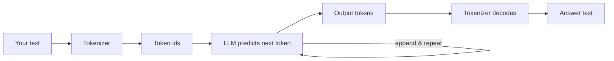

# Post 01 · What is an LLM, and what is a token?

*Series: [Lesson 01 — Foundations](../README.md) · Post 1 of 8 · about 30 minutes*

> **Pt c/o HTN.** Eleven characters. Surely cheaper to send to a model than *"Patient presents with hypertension."*, which has thirty-five?
>
> It isn't. By the end of this post you will know why, and you will have seen it happen in your own terminal.

As a backend developer you already think in units: rows scanned, bytes over the wire, milliseconds of latency. LLM engineering has its own unit, and almost every number you will care about (cost, speed, limits) is measured in it. That unit is the **token**. Before we call any model properly, let's understand what it actually reads.

---

## The idea, in plain English

### What an LLM really does

A **Large Language Model** is a program that has read a huge amount of text and learned one skill: *given some text, predict the next small piece of text.* It repeats that prediction again and again, one piece at a time, until the answer is complete.

Chat, summarising, extracting fields, choosing a tool: all of it is built on this one "predict the next piece" loop.

### What a token is

That "small piece" is a **token**. A model never sees letters or words. Before your text reaches the model, a **tokenizer** cuts it into tokens and turns each one into a number (a **token id**). The model works only with these numbers.

- A common English word is often **1 token**. In the tokenizer we use, ` hypertension` is a single token.
- Rare words, abbreviations, numbers, code and JSON are cut into **more, smaller pieces**.
- Other languages (Arabic, Tamil, Hindi…) usually need **more tokens** for the same meaning.
- Rough rule for English: **1 token ≈ ¾ of a word ≈ 4 characters.** It is only a rule of thumb.

**Each model family has its own tokenizer**, so the same sentence gives a different token count on different models.

### How it fits together

```
 "Patient presents with hypertension."
              │  tokenizer (cuts text, maps each piece to a number)
              ▼
 [Patient][ presents][ with][ hypertension][.]   →   [ 33235, 21849, 483, 78585, 13 ]
              │  model: "given these numbers, what is the most likely next token?"
              ▼
 next token → append → predict again → … → stop
```



### Why you should care

| What | Measured in | Example in your world |
|---|---|---|
| **Cost** (cloud) | input tokens + output tokens | A discharge-summary bot that sends a 6-page record on every request pays for all those tokens, every time. |
| **Speed** | output tokens, generated one by one | A 500-token answer takes about 5× longer than a 100-token one. |
| **Limits** | the context window ([post 02](../02-context-window/README.md)) | A long patient history may simply not fit. |

Think of tokens as the **unit of billing and latency**, the way you think of DB queries or bytes over the network. Two surprises worth knowing:

- Shorthand like `Pt c/o HTN` is fewer *letters* but **not** fewer *tokens*.
- Pretty-printed JSON is expensive: every brace, quote and space counts.

### Two counts, two jobs

- **Your local count.** You can count tokens yourself with a tokenizer library (we use `js-tiktoken`). It is quick and free, and good for **budgeting** before you send a request.
- **The provider's count.** Every response from the model includes **`usage`**: the input and output tokens the provider *actually* counted. This is the **bill**.
- **Why they differ.** Tokenizers differ between model families. On top of that, the provider adds hidden formatting tokens (role labels, special markers). So the provider's number is usually a bit higher.

> **The local count is a budget; the provider's usage is the bill.**

### Tokenizers and encodings, and why we use `js-tiktoken`

A few words come up again and again in this course, so here they are in plain English.

- **Token**: a small piece of text (a word, part of a word, a digit, a symbol) that has a number, its **token id**. The model only ever sees these numbers.
- **Tokenizer**: the program that cuts text into tokens and turns them into ids (`encode`), and turns ids back into text (`decode`).
- **Encoding** (also called a *vocabulary*): the tokenizer's fixed rulebook. It is the full list of known tokens, each with its id, plus the rules for where to cut text. A model is trained with one encoding and must always use that same one. You cannot swap it later.

**Why `js-tiktoken`?** OpenAI publishes its tokenizer as open source under the name [`tiktoken`](https://github.com/openai/tiktoken). [`js-tiktoken`](https://www.npmjs.com/package/js-tiktoken) is a pure-JavaScript port of it ("a pure JS port of the original tiktoken library", from its README). We picked it because:

- it runs **fully offline**: no API key, no model, no network call;
- it is **pure JavaScript**: no native build step, so `npm install` just works on Mac, Linux and Windows;
- it is **fast**, so you can count tokens on every message at almost no cost;
- it is the **most widely used** tokenizer package in the JavaScript world, so you will meet it in other projects.

**What does `getEncoding('o200k_base')` do?** `getEncoding(name)` loads one encoding (one rulebook) by its name and gives you back a tokenizer object with `encode()` and `decode()`. The name says which rulebook:

| Encoding name | Used by (OpenAI models) | Vocabulary size |
|---|---|---|
| `o200k_base` | GPT-4o, GPT-4o mini, GPT-4.1, o1, o3, o4-mini | about **200,000** tokens (that is the "200k") |
| `cl100k_base` | GPT-4, GPT-3.5 Turbo | about **100,000** tokens |

We pass `o200k_base` because it is the newest, most common encoding, and it handles non-English text better than `cl100k_base`. A bigger vocabulary usually means fewer tokens for the same text, because more whole words and word parts have their own token. (The model-to-encoding list above comes from js-tiktoken's own model map, `getEncodingNameForModel()`. The sizes come from the encoding files it ships.)

**The catch: your model probably isn't an OpenAI model.** Each model family is trained with **its own tokenizer**. This course's default models are **Qwen** models (Qwen3), and Qwen3 has its own encoding: **151,643** normal tokens plus **26** special tokens such as `<|im_start|>`, `<|im_end|>` and `<think>`. (These numbers were counted from the `tokenizer.json` that the Qwen team publishes on Hugging Face. Every Qwen3 size, 0.6B to 8B, ships the same file.) So **`o200k_base` is exact only for OpenAI models**. For any other model it is an **estimate**.

How good is that estimate? It depends on the text. Here are some counts we measured once with `o200k_base` and with Qwen3's real tokenizer:

| Text | `o200k_base` | Qwen3 (real) |
|---|---|---|
| An English sentence (`The patient was given 5 mg of amlodipine for high blood pressure.`) | 17 | 18 |
| A line of TypeScript | 19 | 19 |
| An Arabic sentence | 8 | 14 |
| A Tamil sentence | 13 | 40 |
| Numbers (`3.14159 26535 89793, 2026-10-27, +966 55 123 4567`) | 28 | 48 |

For English and code, the two counts are very close. For other languages and for numbers they are not. For example, `o200k_base` keeps up to 3 digits together in one token, but Qwen gives **every digit its own token**. You can see this in the cutting rules (the "pre-tokenizer" pattern) inside each tokenizer's files.

**Pick the tokenizer that matches your model.** If you need real numbers for your model, use its own tokenizer. Every package below was checked on npm:

| Model family | Tokenizer package (npm) |
|---|---|
| OpenAI (GPT-4o, GPT-4.1, o-series) | `js-tiktoken` with `o200k_base`. Exact. |
| OpenAI (GPT-4, GPT-3.5) | `js-tiktoken` with `cl100k_base`. Exact. |
| Qwen3 (this course's default) | `@lenml/tokenizer-qwen3` is a good option. |
| Llama 3 | `@lenml/tokenizer-llama3` |
| Gemma 3 | `@lenml/tokenizer-gemma3` |
| DeepSeek V3 | `@lenml/tokenizer-deepseek_v3` |
| Any open model on Hugging Face | `@huggingface/transformers`, using `AutoTokenizer.from_pretrained('<model id>')` |
| Cloud models with no public tokenizer | Read `usage` from the response (part B). |

- **`@lenml/tokenizer-qwen3`** is a small community package. It is a lightweight fork of the tokenizer part of transformers.js and it **bundles Qwen3's tokenizer file**, so it works offline with no download. We checked that its bundled file is identical to the official Qwen3 `tokenizer.json`, and that its counts match the table above. Use it like this (not part of this post's `example.ts`; install it first with `npm install @lenml/tokenizer-qwen3`):

  ```js
  import { fromPreTrained } from '@lenml/tokenizer-qwen3';
  const qwen = fromPreTrained(); // loads the bundled Qwen3 tokenizer
  const ids = qwen.encode('Patient presents with hypertension.', { add_special_tokens: false }); // → number[]
  ```

- **`@huggingface/transformers`** (transformers.js) is the mainstream way to load **any** open model's tokenizer. `AutoTokenizer.from_pretrained('Qwen/Qwen3-8B')` downloads that model's tokenizer files from Hugging Face once and caches them. It is a big package, because it can also run models.

**When is an estimate enough?** For **budgeting**: checking whether a chat still fits the context window ([post 02](../02-context-window/README.md)), trimming history, or guessing cost before a call. Leave a 10–20 % safety margin and you are fine, *especially for English*. **When do you need exact counts?** For billing and cost dashboards, and when you pack the window right up to its limit. Then use your model's own tokenizer (table above), or read the provider's `usage` after the call. That is the real count, and part B shows it.

---

## Let's see it in code

Open [`example.ts`](./example.ts) next to this post. It has two parts: **A** looks inside the tokenizer with no model at all, **B** asks your real model for its own count.

Near the top, the file imports `chatModel`, `dump`, `section` and `stripThinking` from `@learn/shared`, the course's own helper package: `chatModel()` builds the model named in your `.env`, `dump()` prints the full value a call returned, `section()` prints the bold part headers, and `stripThinking()` cleans a reasoning model's answer ([what `@learn/shared` is](../../shared/README.md), introduced in [post 00](../00-course-toolkit/README.md)).

### Step 1 — get a tokenizer

```ts
// js-tiktoken = a pure-JavaScript copy of OpenAI's `tiktoken` tokenizer. It runs offline,
// needs no API key and no native build, and is fast. (Why we chose it: README, "Tokenizers and encodings".)
import { getEncoding } from 'js-tiktoken'; // a TOKENIZER: the program that cuts text into tokens

// getEncoding(name) loads one ENCODING = a fixed vocabulary of tokens + the rules for cutting text.
// 'o200k_base' is the encoding of OpenAI's newer models (GPT-4o, GPT-4.1, o1/o3/o4-mini): ~200,000 tokens.
// Every model family has its own tokenizer, so for a non-OpenAI model (like Qwen) these numbers
// are an ESTIMATE — see part B.
const tokenizer = getEncoding('o200k_base');
```

We need *some* tokenizer to look inside. `getEncoding('o200k_base')` loads OpenAI's newest public encoding, which ships inside the `js-tiktoken` npm package, so it works offline. It is **not** your Qwen model's tokenizer, and that is on purpose: part B will show you the gap. ([What an encoding is, and why `js-tiktoken`](#tokenizers-and-encodings-and-why-we-use-js-tiktoken).)

### Step 2 — pick sentences that tell a story

```ts
const samples = [
  'Patient presents with hypertension.', // ordinary English: mostly one token per word
  'Pt c/o HTN.', // shorthand: fewer letters, but NOT fewer tokens
  'المريض يعاني من ارتفاع ضغط الدم', // same sentence in Arabic: different cost
  '{"patient":{"id":"P-001","bp":"150/95"}}', // JSON: every brace and quote is a token too
];
```

Each line tests one claim from the theory above: normal English, shorthand, another language, and JSON.

### Step 3 — cut each one into tokens and show the cuts

```ts
for (const text of samples) {
  const ids = tokenizer.encode(text); // text → list of numbers (token ids)
  // Decode each id back to its piece of text, so you can SEE where the cuts are.
  const pieces = ids.map((id) => tokenizer.decode([id]));
  console.log(`${String(ids.length).padStart(2)} tokens, ${String(text.length).padStart(2)} chars: ${pieces.map((p) => `[${p}]`).join('')}`);
}
```

`encode` is exactly what happens before your text reaches a model: text becomes numbers. We then `decode` each number *on its own* so you can see every piece in `[brackets]`. This is the "look inside" moment.

### Step 3b — the raw return values of `encode` and `decode`

```ts
const firstIds = tokenizer.encode(samples[0]!);
dump(`tokenizer.encode(${JSON.stringify(samples[0])})`, firstIds);
dump('tokenizer.decode(thoseIds)', tokenizer.decode(firstIds));
```

Before the pretty `[pieces]`, look at what the functions really return. `encode` returns a **plain array of integers**, nothing more: `[ 33235, 21849, 483, 78585, 13 ]`. Each number is a row in the tokenizer's vocabulary (here about 200,000 entries), and this array is literally what a model receives. `decode` turns the **whole** array back into the exact original string, which proves nothing was lost on the way.

### Step 4 — ask the model for the real count

```ts
const prompt = 'Reply with one word: OK';
const result = await generateText({ model: chatModel(), prompt, maxOutputTokens: 200 });
const { usage, text } = result;
console.log('Model replied:', JSON.stringify(stripThinking(text)));
console.log({
  ourEstimateForPrompt: tokenizer.encode(prompt).length,
  providerInputTokens: usage.inputTokens, // larger: the provider adds hidden chat-format tokens
  providerOutputTokens: usage.outputTokens,
});
```

Three things to notice:

- `chatModel()` comes from the course's shared helper ([how it works](../../shared/README.md#part-2--the-provider-switch-chatmodel-and-embeddingmodel-modelsts)). It reads `CHAT_MODEL` from your `.env`, so this file never names a model. ([Post 03](../03-model-calls-and-streaming/README.md) explains `generateText` properly; for now, it is "send a prompt, get an answer".)
- `usage` is the provider's own count. We print it next to our local estimate so you can compare the budget with the bill.
- `stripThinking()` removes a `<think>…</think>` block that some models add before their answer ([why models do that](../../shared/README.md#stripthinkingtext--and-why-models-think-out-loud)).

Last, the file prints two more small things from the result, not the whole object:

```ts
// We do NOT dump the whole result again: post 00 already showed the full generateText() result.
// Here we only print the fields this post is about. `usage.outputTokens` includes any hidden
// "thinking" tokens, even when `text` is one word, so it can be bigger than you expect.
console.log('finishReason:', result.finishReason);
console.log('usage:', { inputTokens: usage.inputTokens, outputTokens: usage.outputTokens, totalTokens: usage.totalTokens });
```

We saw the full `generateText()` result in [post 00](../00-course-toolkit/README.md#step-4--look-at-everything-the-call-returned), which also has a table of every field in it. Here we only need `usage`: `usage.inputTokens` is the provider's count of your prompt **plus** the hidden chat formatting, and `usage.outputTokens` counts every token the model produced, including any thinking that `text` doesn't show.

---

## Run it

From the lesson folder (`01-foundations-structured-output/`):

```bash
npm run post:01:offline   # part A only, no model needed
npm run post:01           # part A + B (calls your CHAT_MODEL)
# same thing without npm scripts:
npx tsx 01-llm-and-tokens/example.ts --offline
npx tsx 01-llm-and-tokens/example.ts
```

### What you should see

- **Part A** prints each sample cut into `[pieces]`. Compare:
  - The English sentence against the shorthand `Pt c/o HTN.`. The shorthand has far fewer characters but about as many tokens.
  - The Arabic line, which needs more tokens for the same idea.
  - The JSON line, where every `{"` and `":"` is its own token.
- **Part A2** prints the raw `encode` array and the `decode` round trip.
- **Part B** prints `ourEstimateForPrompt` next to `providerInputTokens`. The provider's number is higher, because of its own tokenizer and the hidden chat formatting. Then it prints `finishReason` and a small `usage` object.

A real run with a small `qwen3:0.6b`:

```
── [A] Text → tokens (what the model actually "reads") ─────────
 5 tokens, 35 chars: [Patient][ presents][ with][ hypertension][.]
 6 tokens, 11 chars: [Pt][ c][/o][ HT][N][.]
 8 tokens, 31 chars: [الم][ريض][ يع][اني][ من][ ارتفاع][ ضغط][ الدم]
15 tokens, 40 chars: [{"][patient][":{"][id][":"][P][-][001][","][bp][":"][150][/][95]["}}]

── [A2] The raw return values of encode() and decode() ─────────
▼ tokenizer.encode("Patient presents with hypertension.")
[ 33235, 21849, 483, 78585, 13 ]
▼ tokenizer.decode(thoseIds)
'Patient presents with hypertension.'

── [B] Our estimate vs. the provider’s real count ──────────────
Model replied: "OK"
{
  ourEstimateForPrompt: 6,
  providerInputTokens: 22,
  providerOutputTokens: 2
}
finishReason: stop
usage: { inputTokens: 22, outputTokens: 2, totalTokens: 24 }
```

Part A is the same on every machine (it's a fixed tokenizer). In part B your reply and token counts depend on your model: a bigger reasoning model such as `qwen3:8b` may report far more `outputTokens` than the one-word reply suggests, because its thinking is counted too.

## Common gotchas

- ❌ **Assuming one tokenizer fits all models.** Every model family cuts text differently. `o200k_base` is exact only for OpenAI models; for Qwen and others it is an estimate, and a poor one for non-English text and numbers. Pick the tokenizer that matches your model when you need real counts.
- ❌ **Assuming abbreviations save money.** Often they don't, as part A shows.
- ❌ **Forgetting the answer costs tokens too.** Output tokens are usually priced higher than input tokens on cloud APIs.
- ✅ Leave a safety margin (for example 10–20 %) when you budget with a local count.
- ✅ Always log `usage` from real responses. That is the truth for cost dashboards.

## Try it yourself

1. Add a line from a real clinical note you know, and one in Tamil. Which one is the most "expensive" per character?
2. Change the prompt in part B to something 3× longer. Does the gap between the estimate and the provider's count stay about the same (fixed overhead) or grow?

## Key takeaways

- An LLM does one thing: predict the next token, over and over.
- Models read **tokens** (numbers), not letters or words.
- Tokens decide **cost, speed and limits**.
- Shorthand, JSON and non-English text can cost more tokens than you expect.
- **Your local count is a budget; the provider's `usage` is the bill.**

---

← Previous: [The course toolkit](../00-course-toolkit/README.md) · [📚 Series index](../README.md) · [Next: The context window →](../02-context-window/README.md)
