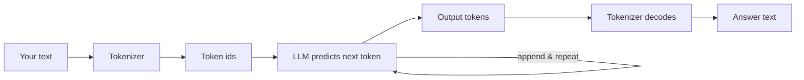

# Post 01 · What is an LLM, and what is a token?

*Series: [Lesson 01 — Foundations](../README.md) · Post 1 of 8 · about 30 minutes*

> **Pt c/o HTN.** Eleven characters. Surely cheaper to send to a model than *"Patient presents with hypertension."*, which has thirty-five?
>
> It isn't. By the end of this post you will know why, and you will have seen it happen in your own terminal.

As a backend developer you already think in units: rows scanned, bytes over the wire, milliseconds of latency. LLM engineering has its own unit, and almost every number you will care about (cost, speed, limits) is measured in it. That unit is the **token**. Before we call any model properly, let's understand what it actually reads.

---

## The idea, in plain English

### What an LLM really does

A **Large Language Model** is a program that has read a huge amount of text and learned one skill: *given some text, predict the next small piece of text.* It repeats that prediction again and again, one piece at a time, until the answer is complete.

Chat, summarising, extracting fields, choosing a tool: all of it is built on this one "predict the next piece" loop.

### What a token is

That "small piece" is a **token**. A model never sees letters or words. Before your text reaches the model, a **tokenizer** cuts it into tokens and turns each one into a number (a **token id**). The model works only with these numbers.

- A common English word is often **1 token**. In the tokenizer we use, ` hypertension` is a single token.
- Rare words, abbreviations, numbers, code and JSON are cut into **more, smaller pieces**.
- Other languages (Arabic, Tamil, Hindi…) usually need **more tokens** for the same meaning.
- Rough rule for English: **1 token ≈ ¾ of a word ≈ 4 characters.** It is only a rule of thumb.

**Each model family has its own tokenizer**, so the same sentence gives a different token count on different models.

### How it fits together

```
 "Patient presents with hypertension."
              │  tokenizer (cuts text, maps each piece to a number)
              ▼
 [Patient][ presents][ with][ hypertension][.]   →   [ 33235, 21849, 483, 78585, 13 ]
              │  model: "given these numbers, what is the most likely next token?"
              ▼
 next token → append → predict again → … → stop
```



### Why you should care

| What | Measured in | Example in your world |
|---|---|---|
| **Cost** (cloud) | input tokens + output tokens | A discharge-summary bot that sends a 6-page record on every request pays for all those tokens, every time. |
| **Speed** | output tokens, generated one by one | A 500-token answer takes about 5× longer than a 100-token one. |
| **Limits** | the context window ([post 02](../02-context-window/README.md)) | A long patient history may simply not fit. |

Think of tokens as the **unit of billing and latency**, the way you think of DB queries or bytes over the network. Two surprises worth knowing:

- Shorthand like `Pt c/o HTN` is fewer *letters* but **not** fewer *tokens*.
- Pretty-printed JSON is expensive: every brace, quote and space counts.

### Two counts, two jobs

- **Your local count.** You can count tokens yourself with a tokenizer library (we use `js-tiktoken`). It is quick and free, and good for **budgeting** before you send a request.
- **The provider's count.** Every response from the model includes **`usage`**: the input and output tokens the provider *actually* counted. This is the **bill**.
- **Why they differ.** Tokenizers differ between model families. On top of that, the provider adds hidden formatting tokens (role labels, special markers). So the provider's number is usually a bit higher.

> **The local count is a budget; the provider's usage is the bill.**

---

## Let's see it in code

Open [`example.ts`](./example.ts) next to this post. It has two parts: **A** looks inside the tokenizer with no model at all, **B** asks your real model for its own count.

Near the top, the file imports `chatModel`, `section` and `stripThinking` from `@learn/shared`, the course's own helper package: `chatModel()` builds the model named in your `.env`, `section()` prints the bold part headers, and `stripThinking()` cleans a reasoning model's answer ([what `@learn/shared` is](../../shared/README.md), introduced in [post 00](../00-course-toolkit/README.md)).

### Step 1 — get a tokenizer

```ts
import { getEncoding } from 'js-tiktoken'; // a TOKENIZER: the program that cuts text into tokens

// We use one public tokenizer (from OpenAI) as an example. Every model family has its own,
// so for YOUR model these numbers are an estimate — see part B.
const tokenizer = getEncoding('o200k_base');
```

We need *some* tokenizer to look inside. `o200k_base` is a public one that ships in an npm package, so it works offline. It is **not** your model's tokenizer, and that is on purpose: part B will show you the gap.

### Step 2 — pick sentences that tell a story

```ts
const samples = [
  'Patient presents with hypertension.', // ordinary English: mostly one token per word
  'Pt c/o HTN.', // shorthand: fewer letters, but NOT fewer tokens
  'المريض يعاني من ارتفاع ضغط الدم', // same sentence in Arabic: different cost
  '{"patient":{"id":"P-001","bp":"150/95"}}', // JSON: every brace and quote is a token too
];
```

Each line tests one claim from the theory above: normal English, shorthand, another language, and JSON.

### Step 3 — cut each one into tokens and show the cuts

```ts
for (const text of samples) {
  const ids = tokenizer.encode(text); // text → list of numbers (token ids)
  // Decode each id back to its piece of text, so you can SEE where the cuts are.
  const pieces = ids.map((id) => tokenizer.decode([id]));
  console.log(`${String(ids.length).padStart(2)} tokens, ${String(text.length).padStart(2)} chars: ${pieces.map((p) => `[${p}]`).join('')}`);
}
```

`encode` is exactly what happens before your text reaches a model: text becomes numbers. We then `decode` each number *on its own* so you can see every piece in `[brackets]`. This is the "look inside" moment.

### Step 4 — ask the model for the real count

```ts
const prompt = 'Reply with one word: OK';
const { usage, text } = await generateText({ model: chatModel(), prompt, maxOutputTokens: 200 });
console.log('Model replied:', JSON.stringify(stripThinking(text)));
console.log({
  ourEstimateForPrompt: tokenizer.encode(prompt).length,
  providerInputTokens: usage.inputTokens, // larger: the provider adds hidden chat-format tokens
  providerOutputTokens: usage.outputTokens,
});
```

Three things to notice:

- `chatModel()` comes from the course's shared helper ([how it works](../../shared/README.md#part-2--the-provider-switch-chatmodel-and-embeddingmodel-modelsts)). It reads `CHAT_MODEL` from your `.env`, so this file never names a model. ([Post 03](../03-model-calls-and-streaming/README.md) explains `generateText` properly; for now, it is "send a prompt, get an answer".)
- `usage` is the provider's own count. We print it next to our local estimate so you can compare the budget with the bill.
- `stripThinking()` removes a `<think>…</think>` block that some models add before their answer ([why models do that](../../shared/README.md#stripthinkingtext--and-why-models-think-out-loud)).

---

## Run it

From the lesson folder (`01-foundations-structured-output/`):

```bash
npm run post:01:offline   # part A only, no model needed
npm run post:01           # part A + B (calls your CHAT_MODEL)
# same thing without npm scripts:
npx tsx 01-llm-and-tokens/example.ts --offline
npx tsx 01-llm-and-tokens/example.ts
```

### What you should see

- **Part A** prints each sample cut into `[pieces]`. Compare:
  - The English sentence against the shorthand `Pt c/o HTN.`. The shorthand has far fewer characters but about as many tokens.
  - The Arabic line, which needs more tokens for the same idea.
  - The JSON line, where every `{"` and `":"` is its own token.
- **Part B** prints `ourEstimateForPrompt` next to `providerInputTokens`. The provider's number is higher, because of its own tokenizer and the hidden chat formatting.

## Common gotchas

- ❌ **Assuming one tokenizer fits all models.** Every model family cuts text differently. Your local count is always an estimate.
- ❌ **Assuming abbreviations save money.** Often they don't, as part A shows.
- ❌ **Forgetting the answer costs tokens too.** Output tokens are usually priced higher than input tokens on cloud APIs.
- ✅ Leave a safety margin (for example 10–20 %) when you budget with a local count.
- ✅ Always log `usage` from real responses. That is the truth for cost dashboards.

## Try it yourself

1. Add a line from a real clinical note you know, and one in Tamil. Which one is the most "expensive" per character?
2. Change the prompt in part B to something 3× longer. Does the gap between the estimate and the provider's count stay about the same (fixed overhead) or grow?

## Key takeaways

- An LLM does one thing: predict the next token, over and over.
- Models read **tokens** (numbers), not letters or words.
- Tokens decide **cost, speed and limits**.
- Shorthand, JSON and non-English text can cost more tokens than you expect.
- **Your local count is a budget; the provider's `usage` is the bill.**

---

← Previous: [The course toolkit](../00-course-toolkit/README.md) · [📚 Series index](../README.md) · [Next: The context window →](../02-context-window/README.md)
