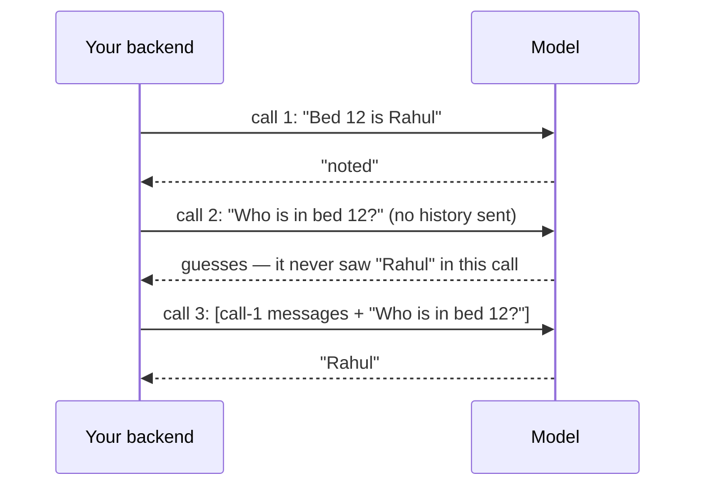

# Post 02 · The context window

*Series: [Lesson 01 — Foundations](../README.md) · Post 2 of 8 · about 30 minutes*

> A nurse uses your ward-round assistant all morning. At 8 am she types *"Bed 12, Rahul, allergic to penicillin."* At 1 pm she asks *"Can I give bed 12 amoxicillin?"* and the assistant says *"Yes."*
>
> Nothing crashed. No error was logged. The model simply never saw the 8 am message. This post explains why, and how you stay in control of it.

In [post 01](../01-llm-and-tokens/README.md) you learned that models read tokens. Now the next question: **how many tokens can a model look at in one go, and what happens to everything else?**

---

## The idea, in plain English

### The model's desk

The **context window** is the maximum number of tokens a model can handle in **one request**. Picture it as the model's desk: everything it can look at for this one answer has to fit on the desk at the same time. That includes:

- the instructions (system prompt),
- the conversation so far,
- any documents or data you add,
- **and the answer it writes.**

Window sizes vary a lot by model, from a few thousand tokens to hundreds of thousands. Your `.env` model has its own limit; check the model's page.

### The model has no memory

A model is **stateless**: it keeps **no memory between requests**. Each call starts from an empty desk. A chat app "remembers" only because the app **sends the earlier messages again** with every new question.

For a backend developer, the closest comparison is a request body with a hard size limit, where your server must build that body fresh on every call.



### Why it matters

- **Long chats break.** A ward-round assistant used for a whole shift builds up a long history. Sooner or later it does not fit. Depending on the provider, the request then fails, or the oldest text is silently cut. That may cut your rules, or the allergy mentioned at the start.
- **Cost grows with every turn.** Because you re-send the history, turn 40 pays for turns 1–39 again.
- **Bigger is not better.** Even when a large window fits everything, models pay less attention to facts buried in the middle of a long context. Answers also get slower and more expensive. *Choosing* what goes in is [post 05](../05-context-engineering/README.md).

### Trimming on purpose

```
 ┌──────────────────── context window (e.g. 1,500 tokens) ────────────────────┐
 │ system prompt │ history turn 1 … turn 40 │ new question │ room for answer │
 └────────────────────────────────────────────────────────────────────────────┘
          too big? → YOU decide what to drop, before sending:

 ┌─────────────────────────────────────────────────────────────────────────────┐
 │ system prompt │ [22 earlier messages omitted] │ newest turns │ question │ answer room │
 └─────────────────────────────────────────────────────────────────────────────┘
```

A simple, common strategy:

1. **Always keep** the system prompt. It holds the rules.
2. **Reserve room** for the answer (`maxOutputTokens`).
3. **Fill the rest with the newest messages first**, going backwards in time.
4. Put in a short note saying older messages were removed. Later you can replace that note with a **summary** of the old turns.

---

## Let's see it in code

Open [`example.ts`](./example.ts). Part **A** trims a long chat to a budget with no model. Part **B** proves the model has no memory.

### Step 1 — a way to measure a message

```ts
const tokenizer = getEncoding('o200k_base');
// Each message costs its text plus a few tokens for the role label; ~4 is a common estimate.
const tokensOf = (m: ModelMessage) => tokenizer.encode(String(m.content)).length + 4;
```

To fit a budget you need a ruler. We reuse the local tokenizer from post 01 and add ~4 tokens per message for the hidden role label. It is an estimate, which is all a budget needs.

### Step 2 — set the budget, and remember the answer

```ts
const BUDGET = 1500; // pretend our model's context window is this small
const RESERVED_FOR_ANSWER = 300; // the answer ALSO uses the window — reserve room for it
```

We pretend the window is tiny so the problem shows up quickly. The second line is the easy-to-forget rule: **the answer shares the window**.

### Step 3 — build a chat that is too long

```ts
const system: ModelMessage = { role: 'system', content: 'You are a ward-round assistant. Be brief.' };
const history = Array.from({ length: 40 }, (_, i) => ({
  role: i % 2 === 0 ? 'user' : 'assistant',
  content: `Turn ${i}: ${'details about bed allocation and lab results '.repeat(8)}`,
})) as ModelMessage[];
```

Forty turns of filler, about 2,600 tokens: roughly double our budget. (The system message here is only for counting. When you actually call a model, the system prompt goes in the `instructions` option, as you will see in post 03.)

### Step 4 — keep the rules and the newest turns

```ts
function fitToBudget(sys: ModelMessage, msgs: ModelMessage[], budget: number): ModelMessage[] {
  let used = tokensOf(sys);
  const kept: ModelMessage[] = [];
  for (let i = msgs.length - 1; i >= 0; i--) {
    if (used + tokensOf(msgs[i]!) > budget) {
      kept.unshift({ role: 'user', content: `[${i + 1} earlier messages omitted to fit the context window]` });
      break;
    }
    used += tokensOf(msgs[i]!);
    kept.unshift(msgs[i]!);
  }
  return [sys, ...kept];
}
```

This is the four-step strategy from above, as code:

- `used = tokensOf(sys)`: the system prompt is counted first and **always kept**.
- The loop walks **backwards** from the newest message, so recent turns win.
- When the next message would not fit, it adds a short "omitted" note and stops, so nothing is lost *silently*.

It is called with `BUDGET - RESERVED_FOR_ANSWER`, so room for the answer is protected:

```ts
const fitted = fitToBudget(system, history, BUDGET - RESERVED_FOR_ANSWER);
```

### Step 5 — prove the model has no memory

```ts
const first: ModelMessage = { role: 'user', content: 'My patient in bed 12 is Rahul. Just say "noted".' };
const question: ModelMessage = { role: 'user', content: 'Who is in bed 12? Answer with the name only.' };

// Call 1 — only the question. The model never saw "Rahul" in THIS call.
const withoutHistory = await generateText({ model: chatModel(), messages: [question], maxOutputTokens: 300, temperature: 0 });
```

`messages` is the whole conversation as an array of `{ role, content }`. Here we send only the question, as if a new call has no idea what came before, which is exactly the case.

```ts
// Call 2 — the same question, but we send the earlier turns along with it.
const withHistory = await generateText({
  model: chatModel(),
  messages: [first, { role: 'assistant', content: 'noted' }, question],
  maxOutputTokens: 300,
  temperature: 0,
});
```

Same model, same question. The **only** difference is that we re-sent the earlier turns. That is all "chat memory" is.

---

## Run it

From the lesson folder (`01-foundations-structured-output/`):

```bash
npm run post:02:offline   # part A only
npm run post:02           # part A + B (calls your CHAT_MODEL)
# or: npx tsx 02-context-window/example.ts [--offline]
```

### What you should see

- **Part A**: before, 41 messages at about 2,600 tokens; after, about 20 messages under the 1,200 budget (1,500 minus 300 kept for the answer). The system prompt is still first, followed by the "omitted" note.
- **Part B**:
  - *Without history* the model does not know who is in bed 12. It guesses or invents a name.
  - *With history* it answers "Rahul".

## Common gotchas

- ❌ **Expecting the model to "remember" the last request.** It cannot; you must re-send.
- ❌ **Filling the window just because it is big.** Cost, speed and accuracy all get worse.
- ❌ **Counting only the history.** The system prompt and tool definitions use tokens too.
- ✅ Trim on purpose, in your code, so *you* control what is lost.
- ✅ Keep critical facts (allergies, the patient ID, the rules) in a part you never trim.

## Try it yourself

1. Change `BUDGET` to 800. How many messages survive?
2. Change `fitToBudget` so that it also always keeps the **first user message** (imagine it contains "Patient is allergic to penicillin").

## Key takeaways

- The context window is one fixed token budget per call, and **the answer shares it**.
- Models are **stateless**: "memory" means you re-send the history.
- Long chats cost more every turn and eventually do not fit.
- Trim deliberately: keep the rules, keep the newest turns, leave a note.

---

[← Previous: What is an LLM, and what is a token?](../01-llm-and-tokens/README.md) · [📚 Series index](../README.md) · [Next: Calling a model with the AI SDK →](../03-model-calls-and-streaming/README.md)
