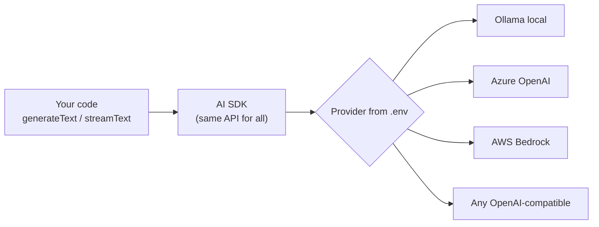

# Post 03 · Calling a model with the Vercel AI SDK (and streaming)

*Series: [Lesson 01 — Foundations](../README.md) · Post 3 of 8 · about 30 minutes*

> Client A wants Azure OpenAI. Client B is on AWS Bedrock. Client C's patient data may not leave the building, so it runs a local model. Do you write three integrations?
>
> No. You write one, and switch with a line in `.env`. And while we are at it, we will make the answer appear in 0.3 seconds instead of 6.

So far we have used `generateText` without really explaining it. This post fixes that: how to call any model from Node.js, how to read what comes back, and how to stream.

---

## The idea, in plain English

### One library for every vendor

The **Vercel AI SDK** (npm package `ai`) is a TypeScript library for talking to LLMs. Every vendor (OpenAI, Anthropic, Azure OpenAI, AWS Bedrock, Google, local models through Ollama) has its own HTTP API. The SDK hides those differences behind **one set of functions**:

| Function | What it does |
|---|---|
| `generateText` | Send a request, **wait**, get the full answer. |
| `streamText` | Send a request, get the answer **piece by piece** as it is generated. |
| `Output.object({ schema })` | Get a **typed object** instead of free text ([post 07](../07-structured-output/README.md)). |
| `tool(...)` + `stopWhen` | Let the model **call your functions** ([post 08](../08-tool-calling/README.md)). |
| `embed` / `embedMany` | Turn text into **vectors** ([post 06](../06-embeddings/README.md)). |

### Provider and model

A *provider* package (for example `@ai-sdk/openai`, `@ai-sdk/amazon-bedrock`, or an Ollama provider) creates a **model object**. You pass that object as `model:`.

In this course you never write a vendor name in the lesson code. `chatModel()` in `shared/` reads `AI_PROVIDER` and `CHAT_MODEL` from your `.env` and builds the model object for you. **Change `.env` and the same code talks to a different model.** This is what "provider-agnostic" means.



### What goes in

- `instructions`: the system prompt, the standing rules ([post 04](../04-prompting/README.md)). Older SDK versions called this option `system`.
- `prompt`: a single user message as a string. **Or** `messages`: the whole conversation as an array of `{ role, content }` ([post 02](../02-context-window/README.md)).
- `maxOutputTokens`: a hard cap on the answer length.
- `temperature`: randomness. Use `0` for repeatable, factual tasks; use higher values for creative text.

### What comes out

- `text`: the answer.
- `finishReason`: why it stopped.
  - `stop`: it finished normally.
  - `length`: it hit `maxOutputTokens` and was **cut off**.
  - `tool-calls`: it wants to use a tool.
- `usage`: `inputTokens`, `outputTokens`. The provider's real count ([post 01](../01-llm-and-tokens/README.md)).

### Streaming

Without streaming, the user stares at a spinner until the very last token is ready. With streaming, the server sends each piece the moment it exists, so the first words appear in a fraction of a second. **Time to first token** is the speed the user *feels*; **total time** is about the same either way.

```
generateText:  request ───────────── wait ─────────────▶ [whole answer]  (+ finishReason, usage)

streamText:    request ─▶ "High" ─▶ " blood" ─▶ " pressure" ─▶ … ─▶ done (+ usage at the end)
                          ▲ time to first token (what the user feels)
```

In code, `streamText` returns at once. You then loop over `result.textStream` with `for await`. In a web server you would forward each piece to the browser, for example with Server-Sent Events.

### Why it matters

- **No vendor lock-in.** Your business code stays the same; only `.env` changes.
- **It fits your backend.** The SDK is plain async TypeScript. It sits inside an Express or Fastify route, a queue worker or a cron job like any other I/O call.
- **Better UX.** A 6-second wait with a blank screen feels broken; text that starts after 0.3 s feels fast.
- **Safety and cost controls** live in the call: `maxOutputTokens`, timeouts, and checking `finishReason === 'length'`.

---

## Let's see it in code

Open [`example.ts`](./example.ts). Part **A** uses `generateText`, part **B** uses `streamText`.

### Step 1 — get the model from `.env`

```ts
import { generateText, streamText } from 'ai';
// chatModel() reads AI_PROVIDER + CHAT_MODEL from .env and returns an AI SDK model object
// (see shared/src/models.ts). Change .env → same code talks to Ollama, Azure or Bedrock.
import { chatModel, dump, modelLabel, section, stripThinking } from '@learn/shared';
```

This import line is the whole "provider-agnostic" idea. Nothing below it knows which vendor it is talking to. `modelLabel()` just prints which model `.env` picked, so you can see it in the output. It returns a `provider:model` string built from `AI_PROVIDER` and `CHAT_MODEL` ([the `@learn/shared` tour](../../shared/README.md#modellabelid) shows its one line of code).

### Step 2 — one request, one complete answer

```ts
const result = await generateText({
  model: chatModel(),
  prompt: 'In one sentence: what is an EHR?',
  maxOutputTokens: 300, // always cap the answer length
});
```

The smallest useful call: a model, a prompt, and a cap. `maxOutputTokens` is your safety belt against a runaway (and expensive) answer.

### Step 3 — read all three outputs, not just the text

```ts
console.log('Answer:      ', stripThinking(result.text)); // stripThinking removes <think>…</think> some models add
console.log('finishReason:', result.finishReason, '  ← "stop" = finished; "length" = cut off by maxOutputTokens');
console.log('usage:       ', { inputTokens: result.usage.inputTokens, outputTokens: result.usage.outputTokens });
```

In production you would branch on `finishReason` (is the answer complete?) and log `usage` (what did it cost?). Get into the habit now.

Those three lines pick fields out of `result`. We saw the full `generateText()` result in [post 00](../00-course-toolkit/README.md#step-4--look-at-everything-the-call-returned), which has a table of every field, so this file does not dump it again. Two facts are worth remembering from that table:

- **`usage`**: `inputTokens`, `outputTokens`, `totalTokens`. In this SDK version `usage` and `totalUsage` both add up **all** steps; each single model call's count is in `steps[i].usage`.
- **`steps`**: one entry per model call, each with its own `usage` and a `performance` block (time per step, tokens per second). A plain call has one step; tool calling (post 08) can make several.

### Step 4 — stream the answer

```ts
const stream = streamText({ model: chatModel(), prompt: 'List three causes of high blood pressure, one per line.', maxOutputTokens: 300 });
```

Notice there is **no `await`** here. `streamText` returns immediately with a handle; the text arrives later.

```ts
let pieces = 0;
for await (const piece of stream.textStream) {
  firstPieceMs ??= performance.now() - s0; // time to first token: what a user "feels"
  pieces++;
  process.stdout.write(piece);
}
```

`textStream` is an async iterable, so a plain `for await` loop reads it. We print each piece as it arrives (in a web app you would write it to the HTTP response instead), and we record when the **first** piece came. That number is the one your users feel.

### Step 5 — the finished values of a stream

```ts
dump('await stream.text', await stream.text);
dump('await stream.finishReason', await stream.finishReason);
dump('await stream.usage', await stream.usage);
dump('await stream.steps', await stream.steps);
```

The stream handle also has the "finished" values, but as **promises**: `stream.text`, `stream.finishReason`, `stream.usage`, `stream.steps` and more. They resolve once the last piece has arrived. Notice they are exactly what `generateText` would have returned. One extra worth noticing in the streamed step's `performance` block: `timeToFirstOutputMs` (the SDK measured time-to-first-token for you) and `timeBetweenOutputChunksMs` (how evenly the pieces arrived).

### Step 6 — `fullStream`: the typed events behind a stream

```ts
const parts: unknown[] = [];
for await (const part of streamText({ model: chatModel(), prompt: 'Say: blood pressure is measured in mmHg.', maxOutputTokens: 300 }).fullStream) {
  parts.push(part);
}
```

`textStream` gives you only text. `fullStream` gives you **every event** as an object with a `type`. We collect them all, then print a count per type and the first and last few parts in full:

```ts
dump('part types and how many of each', counts);
dump('first 5 parts', parts.slice(0, 5));
dump('last 3 parts', parts.slice(-3));
```

The order is always the same: `start` → `start-step` → `text-start` → many `text-delta` parts (each carries one piece in `text`) → `text-end` → `finish-step` (that step's `finishReason`, `usage`, `performance`, `response`) → `finish` (the overall `finishReason` and `totalUsage`). When a model reasons or calls tools, `reasoning-delta`, `tool-call` and `tool-result` parts show up in the same stream. A chat UI that shows "thinking…" or "calling tool…" is reading `fullStream`.

---

## Run it

From the lesson folder (needs your `CHAT_MODEL`):

```bash
npm run post:03
# or: npx tsx 03-model-calls-and-streaming/example.ts
```

### What you should see

- **Part A** (`generateText`): the one-sentence answer, `finishReason: stop`, the `usage` numbers and the total time. The full result object is not printed again (see post 00).
- **Part B** (`streamText`): the list appears gradually. The last line reports how many pieces arrived, the **time to first token** (usually a few hundred ms) and the total time (seconds). Then the awaited `text`, `finishReason`, `usage` and `steps`.
- **Part C** (`fullStream`): how many parts of each type arrived, then the first 5 and last 3 parts.

A real run with a small `qwen3:0.6b` (trimmed at `…`):

```
── [A] generateText (model from .env: ollama:qwen3:0.6b) ───────
Answer:       An EHR is an electronic health record that contains all the medical information a patient has, including their health history, medications, and test results.
finishReason: stop   ← "stop" = finished; "length" = cut off by maxOutputTokens
usage:        { inputTokens: 26, outputTokens: 30 }
time:         501 ms

── [B] streamText — watch the text arrive ──────────────────────
1. **Dietary high sodium intake**  
2. **Smoking or tobacco use**  
3. **Exposure to environmental pollutants**
→ 30 pieces; first after 70 ms, all done after 442 ms
▼ await stream.text
'1. **Dietary high sodium intake**  \n' +
  '2. **Smoking or tobacco use**  \n' +
  '3. **Exposure to environmental pollutants**'
▼ await stream.finishReason
'stop'
▼ await stream.usage
{
  inputTokens: 28,
  inputTokenDetails: {},
  outputTokens: 31,
  outputTokenDetails: {},
  totalTokens: 59
}
▼ await stream.steps
[
  DefaultStepResult {
    text: '1. **Dietary high sodium intake**  \n' + …,
    …
    stepNumber: 0,
    model: { provider: 'ollama.responses', modelId: 'qwen3:0.6b' },
    …
    finishReason: 'stop',
    usage: { inputTokens: 28, … outputTokens: 31, … totalTokens: 59 },
    performance: {
      stepTimeMs: 432.73,
      toolExecutionMs: {},
      responseTimeMs: 430.6,
      effectiveOutputTokensPerSecond: 71.99,
      outputTokensPerSecond: 84.26,
      inputTokensPerSecond: 446.66,
      effectiveTotalTokensPerSecond: 137.02,
      timeToFirstOutputMs: 62.69,
      timeBetweenOutputChunksMs: { min: 4.67, p10: 8.21, median: 10.77, avg: 12.27, p90: 19.81, max: 24.11 }
    },
    …
  }
]

── [C] fullStream — the typed parts behind a stream ────────────
▼ part types and how many of each
{
  start: 1,
  'start-step': 1,
  'text-start': 1,
  'text-delta': 30,
  'text-end': 1,
  'finish-step': 1,
  finish: 1
}
▼ first 5 parts
[
  { type: 'start' },
  { type: 'start-step', request: {}, warnings: [] },
  { type: 'text-start', id: 'G9VHSr1LRznt6E5I' },
  { type: 'text-delta', id: 'G9VHSr1LRznt6E5I', text: 'Yes' },
  { type: 'text-delta', id: 'G9VHSr1LRznt6E5I', text: ',' }
]
▼ last 3 parts
[
  { type: 'text-end', id: 'G9VHSr1LRznt6E5I' },
  {
    type: 'finish-step',
    finishReason: 'stop',
    rawFinishReason: 'stop',
    usage: { inputTokens: 27, … outputTokens: 31, … totalTokens: 58 },
    performance: { stepTimeMs: 369.44, … timeToFirstOutputMs: 51.88, … },
    providerMetadata: { ollama: { responseId: null } },
    response: { id: 'aitxt-FBB2I3vErrnodBvqFptcaYbk', timestamp: 2026-10-24T15:17:40.759Z, modelId: 'qwen3:0.6b', … }
  },
  {
    type: 'finish',
    finishReason: 'stop',
    rawFinishReason: 'stop',
    totalUsage: { inputTokens: 27, … outputTokens: 31, … totalTokens: 58 }
  }
]
```

Your answers, ids, timestamps, token counts, timings and the number of `text-delta` parts will all differ: they depend on your model and machine. A bigger model is slower per token but usually gives better answers.

## Common gotchas

- ❌ **Hard-coding a vendor or model name in business code.** Keep it in config.
- ❌ **Putting a `{ role: 'system' }` message inside `messages`.** The SDK rejects this by default; use the `instructions` option.
- ❌ **Streaming machine-to-machine steps** (extraction, tool loops) where nobody watches. `generateText` is simpler there.
- ✅ Always set `maxOutputTokens`, and check `finishReason`. `length` means the answer is incomplete.
- ✅ Use `temperature: 0` for extraction and classification.
- ℹ️ Some models "think out loud" in `<think>…</think>` before answering. The course helper `stripThinking()` removes that block for display.

## Try it yourself

1. Set `maxOutputTokens: 5` in part A. What is the `finishReason` now? What would your API return to a user in that case?
2. Point `.env` at a different model (another local one, or a cloud one if you have keys) and run the file again **without changing code**. Compare the time and the usage.

## Key takeaways

- The AI SDK gives you **one API for every provider**; the model comes from `.env`.
- Inputs: `instructions`, `prompt` or `messages`, `maxOutputTokens`, `temperature`.
- Outputs: read `text`, **`finishReason`** and **`usage`** every time.
- Stream when a human is watching; **time to first token** is what they feel.

---

[← Previous: The context window](../02-context-window/README.md) · [📚 Series index](../README.md) · [Next: Prompting with roles →](../04-prompting/README.md)
