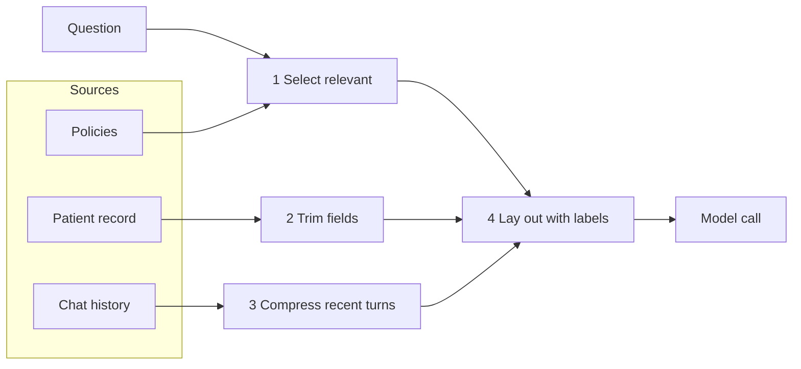

# Post 05 · Context engineering

*Series: [Lesson 01 — Foundations](../README.md) · Post 5 of 8 · about 40 minutes*

> A nurse asks: *"Can Fatima in bed 12 have ibuprofen for her knee pain?"* You have four hospital policies, Fatima's full record and 30 turns of chat history. The safe answer depends on **one fact** hidden in the record: she is on **warfarin**.
>
> Send everything, and that fact is buried under parking rules and insurance numbers. Send too little, and the model never sees it. This post is about sending *exactly* the right things.

In [post 04](../04-prompting/README.md) you learned how to *phrase* instructions. Now we decide *which facts go next to them*. This is where most of the real work in AI apps happens.

---

## The idea, in plain English

### Context, and engineering it

**Context** = everything the model sees in one call: instructions, data, documents, history, tool results.

**Context engineering** is the job of **building that context for each request**. Prompting is about *how you phrase the instructions*; context engineering is about *which facts you put next to them*. The model can only reason about what is on its desk ([post 02](../02-context-window/README.md)). If the key fact is missing, it guesses. If it is buried under noise, it may miss it.

### Four steps

| Step | Question to ask | Example |
|---|---|---|
| **Select** | Which sources help answer *this* question? | Out of 4 hospital policies, only "NSAIDs and anticoagulants" matters for an ibuprofen question. |
| **Trim** | Which fields of those sources are needed? | From the patient record: name, age, allergies, medications. **Not** the phone number or insurance. |
| **Compress** | Can long parts be shortened? | Keep the last 2 chat turns, or a summary, not all 30. |
| **Lay out** | Is it clear what each part is? | Labelled sections like `<patient>…</patient>` and `<policies>…</policies>`, rules first, question last. |



The finished context looks like this:

```
instructions:   You are a clinical assistant for ward nurses. Use ONLY the facts in <patient> and <policies>.
                If the facts are not enough, say what is missing. Never give dosing amounts.
user message:   <patient> name, age, allergies, medications </patient>
                <policies> NSAIDs and anticoagulants: … bleeding risk … </policies>
                <recent_conversation> last 2 turns </recent_conversation>
                Question: Can Fatima in bed 12 have ibuprofen for her knee pain?
```

Two instructions do most of the work:

- **"Use ONLY the facts in …"** keeps the model grounded in the facts you gave it.
- **"If the facts are not enough, say what is missing"** gives it a safe way out instead of inventing an answer.

### Why it matters

- **Accuracy.** The safe answer depends on one fact. It must be in the context, and easy to see.
- **Privacy and compliance.** Sending only what the task needs is the "minimum necessary" principle from healthcare data rules (HIPAA, Saudi PDPL). Phone numbers and insurance IDs have no business in a medication question.
- **Cost and speed.** In the example the dumped context is about 680 tokens and the engineered one about 190: 3–4× cheaper and faster on every call.
- **It is most of the real work.** RAG (lesson 04) is context engineering with a search engine. Agents (lesson 02) are context engineering over many steps.

---

## Let's see it in code

Open [`example.ts`](./example.ts). We start with everything we *could* send, then apply the four steps one by one.

### Step 0 — everything we could send

```ts
const policies = [
  { title: 'Visiting hours', text: 'ICU visiting is 4pm–8pm, two visitors at a time. Children under 12 need approval.' },
  { title: 'Parking', text: 'Visitor parking is in building C. The first 30 minutes are free.' },
  { title: 'NSAIDs and anticoagulants', text: 'Do not give NSAIDs such as ibuprofen to patients on warfarin without a doctor’s order: bleeding risk. Paracetamol is the usual alternative.' },
  { title: 'Fall prevention', text: 'Patients over 65 get a fall-risk score on admission and bed alarms if the score is high.' },
];
```

```ts
const patientRecord = {
  bed: 12, name: 'Fatima Al-Harbi', age: 64, allergies: ['penicillin'],
  medications: ['warfarin 5 mg daily', 'amlodipine 5 mg daily'],
  diet: 'low salt', lastBloodPressure: '138/85', admissionReason: 'knee replacement',
  emergencyContactPhone: '0551234567', insurance: 'Plan B, member 99812',
};
const chatHistory = Array.from({ length: 30 }, (_, i) => `Turn ${i}: earlier small talk about shift handover and room cleaning.`);
```

In real life these come from databases, documents and earlier messages. Spot the important fact (`warfarin`) and the private data that does not belong in this call (`emergencyContactPhone`, `insurance`).

### Step 1 — select

```ts
const keywords = ['ibuprofen', 'nsaid', 'warfarin', 'pain'];
const relevantPolicies = policies.filter((p) => keywords.some((k) => p.text.toLowerCase().includes(k)));
```

A deliberately simple relevance test: keep policies that share a keyword with the question or the patient's medicines. It is enough to learn the idea. Real systems use embeddings ([post 06](../06-embeddings/README.md)) and search (lesson 04).

### Step 2 — trim

```ts
const { name, age, allergies, medications } = patientRecord; // no phone, no insurance: not needed, and it's personal data
```

One destructuring line, and a big privacy win. Only the four fields a medication question needs survive.

### Step 3 — compress

```ts
const recentHistory = chatHistory.slice(-2);
```

The last two turns instead of thirty. A later version could replace the rest with a summary.

### Step 4 — lay out

```ts
const system = `You are a clinical assistant for ward nurses. Use ONLY the facts in <patient> and <policies>.
If the facts are not enough, say what is missing. Never give dosing amounts. Answer in two sentences.`;
const prompt = `<patient>
name: ${name}; age: ${age}; allergies: ${allergies.join(', ')}; current medications: ${medications.join(', ')}
</patient>
<policies>
${relevantPolicies.map((p) => `- ${p.title}: ${p.text}`).join('\n')}
</policies>
<recent_conversation>
${recentHistory.join('\n')}
</recent_conversation>
Question: ${question}`;
```

Rules go in the system prompt; the data goes in the user message, each block wrapped in a labelled tag, with the question **last**. The labels help the model tell data from instructions, and help *you* when you read logs later.

### Step 5 — measure the win

```ts
const everything = JSON.stringify({ policies, patientRecord, chatHistory });
console.log(`Dump everything:     ≈ ${tokens(everything)} tokens (all ${policies.length} policies, full record incl. phone/insurance, ${chatHistory.length} chat turns)`);
console.log(`Engineered context:  ≈ ${tokens(system) + tokens(prompt)} tokens (${relevantPolicies.length} policy, 4 patient fields, ${recentHistory.length} turns)`);
```

We count both versions with the local tokenizer from post 01, so the saving is a number, not a feeling.

Then the file prints the raw output of steps 1–3 with the toolkit's `dump()` ([what it is](../../shared/README.md#dumplabel-value--print-the-full-returned-value)), so you can check each step did what it claims:

```ts
dump('STEP 1 select → relevantPolicies', relevantPolicies);
dump('STEP 2 trim → the patient fields we kept', { name, age, allergies, medications });
dump('STEP 3 compress → recentHistory', recentHistory);
```

`relevantPolicies` is an array with **one** policy object, the NSAIDs one; visiting hours, parking and fall prevention were dropped. The trimmed patient object has four keys and no phone or insurance. `recentHistory` is just two strings. When an answer looks wrong in a real system, this is the first thing to check: *was the right fact in the context at all?*

### Step 6 — ask the model

```ts
const result = await generateText({ model: chatModel(), instructions: system, prompt, temperature: 0, maxOutputTokens: 600 });
const { text, usage } = result;
```

The system prompt goes in `instructions`, the labelled data in `prompt`. Everything you learned in posts 03 and 04, now fed with a context you built on purpose.

```ts
// We do NOT dump the whole generateText() result again: post 00 already showed it in full.
// We only print what matters here. `usage.inputTokens` (logged above) is close to our local estimate
// for the engineered context (not the "dump everything" number), and `finishReason` should be
// 'stop' — if it says 'length', raise maxOutputTokens: the answer was cut off.
console.log('finishReason:', result.finishReason);
```

Compare `usage.inputTokens` (226 in the run below, printed as `inputTokens counted by provider`) with the two local estimates from step 5. It's close to the engineered number (≈194; the provider adds its chat formatting), nowhere near what "dump everything" would cost. And check `finishReason` is `'stop'`: `'length'` would mean the answer was cut off. We saw the full `generateText()` result in [post 00](../00-course-toolkit/README.md#step-4--look-at-everything-the-call-returned).

---

## Run it

From the lesson folder:

```bash
npm run post:05:offline   # builds and prints the context, no model
npm run post:05           # also asks your CHAT_MODEL
# or: npx tsx 05-context-engineering/example.ts [--offline]
```

### What you should see

- **Part A**:
  - the token comparison, "Dump everything ≈ 680" against "Engineered ≈ 190";
  - the printed context: one policy, four patient fields, two turns, and no phone or insurance.
- **Part B**: the answer, the provider's input token count and `finishReason: stop`. The answer should say **no ibuprofen without a doctor's order, because of warfarin / bleeding risk**, and give no dose. Small models sometimes add irrelevant facts (such as the penicillin allergy). Notice it, because this is what evals catch.

A real run with a small `qwen3:0.6b` (trimmed at `…`):

```
── [A] What went into the context, and what we left out ────────
Dump everything:     ≈ 679 tokens (all 4 policies, full record incl. phone/insurance, 30 chat turns)
Engineered context:  ≈ 194 tokens (1 policy, 4 patient fields, 2 turns)

--- system ---
You are a clinical assistant for ward nurses. Use ONLY the facts in <patient> and <policies>.
…
Question: Can Fatima in bed 12 have ibuprofen for her knee pain?

── [A2] The raw output of each step ────────────────────────────
▼ STEP 1 select → relevantPolicies
[
  {
    title: 'NSAIDs and anticoagulants',
    text: 'Do not give NSAIDs such as ibuprofen to patients on warfarin without a doctor’s order: bleeding risk. Paracetamol is the usual alternative.'
  }
]
▼ STEP 2 trim → the patient fields we kept
{
  name: 'Fatima Al-Harbi',
  age: 64,
  allergies: [ 'penicillin' ],
  medications: [ 'warfarin 5 mg daily', 'amlodipine 5 mg daily' ]
}
▼ STEP 3 compress → recentHistory
[
  'Turn 28: earlier small talk about shift handover and room cleaning.',
  'Turn 29: earlier small talk about shift handover and room cleaning.'
]

── [B] The model’s answer using the engineered context ─────────
No, Fatima cannot have ibuprofen for her knee pain. She is on warfarin and amlodipine, which increases her risk of bleeding, so NSAIDs like ibuprofen should be avoided without a doctor's order.
inputTokens counted by provider: 226
Look for: it mentions warfarin / bleeding risk — the one fact that matters, which we made sure was in the context.
finishReason: stop
```

Part A and A2 are the same everywhere. The answer, ids and provider token counts depend on your model. (This small model also wrongly blamed amlodipine for the bleeding risk: a "facts mixed up" mistake that evals in lesson 05 are built to catch.)

## Common gotchas

- ❌ **"Big context window, so send everything."** It costs more, runs slower, gives worse answers and leaks private data.
- ❌ **Mixing user-provided text with your instructions without labels.** This opens the door to prompt injection (lesson 06).
- ❌ **Keyword selection forever.** Fine to learn with; real systems use embeddings and search.
- ✅ Start from the question: "what does the model need to know to answer *this*?"
- ✅ Log the exact final context. Most bad answers trace back to a missing or wrong fact in it.

## Try it yourself

1. Ask a different question, *"Can Fatima's daughter visit her in ICU at 9pm?"*, and update the `keywords` so the visiting-hours policy is selected instead.
2. Temporarily remove `medications` from the trimmed patient fields. What does the model answer now? (This shows how a missing fact turns into a wrong or hedged answer.)

## Key takeaways

- Context engineering = choosing **which facts** the model sees for this one call.
- Four steps: **select, trim, compress, lay out**.
- Label every block and put the question last.
- Less, better context is cheaper, faster, more accurate and safer for private data.

---

[← Previous: Prompting with roles](../04-prompting/README.md) · [📚 Series index](../README.md) · [Next: Embeddings →](../06-embeddings/README.md)
