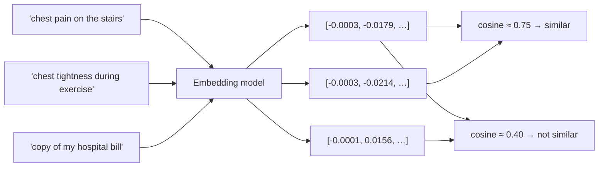
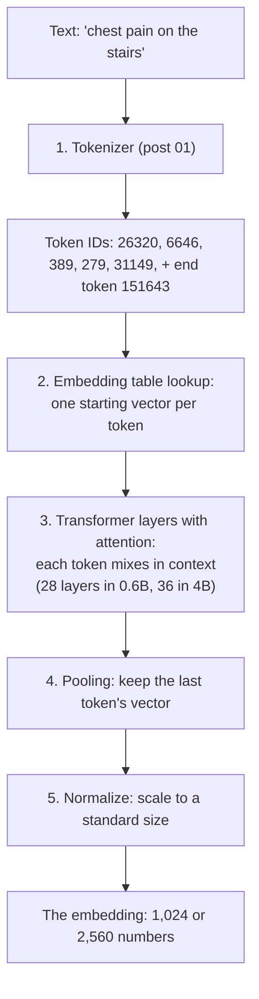

# Post 06 · Embeddings: meaning as numbers

*Series: [Lesson 01 — Foundations](../README.md) · Post 6 of 8 · about 45 minutes*

> A patient types *"heart doctor"*. Your department table says *"cardiology"*. Your SQL `LIKE '%heart doctor%'` returns nothing.
>
> In [post 05](../05-context-engineering/README.md) we picked policies by keyword, and we admitted that was a shortcut. This post shows how software can match **meaning** instead of words.

This post is longer than the others because embeddings are the base of everything in lesson 04 (RAG). We go slowly:

1. [Vectors from the ground up](#vectors-from-the-ground-up): lists of numbers pictured as arrows, and how cosine similarity scores "same direction", with no AI yet.
2. [What an embedding is](#what-an-embedding-is): a vector that a model makes from text, built on step 1.
3. [Embedding model vs. chat model (LLM)](#embedding-model-vs-chat-model-llm): which one to use, and why they are not interchangeable.
4. [How the model turns text into numbers](#how-the-model-turns-text-into-numbers), step by step, for one real sentence, and [how that differs from token IDs](#tokens-vs-embedding-vectors-not-the-same-thing).
5. Then [the code](#lets-see-it-in-code).

---

## The idea, in plain English

### Vectors from the ground up

Before we can say what an embedding is, we need one simple idea: the **vector**.

A **vector** is an ordered list of numbers with a fixed length, like `[0.9, 0.1]`. "Ordered" means position matters: each position is its own slot, like a column in a table. Each slot is called a **dimension**. A GPS point such as `[24.7, 46.7]` (Riyadh: latitude, longitude) is a vector with 2 dimensions. In TypeScript a vector is just a `number[]`; databases store vectors in a vector column (for example [pgvector](https://github.com/pgvector/pgvector) in Postgres).

**Picture it as an arrow.** Suppose we score sentences by hand on two things: how heart-related and how billing-related they are. Each sentence becomes 2 numbers, which is a point on graph paper. Draw an arrow from the corner `(0, 0)` to that point:

```
 billing-related
 ▲
 │    R   R = [0.1, 0.9]    "Where can I download my invoice?"
 │    ·
 │   ·
 │   ·
 │  ·
 │  ·
 │ ·
 │ ·
 │·                 Q·················P   P = [0.9, 0.1]    "chest pain on the stairs"
 │ ··················                     Q = [0.45, 0.05]  same direction as P, half as long
 └──────────────────────────────────────────▶ heart-related
 0                 0.5                 1.0
```

P and Q point the same way (mostly "heart"). R points somewhere else (mostly "billing").

**Same direction means similar.** That is the whole trick: arrows that point the same way stand for similar things. **Cosine similarity** is the score for how much two arrows point the same way. **1** means exactly the same direction; around **0** means unrelated. You never compute it by hand: the `ai` package has a `cosineSimilarity` function.

**Only direction counts, not size.** Q is half as long as P, but it points the same way, so it counts as the same topic. Cosine similarity ignores how long an arrow is.

Later you will see a model produce vectors like these, with 2,560 numbers instead of 2. You cannot draw that, but the idea is exactly the same.

### What an embedding is

Now that you know what a vector is, an embedding is easy to define.

An **embedding** is a vector that an **embedding model** produces from a piece of text, so that it represents the text's **meaning**. The embedding model does not write text. It only turns text into a vector. Typical embeddings have a few hundred to a few thousand numbers (dimensions); `qwen3-embedding:4b`, the model in this course, gives 2,560.

The key property:

> **Texts with similar meaning get vectors that point in a similar direction, even when they share no words.**

"Chest pain when walking upstairs" and "tightness in his chest during exercise" use different words but mean nearly the same thing, so their embeddings point almost the same way. "Copy of my hospital bill" points somewhere else. This is exactly the heart-vs-billing picture from the toy above, except the model chooses the numbers, and there are thousands of them instead of 2.

**Embedding and vector: the same thing, two names.** So an embedding **is** a vector. The two words just look at it from different sides:

- **Vector** is the *data shape*: a fixed-length list of numbers. Everything from the section above (arrows, direction, cosine similarity) applies to it.
- **Embedding** is *what that vector represents*. It is an AI word for a vector that an embedding model produced from a piece of text, so that its direction stands for the text's meaning.

So every embedding is a vector, but not every vector is an embedding. The GPS point `[24.7, 46.7]` is a vector, but it means a place on a map. Even the hand-scored arrows P, Q and R above are only vectors, not real embeddings: a person picked those numbers, not a model.

The chain is: **text → embedding model → vector (this vector *is* the embedding)**. Because it is a vector, cosine similarity works on it. Because of how the model was trained, "same direction" means "similar meaning". **Contrastive training** teaches the model to place texts with similar meanings closer together and unrelated meanings farther apart.

In one line: *text goes into the embedding model, a vector comes out, and that vector is called the embedding.*

One thing to expect: with real embeddings, unrelated texts usually get a cosine around 0.2–0.4, not 0, because all text shares some general "this is English text" direction. What matters is **ranking**: which score is highest.



(The numbers in that picture come from the real run [further down](#what-you-should-see), with `qwen3-embedding:4b`.)

The rest of this section explains how a model makes these vectors.

### Embedding model vs. chat model (LLM)

For an agentic developer the choice is practical, not theoretical. An agent that answers from your notes or policies needs **both** models, for different jobs:

| Use | Model | What you get |
| --- | --- | --- |
| Reasoning, replies, tool calls | Chat LLM (`CHAT_MODEL`, e.g. `generateText`) | Text, token by token |
| Semantic search, RAG, similarity | Embedding model (`EMBED_MODEL`, e.g. `embed` / `embedMany`) | One fixed-length vector of numbers per input |

Both take text in. The chat model writes more text. The embedding model returns a vector that stands for meaning, which you store and compare (see [What an embedding is](#what-an-embedding-is)). How that vector is built is in [How the model turns text into numbers](#how-the-model-turns-text-into-numbers).

Do not swap them. A chat model's vectors were never trained for search, so ranking by them is poor. In this course Ollama will not treat a chat model as an embedding model either: asking `/api/embed` with `qwen3:8b` returned `501 This server does not support embeddings` (Ollama 0.33.2 on our test Mac). Set `CHAT_MODEL` and `EMBED_MODEL` separately in `.env`, and only compare vectors from the same embedding model.

### How the model turns text into numbers

Let's follow one short sentence, **"chest pain on the stairs"**, through `qwen3-embedding`. The numbers below are real.



**Step 1 — Tokens and token IDs.** The tokenizer ([post 01](../01-llm-and-tokens/README.md)) splits the text into tokens and replaces each token with its ID, a whole number that is its row number in the model's vocabulary:

| Token | `chest` | ` pain` | ` on` | ` the` | ` stairs` | `<\|endoftext\|>` |
| --- | --- | --- | --- | --- | --- | --- |
| ID | 26320 | 6646 | 389 | 279 | 31149 | 151643 |

The last one is the end-of-text token that the model adds (often written `[EOS]`, "end of sequence"). That makes **6 tokens**, and Ollama reports exactly `prompt_eval_count: 6` for this sentence (you will see that field in the raw response below). That count is what the AI SDK shows as `usage.tokens`.

**Step 2 — Look up a starting vector for each token.** The model contains a big table called the **embedding table** (or token embedding matrix). It has one row per vocabulary token and one column per hidden-state number:

| Model | Rows (`vocab_size`) | Columns (`hidden_size`) | Numbers in the table |
| --- | --- | --- | --- |
| Qwen3-Embedding-0.6B | 151,669 | 1,024 | 155,309,056 |
| Qwen3-Embedding-4B | 151,665 | 2,560 | 388,262,400 |

(Sizes from the Hugging Face configs for [0.6B](https://huggingface.co/Qwen/Qwen3-Embedding-0.6B/blob/main/config.json) and [4B](https://huggingface.co/Qwen/Qwen3-Embedding-4B/blob/main/config.json).)

Token 26320 ("chest") simply means "read row 26320". So each token becomes a starting vector of 1,024 or 2,560 numbers. At this point the vector knows only *which* token it is. It knows nothing about the sentence yet: "chest" gets the same starting row in every sentence ever written.

**Who decides the vector length?** The model's builders do, **before training**, when they choose the hidden size (the number of columns in this table). Every weight in the model is then trained around that size, so it is fixed forever for that model. The final embedding is the pooled hidden vector (step 4), so it has exactly that length: 1,024 for `qwen3-embedding:0.6b`, 2,560 for `qwen3-embedding:4b`. That is why changing `EMBED_MODEL` changes the vector length, and why you cannot mix vectors from two models.

Choosing the size is a trade-off. More numbers can hold finer shades of meaning, but every stored vector takes more space and every comparison takes longer.

One exception: some models are trained so that the **first part** of the vector is useful on its own (this is called **Matryoshka** training, or **MRL**, after the Russian nesting dolls). With those you may keep only the first N numbers. Qwen3-Embedding supports this: the 4B model allows output sizes from 32 to 2,560 ([model card](https://huggingface.co/Qwen/Qwen3-Embedding-4B)), and Ollama's `/api/embed` accepts a `dimensions` value for it. OpenAI's `text-embedding-3` models have a `dimensions` option for the same reason ([OpenAI embeddings guide](https://developers.openai.com/api/docs/guides/embeddings)). Even then, the builders set the maximum. You can ask for fewer numbers, never more.

**Step 3 — Layers with attention: add context.** Now the vectors go through the transformer layers: 28 layers in the 0.6B model, 36 in the 4B model ([model card](https://huggingface.co/Qwen/Qwen3-Embedding-0.6B)). Each layer does two things to every token's vector:

- **Attention.** Each token "looks at" the earlier tokens and decides how much each one matters to it, then mixes a weighted share of their information into its own vector. Think of a nurse reading a note: to understand one word, they glance back at the words around it.
- A small **feed-forward** step (a fixed calculation applied to each vector on its own), which further transforms what was just mixed in.

Why attention matters: the word **"discharge"** is token ID 31543 in both *"The patient's discharge is planned for Friday."* and *"There is yellow discharge from the wound."*. So in step 2 it gets the **same** starting vector in both. In the layers, the "discharge" token looks back at the words before it: "The patient's" in the first sentence, "There is yellow" in the second. So after the layers the two "discharge" vectors are different: one leans towards *leaving hospital*, the other towards *fluid from a wound*. The tokens after it keep doing the same: "wound" looks back at "yellow discharge from the", and the final end-of-text token looks back at everything. That is how the model turns words into **meaning in context**.

**Step 4 — Pooling: one vector for the whole text.** After the last layer we still have one vector per token (6 here). Different embedding models pool in different ways (some average all the token vectors). Qwen3-Embedding keeps just one: the last layer's vector for the final end-of-text token ([paper, section 2](https://arxiv.org/abs/2506.05176); the [model card](https://huggingface.co/Qwen/Qwen3-Embedding-0.6B)'s code calls it `last_token_pool`). Because each token can only look at the tokens before it (**causal attention**), that final token is the only one that has seen the whole sentence, so it makes a good summary. Result: one vector of 2,560 numbers for the 4B model.

**Step 5 — Normalize.** The vector is scaled to a standard size so only direction counts (think of stretching Q in the drawing above to the same size as P: its direction does not change).

For "chest pain on the stairs", `qwen3-embedding:4b` returns 2,560 numbers that start `[-0.0000048, -0.0243, 0.0434, -0.0378, …]`.

#### Tokens vs. embedding vectors: not the same thing

Post 01 also turned text into numbers, with `encode()`. It is easy to mix the two up, so here they are side by side.

A **token ID** is just **one whole number**: the row number of a token in the vocabulary, like a primary key in a lookup table ([post 01: what a token is](../01-llm-and-tokens/README.md#what-a-token-is)). It carries **no meaning by itself**, and IDs that are next to each other are **not** similar in meaning. In Qwen3's vocabulary, ID 26320 is `chest`, but its neighbours 26319 and 26321 are `NR` and `Currency`. Likewise `heart` is ID 17735 and `cardiology` is two tokens, `card` + `iology` (4951, 30126): nothing in those numbers says they are related.

Meaning only appears once the model turns IDs into **vectors**, and there are two different kinds of vector:

| | Token ID | Token vector (embedding-table row) | Sentence embedding (what `embed()` returns) |
| --- | --- | --- | --- |
| **What it is** | The token's row number in the vocabulary | The starting vector for that token, read from the embedding table (step 2) | One vector for the whole text, after the layers, pooling and normalizing (steps 3–5) |
| **Type / shape** | `number` (an integer) | `number[hidden_size]`: 1,024 numbers (0.6B) or 2,560 (4B) | `number[dims]`: 1,024 (0.6B) or 2,560 (4B) |
| **How many** | One per token | One per token | **One per text** |
| **Carries meaning?** | No, it is just an index | Some: what that token *usually* means | Yes: what *this text* means |
| **Context-aware?** | No | No: "discharge" gets the same row in every sentence | Yes: every word has been mixed with its context |
| **Where you get it** | `tokenizer.encode()` in [post 01](../01-llm-and-tokens/README.md#tokenizers-and-encodings-and-why-we-use-js-tiktoken) | Nowhere: it stays inside the model | `embed()` / `embedMany()` in this post |

**One sentence, all three.** Take "chest pain on the stairs":

- With the course's tokenizer from post 01 (`js-tiktoken`, `o200k_base`), `encode()` gives **6** IDs: `[332, 376, 7432, 402, 290, 49880]` = `ch` · `est` · ` pain` · ` on` · ` the` · ` stairs`.
- Qwen3-Embedding uses **its own** tokenizer, so the IDs differ: `[26320, 6646, 389, 279, 31149]` plus the end token `151643`, also 6 tokens, but `chest` is one token here. (Each model only understands IDs from its own tokenizer; this is the same "pick the tokenizer that matches your model" rule from post 01.)
- Inside the model, those 6 IDs become **6 token vectors** of 2,560 numbers each (for the 4B model), one per token, with no context yet.
- After the layers and pooling, `embed()` returns **1 sentence embedding**: a single `number[]` of length **2,560** for the whole sentence.

So: `encode()` gives you a short list of integers with no meaning; `embed()` gives you one fixed-length list of decimals that *is* the meaning.

#### What "learned" means

The embedding table, the attention calculations and the feed-forward steps are all controlled by **weights**: the stored numbers inside the model. There are roughly 0.6 billion of them in the 0.6B model and 4 billion in the 4B model (that is what the "0.6B" and "4B" in the names mean).

Nobody typed those numbers in. During **training**, the model was shown huge amounts of example text; after each example, a program measured how wrong the output was and nudged every weight a tiny bit in the direction that makes it less wrong. Repeat that billions of times and the weights settle into values that work. "Learned" just means **adjusted during training**. When you use the model, the weights are frozen: they are only read, never changed.

#### No randomness

Embedding has no sampling step, so there is no dice roll like a chat model's `temperature`. The same text with the same model gives the same vector. In practice you can sometimes see differences in the last decimal places: on our test Mac, the very first call (the one that loaded the model) differed from later calls by at most 0.0004 in any single number (cosine 0.99999), and the later calls were bit-for-bit identical. That comes from how the hardware adds up floating-point numbers, not from randomness, and it never changes a ranking.

#### Can you read the numbers?

No. Our toy used tidy slots like "heart-related" and "billing-related", but that is a simplification to build intuition. In a real embedding, number 17 does not mean anything you can label. Meaning lives in the **direction** of the whole vector relative to other vectors.

### Semantic search in three steps

```
semantic search in 3 steps:
 1. ahead of time:  embed every document  → store vectors
 2. at query time:  embed the question     → one vector
 3. compare:        cosine(question, each document) → sort → take the top few
```

**The rule that matters:** compare vectors **from the same embedding model only**. Each model learned its own directions, so vectors from different models live in different "spaces" and comparing them gives nonsense (they may not even have the same length: 1,024 vs. 2,560). If you change `EMBED_MODEL`, you must re-embed everything.

### Why it matters

- **Semantic search.** Find the right policy, guideline or past case when the user's words differ from the document's words ("heart doctor" vs. "cardiology").
- **RAG.** Retrieval-Augmented Generation = embed your documents, embed the question, put the closest chunks into the context (post 05). This is lesson 04.
- **Also:** grouping similar complaints, finding duplicate tickets, routing messages to a department, comparing answers in evals (lesson 05).
- **For a backend developer:** an embedding is an index key for meaning. You store vectors in a vector store (pgvector in Postgres, for example) and query "nearest neighbours" the way you query by ID.

---

## Let's see it in code

Open [`example.ts`](./example.ts). Part **A** tries cosine similarity on tiny hand-made vectors, with no model. Parts **B**, **C** and **D** use your real embedding model.

### Step 1 — cosine similarity with three numbers

```ts
// Pretend the three numbers mean [heart-related, billing-related, children-related].
const chestPain = [0.9, 0.0, 0.1];
const palpitations = [0.8, 0.1, 0.0];
const invoice = [0.0, 1.0, 0.0];
console.log('chest pain vs palpitations:', cosineSimilarity(chestPain, palpitations).toFixed(2), '← similar meaning, close to 1');
console.log('chest pain vs invoice:     ', cosineSimilarity(chestPain, invoice).toFixed(2), '← unrelated, close to 0');
```

Before trusting a model with 2,560-number vectors, see the idea with three numbers. These are like the arrows P, Q and R above, with a third slot added. `cosineSimilarity` comes straight from the `ai` package: give it two vectors of the same length and it returns the direction score. Chest pain and palpitations both lean "heart", so they score close to 1; the invoice points a different way entirely, so it scores 0.

### Step 2 — use the embedding model, not the chat model

```ts
import { cosineSimilarity, embed, embedMany } from 'ai';
// embeddingModel() reads EMBED_MODEL (and AI_PROVIDER) from .env — an embedding model, not a chat model.
import { dump, embeddingModel, section } from '@learn/shared';
```

Same provider-agnostic idea as `chatModel()` in post 03, but it reads `EMBED_MODEL`. The two are set separately in `.env` because they are different kinds of model. `embeddingModel()` is the `@learn/shared` helper that builds the embedding model from `AI_PROVIDER` and `EMBED_MODEL` using the same provider switch as `chatModel()` ([see the code](../../shared/README.md#embeddingmodelmodelid)). `embeddingModel()` does not load anything. It only describes which model to use; the real work happens when `embed` / `embedMany` send the HTTP request.

### Step 3 — embed a batch of sentences

```ts
const sentences = [
  'The patient has chest pain when walking upstairs.',
  'He gets tightness in his chest during exercise.', // same meaning, almost no shared words
  'I need a copy of my hospital bill.',
  'Where can I download my invoice?', // same meaning as the bill sentence
  'My child has a fever and a rash.',
];
// embedMany sends all texts in one go and returns one vector per text, in the same order.
const many = await embedMany({ model: embeddingModel(), values: sentences });
const { embeddings } = many;
```

Two pairs that mean the same thing with different words, plus one outsider. `embedMany` is one request for the whole batch (one `POST /api/embed` with all five texts in `input`), which is faster and cheaper than one call per sentence. If the model is not loaded yet, this is the call that waits for it to load.

```ts
dump('embedMany() result', many);
```

The full `embedMany` result ([what `dump` does](../../shared/README.md#dumplabel-value--print-the-full-returned-value)) has:

- **`values`**: your input texts, echoed back.
- **`embeddings`**: one vector per input, **in the same order**, so `embeddings[i]` belongs to `values[i]`. Each is an ordinary `number[]`; `dump` prints it as `[2560 numbers: -0.0003, -0.0179, …]` because thousands of decimals tell you nothing by eye. The length (2,560 for `qwen3-embedding:4b`) is the model's hidden size from [step 2 of the walkthrough](#how-the-model-turns-text-into-numbers), and every vector from the same model has it.
- **`usage.tokens`**: the tokens Ollama counted for the whole batch (its `prompt_eval_count`). Embedding calls are priced per token too on cloud providers, but much more cheaply than chat.
- **`responses`**: the raw HTTP responses (one per batch request). `dump` hides their headers and bodies; `SHOW_RAW=1` shows them.

### Step 4 — compare every sentence with every other

```ts
embeddings.forEach((a, i) => {
  console.log(`  S${i + 1}  ` + embeddings.map((b) => cosineSimilarity(a, b).toFixed(2).padStart(5) + ' ').join(''));
});
```

This prints a small similarity table. The diagonal is always 1.00 (a sentence compared with itself). Look at the cells off the diagonal.

### Step 5 — semantic search for a new question

```ts
const query = 'Is it normal to feel pressure in the chest on the stairs?';
const single = await embed({ model: embeddingModel(), value: query });
const { embedding: q } = single;
const ranked = sentences
  .map((s, i) => ({ s, score: cosineSimilarity(q, embeddings[i]!) }))
  .sort((a, b) => b.score - a.score);
```

`embed` is the single-value version: its result has `value`, **one** `embedding`, `usage` and `response`. The file dumps it, then the ranked list:

```ts
dump('embed() result', single);
```

```ts
dump('ranked (search hits, best first)', ranked);
```

`ranked` is what a retriever really returns: each document with its raw cosine `score`, best first. The printed table rounds them to two decimals; here you see the full numbers.

This is the three-step search from the theory: the documents were embedded in step 3, now we embed the question with `embed` (single value), score every document and sort. Ten lines, and you have the core of a RAG retriever.

### Step 6 — the same text twice

Part D checks one claim from the theory on real vectors: the same text gives the same vector ([No randomness](#no-randomness)). `embed` and `embedMany` were already dumped in full above, so here we only print the numbers that matter.

```ts
const s1 = embeddings[0]!;
// Embed sentence 1 again (a second, separate request) and compare it with the vector from Part B.
const again = await embed({ model: embeddingModel(), value: sentences[0]! });
const biggestGap = Math.max(...s1.map((x, i) => Math.abs(x - again.embedding[i]!)));
```

This embeds sentence 1 again in a separate request and compares it with the vector from step 3. `biggestGap` is the largest difference between any two matching numbers: `s1.map(...)` computes the difference at every position (`Math.abs` drops the minus sign), and `Math.max(...)` picks the biggest (the `...` spreads the array into separate arguments). Expect a cosine of `1.0000` and a gap of `0` or something tiny like `0.0004` ([see No randomness](#no-randomness)).

---

## Run it

From the lesson folder:

```bash
npm run post:06:offline   # part A: cosine similarity on tiny hand-made vectors
npm run post:06           # parts B, C and D use your EMBED_MODEL
# or: npx tsx 06-embeddings/example.ts [--offline]
# see the raw HTTP response too: SHOW_RAW=1 npm run post:06
```

Want to watch the loading happen? Run `ollama ps` before and after `npm run post:06`. Before, the embedding model is not listed (if you have not used it for 5 minutes); after, it is listed with an `UNTIL` time about 5 minutes away.

### What you should see

- **Part A**: chest pain vs. palpitations ≈ 0.99, chest pain vs. invoice = 0.00.
- **Part B**:
  - the vector length (2560 numbers for `qwen3-embedding:4b`);
  - a 5×5 similarity table, where S1↔S2 (the two chest sentences) and S3↔S4 (bill / invoice) are the highest pairs off the diagonal.
- **Part C**: for *"pressure in the chest on the stairs"*, the two chest sentences rank 1 and 2, even though the words differ.
- **Part D**: the same text embedded twice gives cosine `1.0000`.

A real run with `qwen3-embedding:4b` (trimmed at `…`):

```
── [A] Cosine similarity on tiny hand-made vectors (no model) ──
chest pain vs palpitations: 0.99 ← similar meaning, close to 1
chest pain vs invoice:      0.00 ← unrelated, close to 0

── [B] Real embeddings: which sentences are close in meaning? ──
▼ embedMany() result
DefaultEmbedManyResult {
  values: [
    'The patient has chest pain when walking upstairs.',
    'He gets tightness in his chest during exercise.',
    'I need a copy of my hospital bill.',
    'Where can I download my invoice?',
    'My child has a fever and a rash.'
  ],
  embeddings: [
    [2560 numbers: -0.0003, -0.0179, 0.0229, -0.0476, …],
    [2560 numbers: -0.0003, -0.0214, 0.0516, -0.0453, …],
    [2560 numbers: -0.0001, 0.0156, -0.0174, 0.0078, …],
    [2560 numbers: 0, 0.0112, -0.0494, 0.0331, …],
    [2560 numbers: 0, 0.0277, 0.0215, -0.0366, …]
  ],
  usage: { tokens: 49 },
  warnings: [],
  responses: [ { headers: [hidden headers: 3 keys], body: [hidden body: 5 keys] } ]
}
  (hidden for readability: responses[].headers, responses[].body — set SHOW_RAW=1 to print everything)
Each sentence became a vector of 2560 numbers. First 5 of sentence 1: [ '-0.000', '-0.018', '0.023', '-0.048', '-0.001' ]

        S1   S2   S3   S4   S5
  S1   1.00  0.75  0.40  0.31  0.41
  S2   0.75  1.00  0.38  0.32  0.42
  S3   0.40  0.38  1.00  0.64  0.40
  S4   0.31  0.32  0.64  1.00  0.28
  S5   0.41  0.42  0.40  0.28  1.00
  …

── [C] Semantic search: closest sentence to a new question ─────
▼ embed() result
DefaultEmbedResult {
  value: 'Is it normal to feel pressure in the chest on the stairs?',
  embedding: [2560 numbers: -0.0001, -0.0253, 0.0387, -0.0259, …],
  usage: { tokens: 14 },
  warnings: [],
  response: { headers: [hidden headers: 3 keys], body: [hidden body: 5 keys] }
}
  (hidden for readability: response.headers, response.body — set SHOW_RAW=1 to print everything)
▼ ranked (search hits, best first)
[
  { s: 'The patient has chest pain when walking upstairs.', score: 0.6864883214079125 },
  { s: 'He gets tightness in his chest during exercise.', score: 0.6751079282685603 },
  { s: 'My child has a fever and a rash.', score: 0.342911542287615 },
  { s: 'I need a copy of my hospital bill.', score: 0.3401731764580917 },
  { s: 'Where can I download my invoice?', score: 0.28481515910862987 }
]
Question: Is it normal to feel pressure in the chest on the stairs?
  1. 0.69  The patient has chest pain when walking upstairs.
  2. 0.68  He gets tightness in his chest during exercise.
  …

── [D] The same text twice gives the same vector ───────────────
S1 embedded again: cosine with the first vector = 1.0000, biggest difference in any one number = 0.000000
```

With a different `EMBED_MODEL` the vector length (for example 1024 for `qwen3-embedding:0.6b`), the numbers and the scores change. The **ranking** should look the same.

## Common gotchas

- ❌ **Mixing vectors from two different embedding models.** The scores become meaningless (and the lengths may not even match).
- ❌ **Using the chat model for embeddings.** Even where a tool allows it, the vectors were never contrastively trained, so search quality is poor. Use `EMBED_MODEL`.
- ❌ **Expecting embeddings to handle negation or exact numbers.** "No chest pain" can land close to "chest pain". Combine with keyword search or reranking when it matters (lesson 04).
- ❌ **Embedding huge documents as one vector.** One vector has to summarize the whole text, so details get lost. Split documents into chunks first (lesson 04).
- ❌ **Timing the first call.** The first request after 5 idle minutes includes loading the model (`load_duration`). Measure speed on later calls.
- ✅ Use `embedMany` for batches.
- ✅ Judge by **ranking**, not by the raw score. The "good" score level differs from model to model.

## Try it yourself

1. Add the sentence *"The patient has no chest pain."* and see where it ranks for the question. This shows the negation weakness.
2. Add an Arabic sentence that means "I need my hospital bill". Does it land near S3 / S4? (Qwen3-Embedding supports over 100 languages, according to its model card.)

## Key takeaways

- An embedding is a **vector that represents meaning**; it comes from a separate **embedding model**.
- A **vector** is an ordered, fixed-length list of numbers (`number[]`). Each position is one **dimension**. Picture it as an arrow.
- **Cosine similarity** scores how much two arrows point the same way (1 = same direction, about 0 = unrelated). Only direction counts, not size. Trust the **ranking**, not the raw number.
- Use a **chat LLM** for reasoning, replies and tool calls; use a separate **embedding model** for search, RAG and similarity. They are not interchangeable (`CHAT_MODEL` vs `EMBED_MODEL`).
- A **token ID** (`encode()`, one integer per token) has no meaning; a **sentence embedding** (`embed()`, one `number[]` per text) is context-aware meaning. In between sits the per-token vector from the embedding table.
- The numbers come from: token IDs → rows of a learned **embedding table** → **attention** layers that add context → **pooling** → normalize. "Learned" means the weights were adjusted during training.
- **Contrastive training** teaches the model to place similar meanings closer together and unrelated meanings farther apart. Chat models never had it, so their vectors are poor for search.
- Our code only *describes* the model (`embeddingModel()`); `embed` / `embedMany` send the request that actually runs it (locally via Ollama, or on a cloud provider).
- Semantic search = embed documents, embed the question, compare, sort. Only compare vectors from the **same** embedding model.

---

[← Previous: Context engineering](../05-context-engineering/README.md) · [📚 Series index](../README.md) · [Next: Structured output with Zod →](../07-structured-output/README.md)
