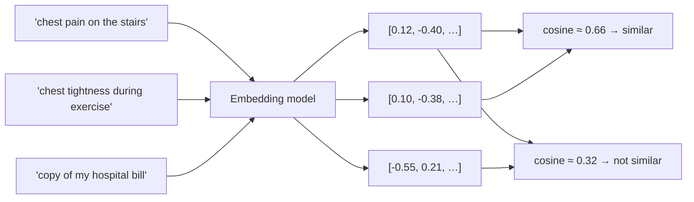

# Post 06 · Embeddings: meaning as numbers

*Series: [Lesson 01 — Foundations](../README.md) · Post 6 of 8 · about 30 minutes*

> A patient types *"heart doctor"*. Your department table says *"cardiology"*. Your SQL `LIKE '%heart doctor%'` returns nothing.
>
> In [post 05](../05-context-engineering/README.md) we selected policies by keyword, and we admitted that was a shortcut. This post shows how software can match **meaning** instead of words.

---

## The idea, in plain English

### What an embedding is

An **embedding** is a list of numbers (a **vector**) that represents the **meaning** of a piece of text. An **embedding model** produces it. This is a different kind of model from a chat model: it does not write text, it only turns text into a vector. Typical vectors have a few hundred to a few thousand numbers.

The key property:

> **Texts with similar meaning get vectors that point in a similar direction, even when they share no words.**

"Chest pain when walking upstairs" and "tightness in his chest during exercise" use different words but mean nearly the same thing, so their vectors are close. "Copy of my hospital bill" points somewhere else entirely.

You can picture each number as a "meaning dimension", for example *heart-related*, *billing-related*, *child-related*. Real dimensions are not that readable, but the geometry works the same way.

### Measuring "close": cosine similarity

**Cosine similarity** measures how closely two vectors point the same way:

- **1.0** means the same direction (same meaning);
- around **0** means unrelated.

With real models, unrelated texts often score around 0.2–0.4 rather than exactly 0. What matters is **ranking**: which score is highest.



### Semantic search in three steps

```
semantic search in 3 steps:
 1. ahead of time:  embed every document  → store vectors
 2. at query time:  embed the question     → one vector
 3. compare:        cosine(question, each document) → sort → take the top few
```

**The rule that matters:** compare vectors **from the same embedding model only**. Vectors from different models live in different "spaces", so comparing them gives nonsense. If you change `EMBED_MODEL`, you must re-embed everything.

### Why it matters

- **Semantic search.** Find the right policy, guideline or past case when the user's words differ from the document's words ("heart doctor" vs. "cardiology").
- **RAG.** Retrieval-Augmented Generation = embed your documents, embed the question, put the closest chunks into the context (post 05). This is lesson 04.
- **Also:** grouping similar complaints, finding duplicate tickets, routing messages to a department, comparing answers in evals (lesson 05).
- **For a backend developer:** an embedding is an index key for meaning. You store vectors in a vector store (pgvector in Postgres, for example) and query "nearest neighbours" the way you query by ID.

---

## Let's see it in code

Open [`example.ts`](./example.ts). Part **A** does the maths with tiny vectors you can check by hand. Parts **B** and **C** use your real embedding model.

### Step 1 — the maths, with three numbers

```ts
// Pretend the three numbers mean [heart-related, billing-related, children-related].
const chestPain = [0.9, 0.0, 0.1];
const palpitations = [0.8, 0.1, 0.0];
const invoice = [0.0, 1.0, 0.0];
console.log('chest pain vs palpitations:', cosineSimilarity(chestPain, palpitations).toFixed(2), '← similar meaning, close to 1');
console.log('chest pain vs invoice:     ', cosineSimilarity(chestPain, invoice).toFixed(2), '← unrelated, close to 0');
```

Before trusting a model with 1,000-number vectors, see the idea with three numbers. `cosineSimilarity` comes straight from the `ai` package. Chest pain and palpitations both lean "heart", so they score high; the invoice points along a different axis entirely.

### Step 2 — use the embedding model, not the chat model

```ts
import { cosineSimilarity, embed, embedMany } from 'ai';
// embeddingModel() reads EMBED_MODEL (and AI_PROVIDER) from .env — an embedding model, not a chat model.
import { dump, embeddingModel, section } from '@learn/shared';
```

Same provider-agnostic idea as `chatModel()` in post 03, but it reads `EMBED_MODEL`. The two are set separately in `.env` because they are different kinds of model. `embeddingModel()` is the `@learn/shared` helper that builds the embedding model from `AI_PROVIDER` and `EMBED_MODEL` using the same provider switch as `chatModel()` ([see the code](../../shared/README.md#embeddingmodelmodelid)).

### Step 3 — embed a batch of sentences

```ts
const sentences = [
  'The patient has chest pain when walking upstairs.',
  'He gets tightness in his chest during exercise.', // same meaning, almost no shared words
  'I need a copy of my hospital bill.',
  'Where can I download my invoice?', // same meaning as the bill sentence
  'My child has a fever and a rash.',
];
// embedMany sends all texts in one go and returns one vector per text, in the same order.
const many = await embedMany({ model: embeddingModel(), values: sentences });
const { embeddings } = many;
```

Two pairs that mean the same thing with different words, plus one outsider. `embedMany` is one request for the whole batch, which is faster and cheaper than one call per sentence.

```ts
dump('embedMany() result', many);
```

The full `embedMany` result ([what `dump` does](../../shared/README.md#dumplabel-value--print-the-full-returned-value)) has:

- **`values`**: your input texts, echoed back.
- **`embeddings`**: one vector per input, **in the same order**, so `embeddings[i]` belongs to `values[i]`. Each is an ordinary `number[]`; `dump` prints it as `[1024 numbers: -0.0529, 0.0818, …]` because a thousand decimals tell you nothing by eye. The length (1024 here) is fixed by the model, and every vector from the same model has it.
- **`usage.tokens`**: the tokens the provider counted for the whole batch. Embedding calls are priced per token too, but much more cheaply than chat.
- **`responses`**: the raw HTTP responses (one per batch request). `dump` hides their headers and bodies; `SHOW_RAW=1` shows them.

### Step 4 — compare every sentence with every other

```ts
embeddings.forEach((a, i) => {
  console.log(`  S${i + 1}  ` + embeddings.map((b) => cosineSimilarity(a, b).toFixed(2).padStart(5) + ' ').join(''));
});
```

This prints a small similarity table. The diagonal is always 1.00 (a sentence compared with itself). Look at the cells off the diagonal.

### Step 5 — semantic search for a new question

```ts
const query = 'Is it normal to feel pressure in the chest on the stairs?';
const single = await embed({ model: embeddingModel(), value: query });
const { embedding: q } = single;
const ranked = sentences
  .map((s, i) => ({ s, score: cosineSimilarity(q, embeddings[i]!) }))
  .sort((a, b) => b.score - a.score);
```

`embed` is the single-value version: its result has `value`, **one** `embedding`, `usage` and `response`. The file dumps it, then the ranked list:

```ts
dump('embed() result', single);
```

```ts
dump('ranked (search hits, best first)', ranked);
```

`ranked` is what a retriever really returns: each document with its raw cosine `score`, best first. The printed table rounds them to two decimals; here you see the full numbers.

This is the three-step search from the theory: the documents were embedded in step 3, now we embed the question with `embed` (single value), score every document and sort. Ten lines, and you have the core of a RAG retriever.

---

## Run it

From the lesson folder:

```bash
npm run post:06:offline   # part A: cosine similarity on tiny hand-made vectors
npm run post:06           # parts B and C use your EMBED_MODEL
# or: npx tsx 06-embeddings/example.ts [--offline]
```

### What you should see

- **Part A**: chest pain vs. palpitations ≈ 0.99, and chest pain vs. invoice = 0.00.
- **Part B**:
  - the vector length (for example 1024 numbers);
  - a 5×5 similarity table, where S1↔S2 (the two chest sentences) and S3↔S4 (bill / invoice) are the highest pairs off the diagonal.
- **Part C**: for *"pressure in the chest on the stairs"*, the two chest sentences rank 1 and 2, even though the words differ.

A real run with `qwen3-embedding:0.6b` (trimmed at `…`):

```
── [B] Real embeddings: which sentences are close in meaning? ──
▼ embedMany() result
DefaultEmbedManyResult {
  values: [
    'The patient has chest pain when walking upstairs.',
    'He gets tightness in his chest during exercise.',
    'I need a copy of my hospital bill.',
    'Where can I download my invoice?',
    'My child has a fever and a rash.'
  ],
  embeddings: [
    [1024 numbers: -0.0529, 0.0818, 0.0008, 0.0099, …],
    [1024 numbers: -0.0339, 0.0319, -0.0056, 0.0402, …],
    [1024 numbers: -0.063, -0.0097, -0.0076, -0.0464, …],
    [1024 numbers: -0.0329, -0.0056, -0.0077, -0.1273, …],
    [1024 numbers: 0.0242, 0.0943, -0.0013, 0.0124, …]
  ],
  usage: { tokens: 49 },
  warnings: [],
  responses: [ { headers: [hidden headers: 3 keys], body: [hidden body: 5 keys] } ]
}
  (hidden for readability: responses[].headers, responses[].body — set SHOW_RAW=1 to print everything)
Each sentence became a vector of 1024 numbers. First 5 of sentence 1: [ '-0.053', '0.082', '0.001', '0.010', '0.003' ]

        S1   S2   S3   S4   S5
  S1   1.00  0.66  0.32  0.27  0.43
  S2   0.66  1.00  0.32  0.25  0.40
  S3   0.32  0.32  1.00  0.57  0.33
  S4   0.27  0.25  0.57  1.00  0.21
  S5   0.43  0.40  0.33  0.21  1.00
  …

── [C] Semantic search: closest sentence to a new question ─────
▼ embed() result
DefaultEmbedResult {
  value: 'Is it normal to feel pressure in the chest on the stairs?',
  embedding: [1024 numbers: -0.027, 0.0485, -0.0049, 0.0438, …],
  usage: { tokens: 14 },
  warnings: [],
  response: { headers: [hidden headers: 3 keys], body: [hidden body: 5 keys] }
}
  (hidden for readability: response.headers, response.body — set SHOW_RAW=1 to print everything)
▼ ranked (search hits, best first)
[
  { s: 'The patient has chest pain when walking upstairs.', score: 0.678086448998953 },
  { s: 'He gets tightness in his chest during exercise.', score: 0.6458470717704269 },
  { s: 'My child has a fever and a rash.', score: 0.3059422555471577 },
  { s: 'I need a copy of my hospital bill.', score: 0.28550369449054186 },
  { s: 'Where can I download my invoice?', score: 0.2591507477007238 }
]
Question: Is it normal to feel pressure in the chest on the stairs?
  1. 0.68  The patient has chest pain when walking upstairs.
  …
```

With a different `EMBED_MODEL` the vector length (for example 2560 for `qwen3-embedding:4b`), the numbers and the scores change. The **ranking** should look the same.

## Common gotchas

- ❌ **Mixing vectors from two different embedding models.** The scores become meaningless.
- ❌ **Expecting embeddings to handle negation or exact numbers.** "No chest pain" can land close to "chest pain". Combine with keyword search or reranking when it matters (lesson 04).
- ❌ **Embedding huge documents as one vector.** Split them into chunks first (lesson 04).
- ✅ Use `embedMany` for batches.
- ✅ Judge by **ranking**, not by the raw score. The "good" score level differs from model to model.

## Try it yourself

1. Add the sentence *"The patient has no chest pain."* and see where it ranks for the question. This shows the negation weakness.
2. Add an Arabic sentence that means "I need my hospital bill". Does it land near S3 / S4? (It depends on whether your embedding model is multilingual.)

## Key takeaways

- An embedding is a **vector that represents meaning**; it comes from a separate **embedding model**.
- **Cosine similarity** measures closeness; trust the **ranking**, not the raw number.
- Semantic search = embed documents, embed the question, compare, sort.
- Only compare vectors from the **same** embedding model.

---

[← Previous: Context engineering](../05-context-engineering/README.md) · [📚 Series index](../README.md) · [Next: Structured output with Zod →](../07-structured-output/README.md)
