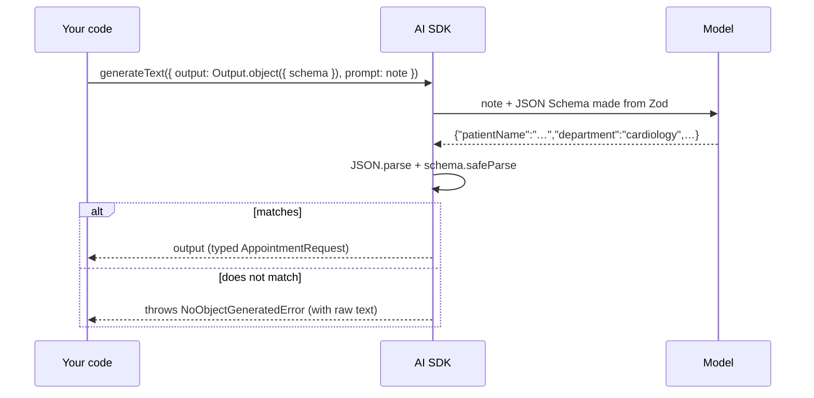

# Post 07 · Structured output: typed JSON from a model, with Zod

*Series: [Lesson 01 — Foundations](../README.md) · Post 7 of 8 · about 45 minutes*

> The call-centre note says: *"Mrs. Fatima Al-Harbi wants to see a heart doctor, chest tightness on the stairs since last week. Prefers 2026-11-03 if possible."* Your booking table needs `patientName`, `department`, `urgency`, `preferredDate`.
>
> You ask the model for "JSON, please". It replies `Sure! Here's the JSON:` followed by a code fence. Your `JSON.parse` throws at 2 am. There is a better way.

In [post 04](../04-prompting/README.md) we got a one-word answer by asking nicely. That works for one word. For a full record your code can trust, you need a **schema**.

---

## The idea, in plain English

### Structured output

Normally a model returns free text. **Structured output** means you give the model a **schema** (a description of the exact shape you want) and get back **JSON that matches it**, already parsed and checked.

### Zod: one schema, three jobs

**Zod** is a TypeScript library for writing schemas. One Zod schema gives you three things:

1. **A runtime check.** `Schema.safeParse(data)` tells you if data matches, and exactly what is wrong if not.
2. **A TypeScript type.** `z.infer<typeof Schema>`, so the schema and the type never drift apart.
3. **A description the model can read.** The AI SDK turns the schema (including `.describe()` texts) into a JSON Schema and sends it with the request.

Useful schema tools:

- `z.enum([...])`: only these values are allowed (a department or urgency code).
- `.nullable()`: an honest "not mentioned". Better than letting the model invent a value.
- `z.array(...)`: a list, such as symptoms.
- `.describe('...')`: per-field instructions for the model.

### How the AI SDK uses it

You ask for structured output with `output: Output.object({ schema })` on `generateText`. Then:

- The SDK asks the model to answer in that shape. Many providers support this natively ("JSON mode" or constrained decoding).
- It **parses and validates** the reply against your Zod schema.
- On success you get `output`, fully typed.
- On failure it throws **`NoObjectGeneratedError`**, which includes the raw text so you can log it or retry.

### Two ways a shape is enforced

- **Constrained decoding.** The provider restricts which tokens the model is *allowed* to pick, so the reply cannot break the JSON Schema. Many cloud APIs and Ollama support this.
- **Post-hoc validation.** The model answers freely, and *afterwards* the SDK parses and checks it with Zod.

The AI SDK uses the first when the provider supports it, and **always** does the second. So your code is protected either way.



```
"Mrs. Fatima Al-Harbi wants to see a heart doctor,          {
 chest tightness on the stairs since last week.       ──▶     patientName: "Fatima Al-Harbi",
 Prefers 2026-11-03 if possible."                             department: "cardiology",
                                                              urgency: "soon",
                                                              preferredDate: "2026-11-03",
                                                              symptoms: ["chest tightness on stairs"]
                                                            }
```

### Why it matters

This is the bridge between "AI" and "backend". Your systems speak in typed records: database rows, HL7 / FHIR resources, API payloads. With structured output:

- A free-text phone note becomes an `AppointmentRequest` you can insert into the booking table.
- The code after the call needs no `JSON.parse`, no regex, no guessing.
- Bad output is **caught at the boundary**, like validating any untrusted API input.

**But a valid shape is not the same as a correct answer.** The schema guarantees that `urgency` is one of `routine | soon | urgent`. It cannot guarantee the model picked the *right* one. Business rules ("chest pain → never `routine`") need their own checks and evals. That is your week-1 exercise below.

---

## Let's see it in code

Open [`example.ts`](./example.ts). Part **A** uses the schema with no model at all. Part **B** asks the model to fill it.

### Step 1 — describe the shape once

```ts
export const AppointmentRequest = z.object({
  patientName: z.string().describe('Full name as written in the note'),
  department: z // ENUM: only these values are allowed
    .enum(['cardiology', 'orthopedics', 'pediatrics', 'general-medicine', 'unknown'])
    .describe('Best matching department; "unknown" if unclear'),
  urgency: z.enum(['routine', 'soon', 'urgent']).describe('urgent = within 24h'),
  preferredDate: z.string().nullable().describe('ISO date YYYY-MM-DD if mentioned, otherwise null'), // NULLABLE: an honest "not mentioned"
  symptoms: z.array(z.string()).describe('Short symptom phrases, may be empty'),
});
```

Every tool from the list above appears here. Notice `'unknown'` in the department enum: an escape value, so the model is never forced to pick a wrong department. And the `.describe()` texts are not comments: they are sent to the model as per-field instructions.

### Step 2 — get the TypeScript type for free

```ts
export type AppointmentRequest = z.infer<typeof AppointmentRequest>;
```

One line, and the type is derived from the schema. Change the schema and the type follows; they can never drift apart.

### Step 3 — validate data without any model

```ts
const good = { patientName: 'Rahul Menon', department: 'orthopedics', urgency: 'routine', preferredDate: null, symptoms: ['knee pain'] };
const bad = { patientName: 'X', department: 'neuro', urgency: 'asap', preferredDate: '3rd Nov', symptoms: [] };
console.log('good →', AppointmentRequest.safeParse(good).success ? 'valid' : 'invalid');
const r = AppointmentRequest.safeParse(bad);
console.log('bad  →', r.success ? 'valid' : 'invalid\n' + z.prettifyError(r.error));
```

This is the "runtime check" job, and exactly what the SDK will do to the model's reply. `safeParse` never throws; it returns success or a list of problems, and `z.prettifyError` makes that list readable.

### Step 4 — ask the model to fill the shape

```ts
const { output } = await generateText({
  model: chatModel(),
  output: Output.object({ schema: AppointmentRequest }), // "reply with JSON matching this schema"
  instructions: 'Extract a structured appointment request from the note. Do not invent facts.',
  prompt: note,
  temperature: 0,
});
```

The only new line compared with post 03 is `output: Output.object(...)`. The `instructions` say "do not invent facts", which pairs with `.nullable()`: the model has an honest way to say "not mentioned".

### Step 5 — use it like any typed object

```ts
// `output` is typed AppointmentRequest and already validated — no JSON.parse, no casting.
console.log(JSON.stringify(output, null, 2));
console.log('Typed access → output.department =', output.department);
```

Hover over `output` in your editor: it is `AppointmentRequest`. Your IDE autocompletes `department`, and TypeScript knows it can only be one of the five enum values.

### Step 6 — handle the failure path

```ts
} catch (error) {
  // The failure path: reply was not valid JSON or did not match the schema.
  if (NoObjectGeneratedError.isInstance(error)) console.error('Did not match the schema. Raw reply:\n', error.text);
  else throw error;
}
```

Treat the model like any untrusted upstream service. When the reply does not fit, you get a specific error with the raw text, so you can log it, retry once, or send it to a human.

---

## Run it

From the lesson folder:

```bash
npm run post:07:offline   # part A: Zod validation without a model
npm run post:07           # part B: note → typed object with your CHAT_MODEL
# or: npx tsx 07-structured-output/example.ts [--offline]
```

### What you should see

- **Part A**: `good → valid`. `bad → invalid`, with a readable list of what is wrong: `department` "neuro" and `urgency` "asap" are not allowed values.
- **Part B**: a JSON object with `department: "cardiology"`, `preferredDate: "2026-11-03"`, and a symptoms list. Then `output.department` is used as a normal typed property.
  - Compare the `urgency` the model chose with what a nurse would choose. That is the "valid, but is it right?" question.

## Common gotchas

- ❌ **Asking for "JSON" in the prompt and calling `JSON.parse` yourself.** It breaks on the first stray sentence or code fence.
- ❌ **Huge, deeply nested schemas for small models.** Keep schemas flat and small; split into two calls if needed.
- ❌ **Trusting the *values* because the *shape* is valid.** Add business-rule checks.
- ✅ Use enums for anything your code branches on, with an escape value like `'unknown'`.
- ✅ Use `.nullable()` for optional facts and tell the model "null if not mentioned".
- ✅ Catch `NoObjectGeneratedError`: log the raw text, then retry once or send to a human.

## Try it yourself

1. Change `preferredDate` to `z.iso.date().nullable()` (a strict YYYY-MM-DD date) and run part A with `preferredDate: '3rd Nov'`. Watch it fail.
2. **Week-1 exercise from the learning map: a business rule on the triage schema.**
   - Write a function `violatesRule(req)` that returns `true` when `symptoms` mention chest pain or chest tightness **and** `urgency === 'routine'`.
   - Run part B **20 times** in a loop and print the **violation rate** (for example "2/20 = 10 %").
   - This number is how you will compare prompts and models from now on.

## Key takeaways

- Structured output = a **schema in, a typed and validated object out**.
- One Zod schema gives you a runtime check, a TypeScript type and instructions for the model.
- `Output.object({ schema })` on `generateText`; failures throw `NoObjectGeneratedError`.
- **A valid shape is not a correct answer.** Check business rules separately.

---

[← Previous: Embeddings](../06-embeddings/README.md) · [📚 Series index](../README.md) · [Next: Tool calling →](../08-tool-calling/README.md)
