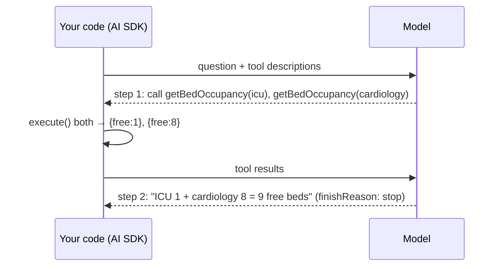

# Post 08 · Tool calling (and the tool loop)

*Series: [Lesson 01 — Foundations](../README.md) · Post 8 of 8 · about 45 minutes*

> *"How many free beds are there in ICU and cardiology right now?"*
>
> No model knows that. It was trained months ago, and bed occupancy changes every hour. Ask anyway and a model will happily make up a confident number. Unless you give it a way to **ask your system**.

Everything so far was one request, one answer. This post adds the missing piece: the model can ask **your code** to run a function, read the result, and then answer. This is the first step towards agents (lesson 02).

---

## The idea, in plain English

### What tool calling is

A model only knows what was in its training data plus what is in the context. It cannot know today's bed occupancy, a lab result or a stock level. **Tool calling** fixes this:

1. You describe some **tools** to the model. Each tool has:
   - a **name**;
   - a **description** in plain English (when to use it);
   - an **input schema** in Zod (what arguments it takes).
2. The model reads the question and, instead of answering, may reply: *"call `getBedOccupancy` with `{ ward: 'icu' }`"*. This is a **tool call**. The model **never runs anything itself**; it only asks.
3. **Your code** runs the function (`execute`) and sends the **tool result** back to the model.
4. The model now has the facts. It either calls another tool or writes the final answer.

### The tool loop, and why it needs a limit

Each round trip is a **step**. The AI SDK runs this **tool loop** for you. `stopWhen: stepCountIs(5)` means "stop after at most 5 steps", a hard safety limit so a confused model cannot loop forever (and run up your bill).



```
step 1  model → tool calls       (finishReason = "tool-calls")
        code  → runs execute(), adds results to the conversation
step 2  model → final text       (finishReason = "stop")
        …at most stepCountIs(N) steps, then the SDK stops anyway
```

The tool's input is checked against its Zod schema **before** `execute` runs. So `ward: 'neurology'` is rejected, the same idea as structured output ([post 07](../07-structured-output/README.md)).

### Why it matters

- **Real data, not guesses.** "How many free ICU beds?" must come from the hospital system, not the model's imagination.
- **Actions.** Tools can also *do* things: book a slot, create a ticket, send a reminder. Those need extra care (approval, auditing; see lesson 06).
- **Your existing backend becomes AI-usable.** Every REST endpoint or DB query you already have can become a tool. This is also the idea behind MCP (lesson 03).
- **Agents = tool calling + a loop + a goal.** Understand this post and you understand the core of every agent framework.

---

## Let's see it in code

Open [`example.ts`](./example.ts). One tool, one question, and a printout of every step of the loop.

### Step 1 — data the model cannot know

```ts
const beds: Record<string, { total: number; occupied: number }> = {
  icu: { total: 12, occupied: 11 },
  cardiology: { total: 30, occupied: 22 },
  pediatrics: { total: 20, occupied: 9 },
};
```

In real life this is your hospital system's API or database. Here it is an in-memory object, so you can check the right answer by hand: ICU has 1 free bed, cardiology 8.

### Step 2 — define the tool

```ts
const getBedOccupancy = tool({
  description: 'Get current bed occupancy for ONE hospital ward. Call once per ward.',
  inputSchema: z.object({ ward: z.enum(['icu', 'cardiology', 'pediatrics']) }),
  execute: async ({ ward }) => {
    console.log(`  ↳ your code ran getBedOccupancy("${ward}")`);
    const b = beds[ward]!;
    return { ward, free: b.total - b.occupied };
  },
});
```

The three parts from the theory, in order:

- `description` is read by the **model**. Write it like API docs for a new colleague, including *how* to use it ("Call once per ward").
- `inputSchema` is a Zod schema, so arguments are validated before your code runs, and the enum keeps inputs narrow and safe.
- `execute` is **your** code. The `console.log` is there so you can see that your function, not the model, does the work. It returns a small JSON result, because tool results also cost context tokens.

### Step 3 — give the model the tool, with a limit

```ts
const result = await generateText({
  model: chatModel(),
  tools: { getBedOccupancy },
  stopWhen: stepCountIs(5), // hard limit on the loop
  instructions: 'Answer questions about hospital capacity using the tools. Never guess numbers.',
  prompt: 'How many free beds are there in ICU and in cardiology combined?',
  temperature: 0,
});
```

Compared with post 03, two new options: `tools` (what the model may ask for) and `stopWhen` (when the loop must stop, no matter what). The single `await` hides the whole loop: model asks, SDK runs `execute`, sends results back, repeats.

### Step 4 — look inside the loop

```ts
result.steps.forEach((step, i) => {
  console.log(`Step ${i + 1} (finishReason=${step.finishReason})`);
  step.toolCalls.forEach((c) => console.log(`   model asked:   ${c.toolName}(${JSON.stringify(c.input)})`));
  step.toolResults.forEach((r) => console.log(`   code returned: ${JSON.stringify(r.output)}`));
});
```

`result.steps` is your debugger for tool loops. Each step shows what the model asked for, what your code returned, and why the step ended.

The lines above print a summary. Next the file dumps the **raw** tool-call and tool-result objects of each step, with the toolkit's `dump()` ([what it is](../../shared/README.md#dumplabel-value--print-the-full-returned-value)):

```ts
result.steps.forEach((step, i) => {
  dump(`steps[${i}].toolCalls`, step.toolCalls);
  dump(`steps[${i}].toolResults`, step.toolResults);
});
```

A **tool call** is `{ type: 'tool-call', toolCallId, toolName, input }`: the model's request, with the `input` it chose (already checked against your `inputSchema`). A **tool result** is `{ type: 'tool-result', toolCallId, toolName, input, output, dynamic }`: `output` is exactly what your `execute` returned. Match them up by **`toolCallId`**. When a model asks for several tools in one step, that id is how each result finds its request. (`dynamic: false` means the tool was declared in code, as here; tools discovered at runtime, such as MCP tools in lesson 03, are "dynamic".)

### Step 5 — check the answer

```ts
console.log('Model:  ', stripThinking(result.text));
console.log('Correct: 1 + 8 = 9 free beds   ← compare! Small models can still get the arithmetic wrong.');
```

The tool gives the model the right facts; it does not guarantee right reasoning. Printing the correct answer next to the model's makes that visible.

### Step 6 — the full result of a tool loop

```ts
section('[D] The full result object');
dump('generateText() result with tools', result);
```

This is the same result object as in [post 03](../03-model-calls-and-streaming/README.md), but now several fields are no longer empty, and it matters which ones describe the **whole loop** and which only the **last step**:

| Field | With tools |
|---|---|
| `steps` | One entry per model call: 3 in the run below (ask ICU → ask cardiology → answer). Each has its own `finishReason` (`'tool-calls'`, then `'stop'`), `usage`, `content`, and a `performance.toolExecutionMs` entry timing your `execute`. |
| `content` | The parts of **all** steps in order: `tool-call`, `tool-result`, `tool-call`, `tool-result`, `text`. |
| `toolCalls` / `toolResults` | Every call and result from **all** steps. |
| `text`, `finishReason`, `response` | From the **last** step only, the one that wrote the answer. |
| `usage` / `totalUsage` | The sum over **all** steps (687 input tokens here, against 185 for the first step alone). Every step re-sends the conversation so far, tool results included, so a tool loop costs much more than one call. |

---

## Run it

From the lesson folder (your `CHAT_MODEL` must support tool calling):

```bash
npm run post:08
# or: npx tsx 08-tool-calling/example.ts
```

### What you should see

- Lines like `↳ your code ran getBedOccupancy("icu")`. This is **your** function running, not the model.
- **Part B**:
  - Step 1 has `finishReason=tool-calls` and lists what the model asked for and what your code returned.
  - Step 2 has `finishReason=stop`.
- **Part C**: the model's answer next to the correct one (1 + 8 = 9). If they differ, you have just seen why calculations belong in code.
- With a very small `CHAT_MODEL` you may see only **one** tool call (ICU) and an invented number for cardiology, despite "Never guess numbers". That is exactly the failure this post warns about; a larger model usually calls the tool once per ward.

A real run with a small `qwen3:0.6b` (trimmed at `…`):

```
── [A] The model asks for tools; the SDK runs them and loops ───
  ↳ your code ran getBedOccupancy("icu")
  ↳ your code ran getBedOccupancy("cardiology")

── [B] Step by step ────────────────────────────────────────────
Step 1 (finishReason=tool-calls)
   model asked:   getBedOccupancy({"ward":"icu"})
   code returned: {"ward":"icu","free":1}
Step 2 (finishReason=tool-calls)
   model asked:   getBedOccupancy({"ward":"cardiology"})
   code returned: {"ward":"cardiology","free":8}
Step 3 (finishReason=stop)
▼ steps[0].toolCalls
[
  {
    type: 'tool-call',
    toolCallId: 'call_xqgr42tp',
    toolName: 'getBedOccupancy',
    input: { ward: 'icu' }
  }
]
▼ steps[0].toolResults
[
  {
    type: 'tool-result',
    toolCallId: 'call_xqgr42tp',
    toolName: 'getBedOccupancy',
    input: { ward: 'icu' },
    output: { ward: 'icu', free: 1 },
    dynamic: false
  }
]
▼ steps[1].toolCalls
…
▼ steps[2].toolCalls
[]
▼ steps[2].toolResults
[]

── [C] Final answer ────────────────────────────────────────────
Model:   In ICU, there are 1 free bed, and in cardiology, there are 8 free beds combined.
Correct: 1 + 8 = 9 free beds   ← compare! Small models can still get the arithmetic wrong.

── [D] The full result object ──────────────────────────────────
▼ generateText() result with tools
DefaultGenerateTextResult {
  finalStep: [same as the last item of steps],
  content: [
    { type: 'tool-call', toolCallId: 'call_xqgr42tp', toolName: 'getBedOccupancy', input: { ward: 'icu' } },
    { type: 'tool-result', toolCallId: 'call_xqgr42tp', toolName: 'getBedOccupancy', input: { ward: 'icu' }, output: { ward: 'icu', free: 1 }, dynamic: false },
    { type: 'tool-call', toolCallId: 'call_m84cm5pi', … input: { ward: 'cardiology' } },
    { type: 'tool-result', toolCallId: 'call_m84cm5pi', … output: { ward: 'cardiology', free: 8 }, dynamic: false },
    { type: 'text', text: 'In ICU, there are 1 free bed, and in cardiology, there are 8 free beds combined.' }
  ],
  text: 'In ICU, there are 1 free bed, and in cardiology, there are 8 free beds combined.',
  …
  toolCalls: [ { type: 'tool-call', toolCallId: 'call_xqgr42tp', … }, { type: 'tool-call', toolCallId: 'call_m84cm5pi', … } ],
  …
  toolResults: [ { type: 'tool-result', toolCallId: 'call_xqgr42tp', … }, { type: 'tool-result', toolCallId: 'call_m84cm5pi', … } ],
  …
  finishReason: 'stop',
  …
  usage: { inputTokens: 687, inputTokenDetails: {}, outputTokens: 70, outputTokenDetails: {}, totalTokens: 757 },
  …
  steps: [
    DefaultStepResult {
      text: '',
      …
      stepNumber: 0,
      …
      finishReason: 'tool-calls',
      rawFinishReason: 'tool_calls',
      usage: { inputTokens: 185, … outputTokens: 24, … totalTokens: 209 },
      performance: {
        effectiveOutputTokensPerSecond: 48.33,
        effectiveTotalTokensPerSecond: 420.88,
        stepTimeMs: 502.34,
        responseTimeMs: 496.58,
        toolExecutionMs: { call_xqgr42tp: 0.21990100000004986 }
      },
      …
    },
    DefaultStepResult { … stepNumber: 1, … finishReason: 'tool-calls', … usage: { inputTokens: 229, … } … },
    DefaultStepResult { … stepNumber: 2, … finishReason: 'stop', … usage: { inputTokens: 273, … } … }
  ],
  totalUsage: { inputTokens: 687, … outputTokens: 70, … totalTokens: 757 }
}
```

Your tool-call ids, token counts and timings will differ. This small model called the tools one per step (some models ask for both wards in a single step, and then there are only two steps) and got the facts right, but its final sentence never actually added them up to 9.

## Common gotchas

- ❌ **Letting the model do maths or logic that code should do.** Small models can fetch 1 and 8 correctly and still say "12 + 8 = 20". Put the calculation in a tool, or check it.
- ❌ **Tools that are too broad** (`runSql(query)`). Give narrow, safe operations.
- ❌ **Assuming every model supports tools.** Your `CHAT_MODEL` must support tool calling (check the model's page).
- ✅ Always set `stopWhen: stepCountIs(n)`, and inspect `result.steps` when debugging.
- ✅ Treat tool inputs as **untrusted**. Validate them, and check permissions inside `execute`.

## Try it yourself

1. Ask about all three wards. How many tool calls happen, and in how many steps?
2. Set `stopWhen: stepCountIs(1)`. What is `result.text` now, and why?
3. **Week-1 exercise from the learning map: a second tool that forces a two-step plan.**
   - Add `findPatientWard({ patientId })`, which returns the ward a patient is in.
   - Ask: *"Is there a free bed in patient P-001's ward?"*
   - The model must first find the ward (step 1), **then** check occupancy for that ward (step 2), **then** answer.
   - Print `result.steps` to prove it planned in two steps.

## Key takeaways

- A tool = **description** (for the model) + **input schema** (validated) + **execute** (your code).
- The model only **asks**; your code **runs**.
- The SDK runs the loop; `stopWhen: stepCountIs(n)` caps it.
- `result.steps` shows every step. Use it to debug.
- **Agents = tool calling + a loop + a goal.** That is lesson 02.

---

[← Previous: Structured output with Zod](../07-structured-output/README.md) · [📚 Series index](../README.md) · Next: this is the last post. Continue with [Lesson 02 — Agents with LangGraph →](../../02-agents-langgraph/README.md)
