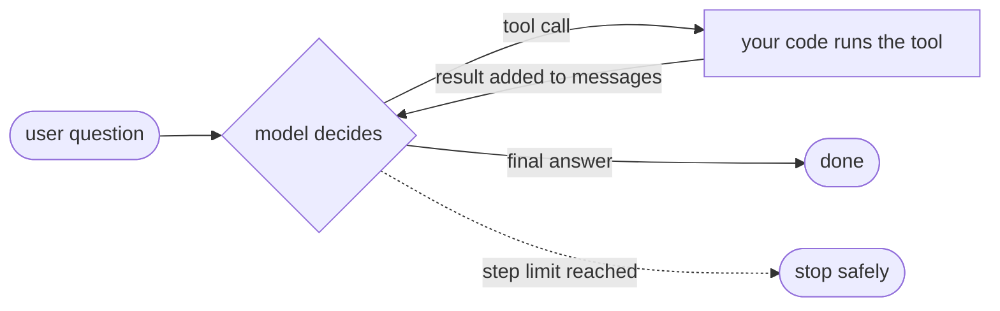

# Post 01 · What is an agent? (the loop, by hand)

*Series: [Lesson 02 — Agents with LangGraph](../README.md) · Post 1 of 8 · about 30 minutes*

> A receptionist types: *"When is patient P-001 seeing radiology?"*
>
> One model call cannot answer that. The model first has to **look up** the appointments, **read** the result, and only then **answer**. Somebody has to run that "look, read, decide again" cycle. That somebody is the agent loop, and in this post you will write it yourself in 30 lines.

"Agent" is the most overloaded word in AI right now. Before any framework, let's pin down what it actually means in code. Once you have written the loop by hand, LangGraph (the rest of this series) will feel like structure on top of something you already understand, not magic.

---

## The idea, in plain English

### An agent is a loop with a goal

In [lesson 01, post 08](../../01-foundations-structured-output/08-tool-calling/README.md) the model asked for a tool and the AI SDK ran it. An **agent** is the same idea, repeated until the job is done:

1. **Decide.** The model reads the whole conversation so far and picks the next action: call a tool, or give the final answer.
2. **Act.** If it asked for a tool, **your code** runs it. The model never runs anything.
3. **Observe.** The tool's result is added to the conversation.
4. Go back to 1. Stop when the model gives a final answer, **or when you hit a step limit**.



That's it. Every agent framework (the AI SDK's tool loop, LangGraph, Mastra, OpenAI Agents) is this loop plus extra features.

### The three things that make it work

- **Memory = the message list.** The model has no memory of its own. "Remembering" the tool result simply means the result is in the `messages` array you send on the next call.
- **The decision signal.** After each call you check: did the model ask for tools (`finishReason = "tool-calls"`) or did it answer (`"stop"`)?
- **A step limit.** A confused model can ask for tools forever. A hard maximum (`MAX_STEPS`) protects your bill and your users.

### Agent or workflow?

Not everything needs an agent. Anthropic's article [*Building effective agents*](https://www.anthropic.com/research/building-effective-agents) draws a useful line:

| | **Workflow** | **Agent** |
|---|---|---|
| Who picks the next step? | **Your code** (fixed order) | **The model** (at run time) |
| Example | "classify note → route to urgent or routine" | "find this patient's appointment and cancel it" |
| Predictable? | Yes, test it like normal code | Less; needs limits, evals, approval |

Prefer a workflow when the steps are known in advance. Use an agent when the model really must choose what to do next. LangGraph handles both, as you will see in posts 02 and 03.

---

## Let's see it in code

Open [`example.ts`](./example.ts). One tool, one question, and a visible loop.

> **Course helpers:** this example imports `chatModel`, `section`, `stripThinking` from `@learn/shared`, the small helper package every lesson uses so that no example names a model or provider. `chatModel()` returns the chat model named in `.env` (`CHAT_MODEL`), on whichever provider you configured; `section()` prints a bold heading in the console output; and `stripThinking()` removes a reasoning model's `<think>…</think>` text from a reply. See [the `@learn/shared` guide](../../shared/README.md) for every helper.

### Step 1 — a tool the model may ask for, but cannot run

```ts
const tools = {
  list_appointments: tool({
    description: 'List all appointments for a patient id like P-001.',
    inputSchema: z.object({ patientId: z.string() }),
  }),
};
```

This looks like lesson 01's tool, with one thing missing: there is **no `execute`**. Without it, the AI SDK stops as soon as the model asks for the tool and hands the request to us. That is exactly what we want here, because we are going to be the loop.

### Step 2 — our code does the work

```ts
function runTool(name: string, input: unknown): JSONValue {
  if (name === 'list_appointments') {
    const { patientId } = input as { patientId: string };
    return appointments.filter((a) => a.patientId === patientId);
  }
  return { error: `Unknown tool ${name}` };
}
```

A plain function that looks up the in-memory appointment book. Notice the last line: if the model asks for a tool that doesn't exist, we return an error **as data**, so the model can read it and correct itself, instead of crashing.

### Step 3 — the conversation is the memory, and the loop has a limit

```ts
const MAX_STEPS = 5; // the safety limit every agent needs
const messages: ModelMessage[] = [{ role: 'user', content: 'When is patient P-001 seeing radiology?' }];
```

`messages` grows on every step. `MAX_STEPS` is the cap from the theory.

### Step 4 — decide

```ts
const result = await generateText({
  model: chatModel(),
  instructions: 'You help hospital front-desk staff. Use the tools to look things up. Never invent appointments.',
  tools,
  messages, // the WHOLE conversation so far: this is the agent's memory
  temperature: 0,
});
messages.push(...result.response.messages); // remember what the model said (text and/or tool calls)
```

One model call per step. We pass the **whole** `messages` array every time, then append whatever the model said (its tool-call request or its text) so the next step can see it.

### Step 5 — finished, or act and observe

```ts
if (result.toolCalls.length === 0) {
  console.log('Final answer:', stripThinking(result.text) || '(empty: the model gave no visible text)');
  break;
}
```

No tool calls means the model has decided to answer: leave the loop.

```ts
for (const call of result.toolCalls) {
  const output = runTool(call.toolName, call.input);
  console.log(`model asked: ${call.toolName}(${JSON.stringify(call.input)})`);
  console.log(`we returned: ${JSON.stringify(output)}`);
  messages.push({
    role: 'tool',
    content: [{ type: 'tool-result', toolCallId: call.toolCallId, toolName: call.toolName, output: { type: 'json', value: output } }],
  });
}
```

Otherwise we **act** (run each requested tool) and **observe** (push a `tool` message with the result). The `toolCallId` links each result to the request it answers; models and providers reject a conversation where they don't match.

The loop then goes round again, and the model decides with the new facts in front of it.

---

## Run it

From the lesson folder (your `CHAT_MODEL` must support tool calling):

```bash
npm run post:01
# or: npx tsx 01-what-is-an-agent/example.ts
```

### What you should see

- **Step 1**: `finishReason = tool-calls`, then `model asked: list_appointments({"patientId":"P-001"})` and the two appointments your code returned.
- **Step 2**: `finishReason = stop` and a final answer like *"P-001 is seeing radiology on 2026-11-05 at 14:00."*

On the box this was tested with a 0.6 B model. Most runs looked exactly like that. Two kinds of bad run also happened, and both are worth recognising:

- **Step 1 ends with `stop`** and the text *"I need to look up the appointments… let me check."* The model *said* it would use the tool but never asked for it. The loop correctly stops, because there is no tool call.
- **An empty final answer.** Some "thinking" models spend the whole reply inside `<think>…</think>`, which `stripThinking` removes.

## Common gotchas

- ❌ **No step limit.** A loop without `MAX_STEPS` (or `stopWhen`, or LangGraph's `recursionLimit`) is a production incident waiting to happen.
- ❌ **Forgetting to push the model's own message.** If you only push the tool results, the provider sees a result for a call that never happened and rejects the request.
- ❌ **Throwing on unknown tools or bad input.** Return an error as data so the model can fix its next step.
- ❌ **Calling something an agent when it is a workflow.** If the steps never change, write normal code and call the model only where you need language.
- ✅ Log every step (what was asked, what was returned). That log is how you debug agents.

## Try it yourself

1. Change the question to *"Does P-002 have any appointments?"*. What does your code return, and what does the model say?
2. Set `MAX_STEPS = 1`. What happens, and why?
3. Add a second tool, `get_department_phone({ dept })`, and ask *"When is P-001 seeing radiology, and what is radiology's phone number?"*. How many steps does it take?

## Key takeaways

- An **agent** = a model in a **loop**: decide → act → observe, until it answers or hits a **step limit**.
- The model only **asks**; your code **acts**.
- The agent's memory is just the **message list** you send each time.
- Use a **workflow** when you know the steps; use an **agent** when the model must choose them.

---

[← Previous: Lesson 01 — Foundations](../../01-foundations-structured-output/README.md) · [📚 Series index](../README.md) · [Next: State graphs →](../02-state-graphs/README.md)
