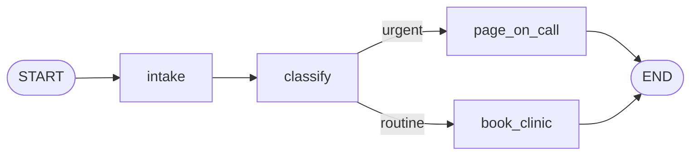

# Post 02 · State graphs: state, nodes and edges

*Series: [Lesson 02 — Agents with LangGraph](../README.md) · Post 2 of 8 · about 40 minutes*

> A triage note arrives: *"Severe chest pain since 20 minutes, sweating."* It must be cleaned up, classified, and then **either** page the on-call doctor **or** offer a clinic slot. Never both, never neither.
>
> You could write that as nested `if`s inside one big function. Then someone asks: "add an approval step here", "retry that call", "show me exactly which steps ran for ticket 4711". A graph makes all of those easy, and this post builds one without a single model call.

In [post 01](../01-what-is-an-agent/README.md) the loop lived inside a `for`. That's fine for one tool. As soon as you need branches, retries, pauses and an audit trail, you want the control flow written down as a **graph** that you can see, test and change. That is what LangGraph gives you.

---

## The idea, in plain English

### Three building blocks

A LangGraph app is made of three things:

1. **State.** One typed object that travels through the whole run. Here: the note, its urgency, and an audit trail. Think of it as the "ticket" every step can read.
2. **Nodes.** Plain `async` functions. A node receives the current state and returns **only the fields it wants to change** (a *partial update*). It never edits the state directly.
3. **Edges.** Which node runs next.
   - A **normal edge** always goes to the same place (`intake → classify`).
   - A **conditional edge** calls a small *router* function that looks at the state and returns the name of the next node.
   - Two special names: `START` (where every run begins) and `END` (where it finishes).



### Reducers: how updates are combined

When a node returns `{ urgency: 'urgent' }`, LangGraph has to merge that into the state. The rule for each field is its **reducer**:

- **Default (last value wins):** the new value replaces the old one. Good for `urgency`.
- **Custom reducer:** you decide. For an audit trail you want to **append**, not replace, so each node can add one line without knowing what the others wrote.

You will meet a built-in reducer in the next post: `MessagesValue`, which appends chat messages.

### Why a graph and not just functions?

- **You can see it.** LangGraph can draw the graph as a diagram (the example prints one).
- **Policy lives between steps.** Approval gates, retries and limits attach to nodes and edges, not to prompts.
- **Every step is a checkpoint.** In post 06 you will see the state saved after each node, which gives you memory, audit and resume-after-crash for free.

A graph with no model is just a **workflow** (post 01's table). Post 03 puts a model in one node and turns it into an **agent**.

---

## Let's see it in code

Open [`example.ts`](./example.ts). No model, so the output is completely predictable.

> **Course helpers:** this example imports `section` from `@learn/shared`, the small helper package every lesson uses so that no example names a model or provider. `section()` prints a bold heading in the console output. See [the `@learn/shared` guide](../../shared/README.md) for every helper.

### Step 1 — the state

```ts
const TriageState = new StateSchema({
  note: z.string(), // plain field: a new value REPLACES the old one
  urgency: z.enum(['unknown', 'routine', 'urgent']).default('unknown'),
  // ReducedValue: a REDUCER decides how updates combine. Here: append to the audit trail.
  trail: new ReducedValue(z.array(z.string()).default(() => []), {
    inputSchema: z.string(),
    reducer: (current, next) => [...current, next],
  }),
});
```

Each field is a Zod schema, so the state is typed and validated, just like structured output in lesson 01.

- `note` and `urgency` use the default "last value wins".
- `trail` is a `ReducedValue`: it **stores** an array of strings, but a node **sends** one string (`inputSchema`), and the `reducer` appends it.

### Step 2 — nodes return partial updates

```ts
const intake: GraphNode<typeof TriageState> = async (state) => {
  return { note: state.note.trim(), trail: 'intake: note received' };
};
```

`GraphNode<typeof TriageState>` gives you full typing: `state.note` is a `string`, and TypeScript rejects a return value with a field the state doesn't have.

```ts
const classify: GraphNode<typeof TriageState> = async (state) => {
  // A rule, not a model — so you can predict the result. (Post 03 lets a model decide.)
  const urgent = /chest pain|breathless|unconscious|bleeding/i.test(state.note);
  return { urgency: urgent ? 'urgent' : 'routine', trail: `classify: ${urgent ? 'urgent' : 'routine'}` };
};
```

`classify` returns two fields. `urgency` replaces the old value; `trail` gets one more line appended. Neither node knows or cares what the others wrote.

### Step 3 — edges, including a conditional one

```ts
const graph = new StateGraph(TriageState)
  .addNode('intake', intake)
  .addNode('classify', classify)
  .addNode('page_on_call', pageOnCall)
  .addNode('book_clinic', bookClinic)
  .addEdge(START, 'intake') // normal edge: always go here next
  .addEdge('intake', 'classify')
```

Register every node by name, then connect them. The chain reads like the diagram.

```ts
.addConditionalEdges(
  'classify',
  (state) => (state.urgency === 'urgent' ? 'page_on_call' : 'book_clinic'), // the ROUTER function
  ['page_on_call', 'book_clinic'], // every place it may go (used for checks and drawings)
)
```

The router is ordinary TypeScript. It reads the state *after* `classify` has run and returns the next node's name. The third argument lists every possible target, so LangGraph can check the wiring when you `compile()` and draw the dashed lines in the diagram.

```ts
.addEdge('page_on_call', END)
.addEdge('book_clinic', END)
.compile();
```

`compile()` checks the graph (no dangling nodes, every target exists) and returns something you can run.

### Step 4 — run it

```ts
const final = await graph.invoke({ note });
console.log('urgency =', final.urgency);
final.trail.forEach((line, i) => console.log(`  ${i + 1}. ${line}`));
```

`invoke()` takes the **starting** state and returns the **final** state after `END`. The trail shows exactly which nodes ran, in which order.

To see the **whole** value `invoke()` returned, not just two fields, the file prints it with the toolkit's `dump()` ([what it is](../../shared/README.md#dumplabel-value--print-the-full-returned-value)). It does this only for the **first** note. The second note returns the same shape, so the file prints just its `note` field:

```ts
if (firstNote) {
  // The full value invoke() returned: the FINAL STATE, a plain object with every field of the schema.
  // Notice: `note` is trimmed (intake replaced it), `urgency` was set by classify, and `trail`
  // has one entry per node because its reducer APPENDS instead of replacing.
  // We dump it in full only for the FIRST note: the second note returns the same shape.
  dump('graph.invoke() result (final state)', final);
  firstNote = false;
} else {
  // Same shape as above, so we only print the `note` field of the final state.
  console.log('final state note =', final.note);
}
```

The dump is a plain object with one key per field of the schema: `note` (trimmed, because `intake` returned a new value and a plain field is **replaced**), `urgency` (set by `classify`; it started as the default `'unknown'`) and `trail` (one entry per node, because its reducer **appends**). Nothing else: no history, no node list. The state is all you get back.

```ts
console.log((await graph.getGraphAsync()).drawMermaid());
```

This prints the graph as a Mermaid diagram. Paste it into any Markdown preview (VS Code, GitHub) to see your workflow drawn for you.

---

## Run it

From the lesson folder (no model needed):

```bash
npm run post:02
# or: npx tsx 02-state-graphs/example.ts
```

### What you should see

- The chest-pain note: `urgency = urgent`, then a trail of `intake`, `classify: urgent`, `page_on_call`.
- The knee-pain note: `urgency = routine`, then `intake`, `classify: routine`, `book_clinic`.
- After the first trail, the full final state from `dump`. After the second trail, only its `note`.
- A Mermaid diagram where `classify -.-> page_on_call` and `classify -.-> book_clinic` are dashed lines (conditional edges).

A real run (no model, so yours will match, trimmed at `…`):

```
── Note: "Severe chest pain since 20 minutes, sweating." ───────
urgency = urgent
  1. intake: note received
  2. classify: urgent
  3. page_on_call: on-call doctor paged
▼ graph.invoke() result (final state)
{
  note: 'Severe chest pain since 20 minutes, sweating.',
  urgency: 'urgent',
  trail: [ 'intake: note received', 'classify: urgent', 'page_on_call: on-call doctor paged' ]
}

── Note: "Needs a repeat prescription for knee pain." ──────────
urgency = routine
  1. intake: note received
  2. classify: routine
  3. book_clinic: next free clinic slot offered
final state note = Needs a repeat prescription for knee pain.
…
```

## Common gotchas

- ❌ **Mutating `state` inside a node** (`state.trail.push(...)`). Return an update instead; LangGraph applies it through the reducer and records it in the checkpoint.
- ❌ **Returning the whole state from every node.** Return only what changed. With an append reducer, returning the whole `trail` again would duplicate it.
- ❌ **A router that returns a name not in its target list.** You get a runtime error. Keep the list complete.
- ✅ Keep routers small and pure: read the state, return a node name. Put the real work in nodes.

## Try it yourself

1. Add a `notify_family` node that runs after `page_on_call` and before `END`. Check the trail and the diagram.
2. Give `classify` a third outcome, `'unknown'`, for empty notes, and route it to a new `ask_nurse` node.
3. Replace the `trail` reducer with the default (just `z.array(z.string())`). What happens to the trail, and why?

## Key takeaways

- **State** is one typed object; **nodes** return partial updates; **edges** decide what runs next.
- A **reducer** says how an update is merged: replace by default, or append (or anything you write).
- **Conditional edges** route at run time with a plain function.
- A graph without a model is a **workflow**: predictable, testable, and already useful.

---

[← Previous: What is an agent?](../01-what-is-an-agent/README.md) · [📚 Series index](../README.md) · [Next: An LLM agent as a graph →](../03-agent-graph/README.md)
