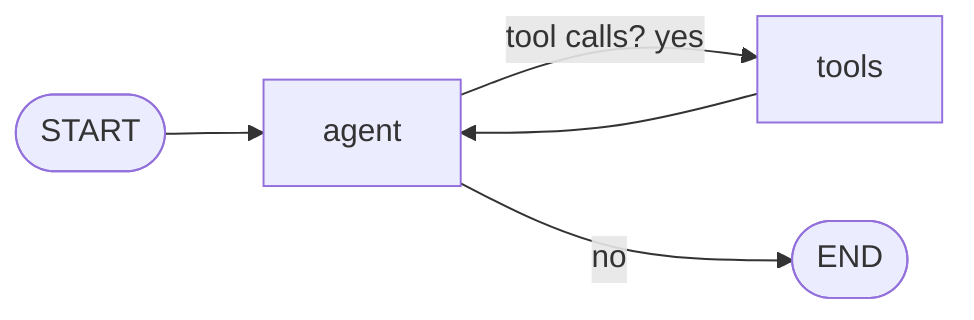

# Post 03 · An LLM agent as a graph (agent ⇄ tools)

*Series: [Lesson 02 — Agents with LangGraph](../README.md) · Post 3 of 8 · about 40 minutes*

> In post 01 you wrote the agent loop as a `for` loop. In post 02 you built a graph with no model. Now put them together: **the same "when is P-001 seeing radiology?" agent, as a two-node graph.**
>
> Why bother, if the `for` loop worked? Because every later post (retries, step limits, memory, human approval, handoffs) plugs into this graph without rewriting the loop.

This is the most important shape in the whole lesson. Almost every production LangGraph agent you will read at work starts as these two nodes and one conditional edge.

---

## The idea, in plain English

### The loop as a graph

Look at post 01's loop again: *decide → (tool calls?) → act → decide again*. Map each part to a graph piece:

| Post 01 loop | Graph piece |
|---|---|
| the `messages` array | **state** (`messages`, with an append reducer) |
| `generateText(...)` | the **`agent` node** (calls the model) |
| `runTool(...)` | the **`tools` node** (runs your code) |
| `if (toolCalls.length === 0) break` | a **conditional edge** after `agent` |
| "go round again" | a normal edge `tools → agent` |



### Messages as state

The state holds just one field, `messages`, using LangGraph's built-in **`MessagesValue`**. Its reducer **appends** whatever a node returns. So the `agent` node returns `[reply]` and the `tools` node returns `[toolResult]`, and the conversation grows exactly as it did in post 01.

LangGraph uses LangChain's message classes: `HumanMessage` (the user), `SystemMessage` (instructions), `AIMessage` (the model, possibly with `tool_calls`), `ToolMessage` (a tool's result, linked by `tool_call_id`).

### Testing without a model

Model output changes from run to run, so how do you test the graph itself? Swap the model for a **scripted model**: a function that returns fixed `AIMessage`s ("first ask for the tool, then answer"). Now routing, tools and state can be tested deterministically, and model *quality* is checked separately with evals (lesson 05).

### Streaming steps

`graph.stream(..., { streamMode: 'updates' })` yields one event **each time a node finishes**, with that node's update. That is perfect for logs, progress bars in a UI, or watching an agent think.

---

## Let's see it in code

Open [`example.ts`](./example.ts).

> **Course helpers:** this example imports `env`, `section`, `stripThinking` from `@learn/shared`, the small helper package every lesson uses so that no example names a model or provider. `env` gives typed access to the `.env` settings (provider, Ollama URL, model names); `section()` prints a bold heading in the console output; and `stripThinking()` removes a reasoning model's `<think>…</think>` text from a reply. See [the `@learn/shared` guide](../../shared/README.md) for every helper.

### Step 1 — a LangChain tool

```ts
const listAppointments = tool(
  async ({ patientId }) => JSON.stringify(appointments.filter((a) => a.patientId === patientId)),
  {
    name: 'list_appointments',
    description: 'List all appointments for a patient id like P-001. Read-only.',
    schema: z.object({ patientId: z.string() }),
  },
);
```

Same three parts as an AI SDK tool (name and description for the model, a Zod schema, your function), in LangChain's shape. The function returns a string because a `ToolMessage`'s content is text.

### Step 2 — state is just the conversation

```ts
const AgentState = new StateSchema({ messages: MessagesValue });
```

One line. `MessagesValue` is a ready-made `ReducedValue` that appends messages (and can also update a message by id).

### Step 3 — a real model, or a scripted one

```ts
function realModel(): CallModel {
  const llm = new ChatOllama({ model: env.chatModel, baseUrl: env.ollamaBaseUrl, temperature: 0, numPredict: 1024 });
  const withTools = llm.bindTools([listAppointments]); // tell the model which tools exist
  return (messages) => withTools.invoke(messages);
}
```

The model name and URL come from `.env` through `@learn/shared`. `bindTools` sends the tool descriptions with every call. `numPredict: 1024` caps the reply length, because small "thinking" models can otherwise ramble for minutes.

```ts
function scriptedModel(): CallModel {
  return async (messages) => {
    const lastMessage = messages.at(-1);
    if (!ToolMessage.isInstance(lastMessage)) {
      return new AIMessage({ content: '', tool_calls: [{ id: 'call-1', name: 'list_appointments', args: { patientId: 'P-001' } }] });
    }
    return new AIMessage('P-001 has radiology on 2026-11-05 at 14:00.');
  };
}
```

The scripted model has the same signature. If the last message is not a tool result, it asks for the tool; otherwise it answers. `--offline` picks this one.

### Step 4 — the two nodes

```ts
const agent: GraphNode<typeof AgentState> = async (state) => {
  const reply = await callModel([
    new SystemMessage('You help hospital front-desk staff. Use the tools to look things up. Never invent appointments.'),
    ...state.messages,
  ]);
  return { messages: [reply] }; // appended, thanks to MessagesValue
};
```

The `agent` node adds the system instructions in front of the conversation on every call (they are not stored in state), calls the model, and returns its reply.

```ts
const tools: GraphNode<typeof AgentState> = async (state) => {
  const last = state.messages.at(-1) as AIMessage;
  const results: ToolMessage[] = [];
  for (const call of last.tool_calls ?? []) {
    const output = await listAppointments.invoke(call.args as { patientId: string }); // args checked by the tool's schema
    results.push(new ToolMessage({ tool_call_id: call.id!, name: call.name, content: String(output) }));
  }
  return { messages: results };
};
```

The `tools` node reads the tool calls from the model's last message, runs each one, and returns one `ToolMessage` per call, linked by `tool_call_id`. `tool.invoke` validates the arguments against the Zod schema first.

### Step 5 — the loop is two edges

```ts
.addConditionalEdges(
  'agent',
  (state) => {
    const last = state.messages.at(-1);
    return last && AIMessage.isInstance(last) && last.tool_calls?.length ? 'tools' : END;
  },
  ['tools', END],
)
.addEdge('tools', 'agent') // after the tools, the model looks again
```

The router is post 01's `if`: tool calls → `tools`, otherwise `END`. The plain edge `tools → agent` closes the loop.

### Step 6 — stream node-by-node updates

```ts
const stream = await graph.stream(
  { messages: [new HumanMessage('When is patient P-001 seeing radiology?')] },
  { streamMode: 'updates' },
);
for await (const update of stream) {
  for (const [node, delta] of Object.entries(update)) {
```

Each `update` looks like `{ agent: { messages: [...] } }` or `{ tools: { messages: [...] } }`: the node's name and what it returned. The example prints one line per message.

---

## Run it

From the lesson folder:

```bash
npm run post:03:offline   # scripted model: always the same output
npm run post:03           # your CHAT_MODEL through Ollama
# or: npx tsx 03-agent-graph/example.ts [--offline]
```

### What you should see

Three lines, in this order:

```
[agent] ai:  → asks for [["list_appointments",{"patientId":"P-001"}]]
[tools] tool: [{"id":"A-100",...},{"id":"A-101",...,"dept":"radiology","when":"2026-11-05 14:00"}]
[agent] ai: Patient P-001 is seeing radiology on 2026-11-05 14:00.
```

The offline run always looks like this. The live run did too on the box with a 0.6 B model; only the wording of the last line changes.

## Common gotchas

- ❌ **Putting the system prompt into state.** It then gets saved in every checkpoint and is hard to change. Add it inside the `agent` node.
- ❌ **Forgetting `tool_call_id`.** Every `ToolMessage` must point at the call it answers, or the next model call fails.
- ❌ **Testing the graph only with a live model.** A scripted model makes routing bugs show up every time instead of "sometimes".
- ✅ This folder uses `ChatOllama`. For Azure or Bedrock, swap in `AzureChatOpenAI` or `ChatBedrockConverse`; nodes and edges stay the same.
- ✅ LangGraph also ships a prebuilt `ToolNode` and `createReactAgent`. Use them once you understand what they do; this post builds them by hand so you do.

## Try it yourself

1. Add a second tool, `get_department_phone({ dept })`, bind it, and dispatch by `call.name` in the `tools` node.
2. Change the scripted model so it asks for **two** tools in one message. Does the `tools` node handle both?
3. Try `streamMode: 'values'` instead of `'updates'`. What is different about each event?

## Key takeaways

- An agent graph = **`agent` node** (model) + **`tools` node** (your code) + a **conditional edge** + an edge back.
- `MessagesValue` makes the conversation the state and appends to it.
- A **scripted model** lets you test the graph with no LLM.
- `streamMode: 'updates'` shows each node's work as it happens.

---

[← Previous: State graphs](../02-state-graphs/README.md) · [📚 Series index](../README.md) · [Next: Retries and failure recovery →](../04-retries-and-recovery/README.md)
