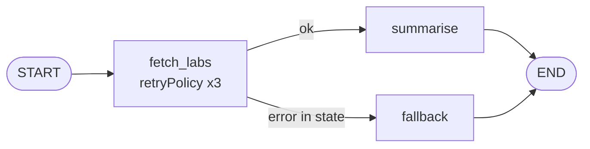

# Post 04 · Retries and failure recovery

*Series: [Lesson 02 — Agents with LangGraph](../README.md) · Post 4 of 8 · about 30 minutes*

> 07:55, Monday. Everyone logs in at once and the lab system starts timing out. Your agent asks for Mrs. Al-Harbi's HbA1c and gets `Lab API timeout`.
>
> Should it crash? Try again? Make up a number? (Please, not that.) This post gives a clear answer for each kind of failure, using two graph features: a **retry policy** and a **fallback path**.

Agents call many systems: lab, pharmacy, scheduling, the model itself. Each will fail sometimes. A demo can ignore that; a hospital system cannot.

---

## The idea, in plain English

### Two kinds of failure

| | **Temporary (transient)** | **Lasting** |
|---|---|---|
| Example | a timeout, a 503, a rate limit | the lab system is down for maintenance |
| What helps | **wait a little and try again** | **stop trying** and do something sensible instead |
| Graph tool | `retryPolicy` on the node | a **conditional edge** to a **fallback node** |

### Retry with exponential backoff

A **retry policy** says: "if this node throws, run it again, up to N times, waiting a bit longer each time". Waiting longer each time (100 ms, 200 ms, 400 ms…) is called **exponential backoff**. It gives the struggling system room to recover instead of hammering it.

In LangGraph you attach it to a node:

```
retryPolicy: { maxAttempts: 3, initialInterval: 100, backoffFactor: 2 }
attempt 1 → fails → wait 100 ms → attempt 2 → fails → wait 200 ms → attempt 3
```

**Only retry what is safe to repeat.** Reading lab results twice is harmless (*idempotent*). Booking an appointment twice is not. Never put a retry on a node that changes data unless the downstream API ignores duplicates.

### Fallback: fail honestly

When the retries run out, the node stops throwing and **records the failure in the state** (`error: '...'`). A conditional edge then routes to a **fallback node** that tells the user what happened and what to do next. The rule for fallbacks in healthcare: **never invent the missing data.**



Lesson 06 (guardrails) adds model fallbacks (try a second model) and circuit breakers; this post covers the graph mechanics.

---

## Let's see it in code

Open [`example.ts`](./example.ts). No model: a fake lab API fails as many times as we tell it to.

> **Course helpers:** this example imports `section` from `@learn/shared`, the small helper package every lesson uses so that no example names a model or provider. `section()` prints a bold heading in the console output. See [the `@learn/shared` guide](../../shared/README.md) for every helper.

### Step 1 — a flaky API

```ts
async function labApi(patientId: string) {
  calls++;
  if (calls <= failTimes) {
    console.log(`  ↳ lab API call #${calls}: timeout`);
    throw new Error('Lab API timeout');
  }
  console.log(`  ↳ lab API call #${calls}: ok`);
  return { patientId, hba1c: '7.9 %', ldl: '3.1 mmol/L' };
}
```

`failTimes` controls the scenario: 2 means "fails twice, then works"; 99 means "down".

### Step 2 — the node: throw to retry, return an error to give up

```ts
const fetchLabs: GraphNode<typeof LabState> = async (state) => {
  attempt++;
  try {
    return { labs: await labApi(state.patientId) };
  } catch (e) {
    // Not the last attempt yet → re-throw, so the retryPolicy runs this node again.
    if (attempt < MAX_ATTEMPTS) throw e;
    // Last attempt also failed → stop retrying and RECORD the failure in state instead.
    return { error: (e as Error).message };
  }
};
```

This is the heart of the post. A node communicates with the retry policy by **throwing**. On the last attempt it stops throwing and turns the failure into **data** (`error`) that the graph can route on. (The example counts attempts in a module variable to keep it short. In a real service you would keep that count per request, for example in state.)

### Step 3 — attach the retry policy

```ts
.addNode('fetch_labs', fetchLabs, {
  // Retry with exponential backoff: wait 100 ms, then 200 ms, ... up to maxAttempts runs in total.
  retryPolicy: { maxAttempts: MAX_ATTEMPTS, initialInterval: 100, backoffFactor: 2, logWarning: false },
})
```

The policy belongs to the **node**, not to the API client. That keeps "how hard do we try?" visible in the graph definition, next to the edges.

### Step 4 — route on the result

```ts
.addConditionalEdges('fetch_labs', (state) => (state.error ? 'fallback' : 'summarise'), ['summarise', 'fallback'])
```

Exactly the conditional edge from post 02: an error in state means fallback.

```ts
const fallback: GraphNode<typeof LabState> = async (state) => ({
  reply: `Lab results are unavailable right now (${state.error}). A ticket was raised; please check the lab portal.`,
});
```

The fallback says what failed and what to do next. It does not guess an HbA1c.

---

## Run it

From the lesson folder (no model needed):

```bash
npm run post:04
# or: npx tsx 04-retries-and-recovery/example.ts
```

### What you should see

- **A**: calls #1 and #2 time out, #3 is `ok`, then `Latest labs for P-001: {...}`. The user never noticed the outage.
- **B**: calls #1, #2 and #3 all time out, then `Lab results are unavailable right now (Lab API timeout). A ticket was raised...`.
- The run takes a few seconds: that is the backoff waiting between attempts.

## Common gotchas

- ❌ **Retrying non-idempotent actions** (book, cancel, send SMS). You may do it twice.
- ❌ **Retrying forever or without backoff.** You turn a slow system into a dead one.
- ❌ **Swallowing errors silently.** The fallback must be visible to the user and to your logs.
- ❌ **A fallback that guesses.** "Probably around 7 %" is worse than "unavailable".
- ✅ Retry the **model call** node too: model APIs return 429 and 503 like any other service.

## Try it yourself

1. Set `failTimes = 3` in scenario A. Which path runs now?
2. Change `backoffFactor` to `3` and time the run. How long does scenario B take?
3. Add a `retryOn` function to the policy so it retries only when the error message contains `timeout`, and make the API throw `Patient not found` once. Does it retry?

## Key takeaways

- **Temporary failure → retry** with exponential backoff (`retryPolicy` on the node).
- **Lasting failure → fallback**: record the error in state and route to a node that answers honestly.
- A node talks to the retry policy by **throwing**; it gives up by **returning** the error as data.
- Only retry what is safe to repeat.

---

[← Previous: An LLM agent as a graph](../03-agent-graph/README.md) · [📚 Series index](../README.md) · [Next: Step limits →](../05-step-limits/README.md)
