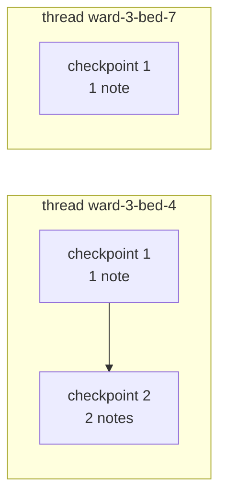

# Post 06 · Checkpoints, threads and memory

*Series: [Lesson 02 — Agents with LangGraph](../README.md) · Post 6 of 8 · about 40 minutes*

> 10:00, a nurse tells the ward assistant: *"The patient in bed 4 is Rahul Menon. He is allergic to penicillin."*
>
> 10:05, she asks: *"What is the patient in bed 4 allergic to?"* The assistant must answer "penicillin", and the nurse on bed 7's chat must **not** see it. And if the server restarts at 10:03, nothing should be lost.

A model has no memory between calls (lesson 01, post 02). So where does an agent's "memory" come from? In LangGraph the answer is one object: the **checkpointer**. Get this post right and posts 07 (human approval) and 08 (handoffs) become easy.

---

## The idea, in plain English

### Checkpoints

A **checkpointer** saves the graph's whole state **after every step**. Each saved copy is a **checkpoint**. You add one when you compile: `.compile({ checkpointer })`.

### Threads

Each checkpoint belongs to a **thread**, named by a `thread_id` you choose: a chat session id, a ticket number, `ward-3-bed-4`. When you invoke with a `thread_id`:

1. LangGraph **loads** the latest checkpoint of that thread (if any),
2. **adds** your new input to it (through the reducers),
3. runs the graph and **saves** new checkpoints as it goes.

Same thread → the run continues from where the last one stopped. New thread → a fresh, empty state. That is all "memory" means here.



### Where checkpoints are stored

| Checkpointer | Stored in | Survives a restart? | Use for |
|---|---|---|---|
| `MemorySaver` | RAM | ❌ | tests, demos |
| `SqliteSaver` | a SQLite file | ✅ | one server, local apps, this course |
| `PostgresSaver` | Postgres | ✅ | production with several servers |

The graph code is identical for all three; only the `checkpointer` you pass to `compile()` changes.

### What you get for free

- **Memory** per conversation (`thread_id`).
- **History**: every checkpoint is kept, so you can read the full trail (`getStateHistory`) for audits or debugging, and even re-run from an older one ("time travel").
- **Durability**: with a file or database saver, a crash or deploy loses nothing. Post 07 builds on this to pause a run for hours.

---

## Let's see it in code

Open [`example.ts`](./example.ts). Parts A and B need no model; part C uses your `CHAT_MODEL`.

> **Course helpers:** this example imports `env`, `section`, `stripThinking` from `@learn/shared`, the small helper package every lesson uses so that no example names a model or provider. `env` gives typed access to the `.env` settings (provider, Ollama URL, model names); `section()` prints a bold heading in the console output; and `stripThinking()` removes a reasoning model's `<think>…</think>` text from a reply. See [the `@learn/shared` guide](../../shared/README.md) for every helper.

### Step 1 — a tiny graph that records notes

```ts
function buildNotesGraph(checkpointer: BaseCheckpointSaver) {
  return new StateGraph(NotesState).addNode('record', record).addEdge(START, 'record').addEdge('record', END).compile({ checkpointer });
}
```

One node that does nothing: the input message is already appended to `messages` by the reducer. We take the checkpointer as a parameter so we can try different ones.

### Step 2 — two threads, one MemorySaver

```ts
const notes = buildNotesGraph(new MemorySaver());
const bed4 = { configurable: { thread_id: 'ward-3-bed-4' } };
const bed7 = { configurable: { thread_id: 'ward-3-bed-7' } };
```

The `thread_id` goes in `configurable`, the place for per-run settings.

```ts
await notes.invoke(note('08:00 BP 150/95, gave amlodipine.'), bed4);
await notes.invoke(note('12:00 BP 135/85, patient comfortable.'), bed4); // same thread → added to the first
await notes.invoke(note('09:00 Admitted with fever.'), bed7); // different thread → separate memory
```

Three separate `invoke` calls. Bed 4's second note lands next to its first; bed 7 starts empty.

```ts
const { values } = await notes.getState(cfg); // read the latest checkpoint of a thread
```

`getState` reads a thread's latest checkpoint without running anything.

The file also prints one whole snapshot with the toolkit's `dump()` ([what it is](../../shared/README.md#dumplabel-value--print-the-full-returned-value)), so you can see everything a checkpoint holds:

```ts
dump('notes.getState(bed4)', await notes.getState(bed4));
```

| Field | What it is |
|---|---|
| `values` | The state itself: here `messages`, both of bed 4's `HumanMessage`s. |
| `next` | Which node(s) would run next. `[]` means the run finished. (Post 07 shows a paused thread, where this is `['approval']`.) |
| `tasks` | The tasks waiting to run, with any `interrupts`. Empty here. |
| `config.configurable` | The `thread_id` **and** the `checkpoint_id` of this exact snapshot. Pass that id back in a config to read or resume from an older checkpoint ("time travel"). |
| `metadata` | `source` (`'input'` or `'loop'`) and `step`, which counts super-steps on this thread across **all** its runs. |
| `createdAt` | When the checkpoint was written. |
| `parentConfig` | The `checkpoint_id` of the snapshot before this one: the checkpoints form a chain, which is what `getStateHistory` walks. |

### Step 3 — the history

```ts
for await (const snapshot of notes.getStateHistory(bed4)) {
  console.log(`  checkpoint ${++n}: ${snapshot.values.messages?.length ?? 0} message(s), next = [${snapshot.next.join(', ')}]`);
}
```

Newest first. Each run of bed 4 left several checkpoints (input received, before `record`, after `record`), and `next` shows which node was about to run. This is your audit trail.

### Step 4 — survive a restart with SqliteSaver

```ts
const before = buildNotesGraph(SqliteSaver.fromConnString(dbPath));
await before.invoke(note('22:00 Night shift: patient asleep, pain 2/10.'), bed4);
```

Same graph, now saving to `data/notes.db`.

```ts
// Pretend the server restarted: a NEW saver, a NEW graph object, same file, same thread id.
const after = buildNotesGraph(SqliteSaver.fromConnString(dbPath));
await after.invoke(note('06:00 Morning: asked for breakfast.'), bed4);
```

Nothing is shared in memory between `before` and `after`; only the file. Yet the morning note joins the night note. (Post 07 does this across two real processes.)

### Step 5 — (live) memory for a chat model

```ts
const chat: GraphNode<typeof NotesState> = async (state) => ({
  messages: [await llm.invoke([new SystemMessage('You are a ward assistant. Answer in one short sentence.'), ...state.messages])],
});
```

Now the node calls the model with the whole conversation from the checkpoint.

```ts
await chatGraph.invoke(note('The patient in bed 4 is Rahul Menon. He is allergic to penicillin.'), t1);
const same = await chatGraph.invoke(note('What is the patient in bed 4 allergic to?'), t1);
const other = await chatGraph.invoke(note('What is the patient in bed 4 allergic to?'), t2);
```

The same question on two threads. Only thread `t1` has the earlier message in its checkpoint, so only there can the model answer.

```ts
// We do not dump the whole final state here: post 02 showed a full invoke() state, and the getState()
// snapshot above showed what a checkpoint holds. We only print the number of messages.
// Notice: `messages` holds BOTH turns (4 messages: question, answer, question, answer): the
// checkpointer loaded the first turn before the model ran. The last one is printed above ("same thread").
console.log('messages in the same-thread state:', same.messages.length);
```

This shows *how* the model "remembered": the `t1` state holds **four** messages, the first turn's question and answer followed by the second turn's. The checkpointer loaded the first two before the `chat` node ran. The model sees the whole list every time; it has no memory of its own. We saw a full `invoke()` final state in [post 02](../02-state-graphs/README.md#step-4--run-it), and Post 03 has [a table of the message fields](../03-agent-graph/README.md#step-6--stream-node-by-node-updates) (such as `usage_metadata`).

---

## Run it

From the lesson folder:

```bash
npm run post:06:offline   # parts A + B, no model
npm run post:06           # A + B + C (C uses CHAT_MODEL)
# or: npx tsx 06-checkpoints-and-memory/example.ts [--offline]
```

### What you should see

- **A**: bed 4 has two notes, bed 7 has one. Then six checkpoints for bed 4, newest first (2, 2, 1, 1, 1, 0 messages).
- **B**: bed 4 after "restart" has both the 22:00 and the 06:00 note.
- **C**: `same thread : The patient in bed 4, Rahul Menon, is allergic to penicillin.` and `new thread  :` something like *"Please provide more context…"*. That was the box's 0.6 B model; a larger one answers the same way, more politely. Then `messages in the same-thread state: 4`.

A real run with a small `qwen3:0.6b` (trimmed at `…`; message ids, checkpoint ids, times and the model's wording will differ):

```
── A. MemorySaver — same thread continues, other thread starts empty 
bed 4: [
  '08:00 BP 150/95, gave amlodipine.',
  '12:00 BP 135/85, patient comfortable.'
]
bed 7: [ '09:00 Admitted with fever.' ]
▼ notes.getState(bed4)
{
  values: {
    messages: [
      HumanMessage {
        text: '08:00 BP 150/95, gave amlodipine.',
        contentBlocks: [ { type: 'text', text: '08:00 BP 150/95, gave amlodipine.' } ],
        id: '0b1374f9-8fbf-4b74-8034-afaafb7f0d28',
        content: '08:00 BP 150/95, gave amlodipine.',
        additional_kwargs: {},
        response_metadata: {},
        type: 'human'
      },
      HumanMessage {
        text: '12:00 BP 135/85, patient comfortable.',
        …
      }
    ]
  },
  next: [],
  tasks: [],
  metadata: { source: 'loop', step: 4, parents: {}, thread_id: 'ward-3-bed-4' },
  config: {
    configurable: {
      thread_id: 'ward-3-bed-4',
      checkpoint_id: '1f1cfbf1-5a62-6830-8004-88585d2354d4',
      checkpoint_ns: ''
    }
  },
  createdAt: '2026-10-24T15:25:03.411Z',
  parentConfig: {
    configurable: {
      thread_id: 'ward-3-bed-4',
      checkpoint_ns: '',
      checkpoint_id: '1f1cfbf1-5a5d-6a10-8003-8b8f7818af80'
    }
  }
}
  (hidden for readability: values.messages[].lc_* — set SHOW_RAW=1 to print everything)
  checkpoint 1: 2 message(s), next = []
  checkpoint 2: 2 message(s), next = [record]
  checkpoint 3: 1 message(s), next = [__start__]
  checkpoint 4: 1 message(s), next = []
  checkpoint 5: 1 message(s), next = [record]
  checkpoint 6: 0 message(s), next = [__start__]

── B. SqliteSaver — state in a file, read back by a brand-new saver 
bed 4 after "restart": [
  '22:00 Night shift: patient asleep, pain 2/10.',
  '06:00 Morning: asked for breakfast.'
]

── C. A chat model remembers earlier turns — on the same thread only 
same thread : The patient in bed 4 is allergic to penicillin.
new thread  : Please provide more context or details about the patient in bed 4 so I can assist you effectively.   ← it has never heard of bed 4
messages in the same-thread state: 4
```

## Common gotchas

- ❌ **Using a user-controlled value as `thread_id` without checks.** If a user can pick another user's thread id, they can read that conversation. Derive it from the authenticated session.
- ❌ **`MemorySaver` in production.** All memory is gone on every deploy.
- ❌ **Letting threads grow forever.** Every message is sent to the model on every turn; old turns cost tokens and eventually overflow the context window (lesson 01, post 02). That is the week-2 exercise below.
- ✅ Keep the system prompt out of state (add it in the node), so prompt changes apply to old threads too.

## Try it yourself

1. In part A, print `getStateHistory(bed7)`. How many checkpoints, and why fewer than bed 4?
2. Delete `data/notes.db` between `before` and `after`. What does bed 4 contain now?
3. **Week-2 exercise from the learning map: a history-summarisation node.**
   - In part C's graph, add a `summarise` node **before** `chat`.
   - When `messages` is longer than N (say 6), ask the model for a 2-sentence summary of the older messages, then return an update that **replaces** them with one `SystemMessage` holding the summary. (Look up `RemoveMessage` in LangChain, or keep a separate `summary` field in state.)
   - Have a 10-turn chat and check that the token count sent to the model stays flat.

## Key takeaways

- A **checkpointer** saves state after every step; a **`thread_id`** groups checkpoints into one conversation.
- Same thread = continue; new thread = start empty. That is the agent's **memory**.
- `MemorySaver` for tests, `SqliteSaver` / `PostgresSaver` when it must survive restarts. The graph doesn't change.
- `getState` and `getStateHistory` give you the current state and a full audit trail.

---

[← Previous: Step limits](../05-step-limits/README.md) · [📚 Series index](../README.md) · [Next: Human approval that survives a restart →](../07-human-approval/README.md)
