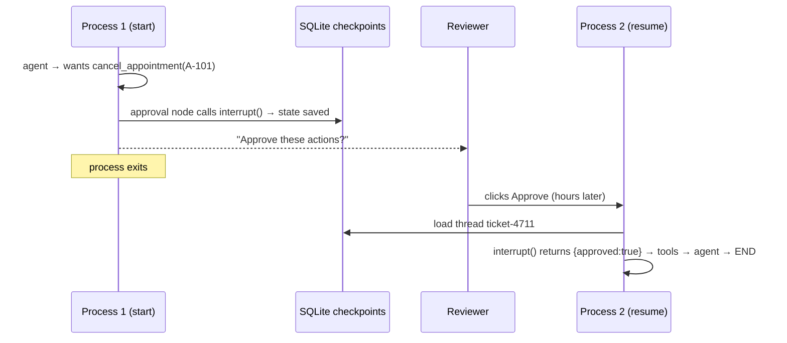

# Post 07 · Human approval that survives a restart

*Series: [Lesson 02 — Agents with LangGraph](../README.md) · Post 7 of 8 · about 45 minutes*

> *"Patient P-001 asked to cancel their radiology appointment. Please do it."*
>
> The agent finds appointment A-101 and is ready to cancel it. But cancelling is **irreversible**, so a human must say yes first. The reviewer is in a meeting until tomorrow. Meanwhile the server is redeployed twice.
>
> Tomorrow, the reviewer clicks **Approve**, and the agent carries on exactly where it stopped.

This is the feature that makes agents acceptable in regulated places like hospitals and banks, and the one most job postings mean by "human-in-the-loop". It combines everything so far: the agent graph (post 03), conditional edges (post 02) and durable checkpoints (post 06).

---

## The idea, in plain English

### Pause, save, resume

LangGraph has a function called **`interrupt(payload)`**. When a node calls it:

1. The graph **stops** right there.
2. The state is **saved** by the checkpointer (that's why you need one).
3. `invoke()` **returns** to your code, with the payload under `__interrupt__`, so you can show it to a reviewer.

Later (a second later, or a day later, from **any** process that can reach the same checkpoint store) you continue with:

```
graph.invoke(new Command({ resume: { approved: true, reviewer: 'dr.ashok' } }), { configurable: { thread_id } })
```

LangGraph loads the thread, re-runs the paused node from the top, and this time `interrupt()` **returns** the value you passed in `resume`.



### Policy in code, not in the prompt

Which actions need a human is a **business rule**, so it lives in code: `REQUIRES_APPROVAL = new Set(['cancel_appointment'])`. The prompt can be ignored by a model; a conditional edge cannot. Read-only tools go straight to `tools`; risky ones go through the `approval` node first.

### Approve or reject

- **Approved** → continue to the `tools` node and really cancel.
- **Rejected** → do not run the tool. Instead, answer the model's pending tool call with `"REJECTED by dr.ashok"`, so the model knows and can tell the user. (Every tool call must get an answer, or the next model call fails.)

### One subtle rule

On resume, the paused node runs **again from its first line**. So any code *before* `interrupt()` runs twice. Keep it free of side effects (no emails, no database writes before the interrupt).

---

## Let's see it in code

Open [`example.ts`](./example.ts). It is post 03's agent plus one node.

> **Course helpers:** this example imports `env`, `section`, `stripThinking` from `@learn/shared`, the small helper package every lesson uses so that no example names a model or provider. `env` gives typed access to the `.env` settings (provider, Ollama URL, model names); `section()` prints a bold heading in the console output; and `stripThinking()` removes a reasoning model's `<think>…</think>` text from a reply. See [the `@learn/shared` guide](../../shared/README.md) for every helper.

### Step 1 — a safe tool, a risky tool, and the policy

```ts
const cancelAppointment = tool(
  async ({ appointmentId }) => {
    const a = appointments.get(appointmentId);
    if (!a) return `No appointment ${appointmentId}`;
    a.status = 'cancelled';
    return `Appointment ${appointmentId} cancelled.`;
  },
  { name: 'cancel_appointment', description: 'Cancel ONE appointment by id like A-100.', schema: z.object({ appointmentId: z.string() }) },
);
```

`list_appointments` is the same read-only tool as before. `cancel_appointment` changes data.

```ts
// POLICY IN CODE, not in the prompt: which tools need a human.
const REQUIRES_APPROVAL = new Set(['cancel_appointment']);
```

### Step 2 — tell the model to act, and let the graph ask the human

```ts
'To act on an appointment, first call list_appointments to find its id, then call the action tool. ' +
'Do not ask for confirmation: the system asks a human before any risky action runs. ' +
```

This line in the system prompt matters. In testing, when the tool description said "needs human approval", small models stopped and asked the *user* for confirmation in text, so the graph never reached the approval node. The model's job is to propose; the graph's job is to ask.

### Step 3 — route risky calls to `approval`

```ts
(state) => {
  const calls = lastToolCalls(state);
  if (calls.length === 0) return END;
  return calls.some((c) => REQUIRES_APPROVAL.has(c.name)) ? 'approval' : 'tools';
},
```

The router after `agent` now has three exits. If any requested tool is on the list, go to `approval`.

### Step 4 — the approval node

```ts
const approval: GraphNode<typeof AgentState> = async (state) => {
  const risky = lastToolCalls(state).filter((c) => REQUIRES_APPROVAL.has(c.name));
  const decision = interrupt({ question: 'Approve these actions?', actions: risky }) as { approved: boolean; reviewer: string };
  if (decision.approved) return {}; // nothing to add; the edge below sends us to `tools`
```

The first time, `interrupt(...)` pauses here and its payload (the question and the exact actions) goes to the caller. On resume, the same line returns `{ approved, reviewer }`. Note that the line before it only *reads* state: safe to run twice.

```ts
return {
  messages: lastToolCalls(state).map((c) => new ToolMessage({ tool_call_id: c.id!, content: `REJECTED by ${decision.reviewer}` })),
};
```

On rejection, every pending call gets a "REJECTED" answer.

```ts
.addConditionalEdges('approval', (state) => (ToolMessage.isInstance(state.messages.at(-1)) ? 'agent' : 'tools'), ['agent', 'tools'])
```

After `approval`: if we just added rejection messages, go back to the `agent` to explain; otherwise run the `tools`.

### Step 5 — a durable checkpointer and a thread id

```ts
.compile({ checkpointer: SqliteSaver.fromConnString(dbPath) });
```

```ts
const config = { configurable: { thread_id: 'ticket-4711' }, recursionLimit: 20 }; // thread id = e.g. your support-ticket id
```

The `SqliteSaver` from post 06, and the step limit from post 05, side by side.

### Step 6 — `start`: run until the pause

```ts
const pending = (result as { __interrupt__?: { value: unknown }[] }).__interrupt__; // set when the graph paused
if (pending?.length) {
  console.log('⏸  Paused for approval:', JSON.stringify(pending[0]!.value, null, 2));
```

When the graph paused, `invoke` returns normally with `__interrupt__`. In a real app you would store this in a review queue and show it in a UI. Then the process simply ends.

```ts
dump('graph.invoke() result (paused)', result);
```

The whole value `invoke` returned, printed with the toolkit's `dump()` ([what it is](../../shared/README.md#dumplabel-value--print-the-full-returned-value)). It is the state so far (`messages`: the request, the `list_appointments` call and its result, and the `cancel_appointment` call) **plus** one extra key, `__interrupt__`: a list of `{ id, value }`, where `value` is exactly the object the approval node passed to `interrupt()`. Read the `args` there before approving: that's the whole point of this post (see the real run below).

### Step 7 — `resume`: a new process continues

```ts
const snapshot = await graph.getState(config);
console.log('Waiting at node(s):', snapshot.next);
```

A brand-new process loads the thread and sees it waiting at `approval`.

```ts
dump('graph.getState() snapshot', snapshot);
```

The same snapshot shape as in [post 06](../06-checkpoints-and-memory/README.md#step-2--two-threads-one-memorysaver), but for a **paused** thread: `next` is `['approval']`, and `tasks` holds the paused task with its `interrupts`, the same question the start run printed. This process never saw that question; it read it from SQLite.

```ts
const approved = process.argv.includes('--approve');
const result = await graph.invoke(new Command({ resume: { approved, reviewer: 'dr.ashok' } }), config);
```

`Command({ resume })` is the answer to the interrupt. The run continues to the end.

```ts
// We do not dump the whole final state again: the paused invoke() above showed that shape, and the
// line above already prints the final reply. We only print the last ToolMessage: it has the same
// `tool_call_id` as the cancel call, and says what the tool did on approve or "REJECTED by dr.ashok" on reject.
const toolMessages = result.messages.filter((m: BaseMessage) => ToolMessage.isInstance(m));
console.log('last tool message:', String(toolMessages.at(-1)?.content));
```

The final state holds the messages from **both** processes (the shape is the one we saw in the paused `invoke` above, so we do not dump it again). After the `cancel_appointment` call comes a `ToolMessage` with the same `tool_call_id`: what the tool did on approve, or `REJECTED by dr.ashok` on reject. That is the line we print.

---

## Run it

From the lesson folder. These are **two separate processes**: that is the point.

```bash
npm run post:07           # start: runs until the approval pause, then exits
npm run post:07:resume    # resume with --approve   (or: npm run post:07:reject)

# the same with the scripted model, no LLM:
npm run post:07:offline

# or: npx tsx 07-human-approval/example.ts start [--offline]
#     npx tsx 07-human-approval/example.ts resume --approve|--reject [--offline]
```

### What you should see

- **start**: `⏸  Paused for approval:` and a JSON payload with `cancel_appointment` and `{"appointmentId": "A-101"}`.
- **resume --approve**: `Waiting at node(s): [ 'approval' ]`, then `✅ approved → final:` *"Appointment A-101 has been cancelled…"*.
- **resume --reject**: `⛔ rejected → final:` a reply saying the cancellation was rejected.
- Around those lines, the dumped state: the paused result with its `__interrupt__` and the loaded snapshot. After resuming, only the last tool message is printed (`last tool message: …`), not the whole final state.

With a very small model (tested with 0.6 B and 1.7 B), **start** sometimes ends with `Finished without needing approval:` and an empty reply or *"Please provide the appointment ID"*. The model failed to call the tools at all. Run it again or use a larger `CHAT_MODEL`. Notice the safety property even then: **nothing was cancelled without approval**.

A real run with a small `qwen3:0.6b` (trimmed at `…`; ids, timestamps and tokens will differ, and so may the model's choices):

```
── start: the agent proposes a risky action ────────────────────
▼ graph.invoke() result (paused)
{
  messages: [
    HumanMessage { text: 'Patient P-001 asked to cancel their radiology appointment. Please do it.', … },
    AIMessage { … tool_calls: [ { name: 'list_appointments', args: { patientId: 'P-001' }, … } ], … },
    ToolMessage { … name: 'list_appointments', … },
    AIMessage {
      …
      tool_calls: [
        {
          name: 'cancel_appointment',
          args: { appointmentId: 'A-100' },
          id: 'c3089051-d1d5-4cdc-8fcc-f99940de92ee',
          type: 'tool_call'
        }
      ],
      …
    }
  ],
  __interrupt__: [
    {
      id: 'f8746d0e19f765eafa0cbc50b084735b',
      value: {
        question: 'Approve these actions?',
        actions: [
          {
            name: 'cancel_appointment',
            args: { appointmentId: 'A-100' },
            id: 'c3089051-d1d5-4cdc-8fcc-f99940de92ee',
            type: 'tool_call'
          }
        ]
      }
    }
  ]
}
  (hidden for readability: messages[].lc_* — set SHOW_RAW=1 to print everything)
⏸  Paused for approval: {
…

── resume: a NEW process continues from the checkpoint ─────────
Waiting at node(s): [ 'approval' ]
▼ graph.getState() snapshot
{
  values: { messages: [ … the same four messages … ] },
  next: [ 'approval' ],
  tasks: [
    {
      id: '539fd38e-1495-5c14-a3f6-eaf99af67a92',
      name: 'approval',
      path: [ '__pregel_pull', 'approval' ],
      interrupts: [
        {
          id: 'f8746d0e19f765eafa0cbc50b084735b',
          value: {
            question: 'Approve these actions?',
            actions: [
              {
                name: 'cancel_appointment',
                args: { appointmentId: 'A-100' },
                …
              }
            ]
          }
        }
      ]
    }
  ],
  metadata: { source: 'loop', step: 3, parents: {}, thread_id: 'ticket-4711' },
  …
}
…
✅ approved → final: The cancellation of appointment A-100 was successful.
last tool message: Appointment A-100 cancelled.
```

**Look at the `args`.** The patient asked to cancel **radiology**, which is `A-101`. In every live run on the box, this small model picked `A-100`, the **cardiology** appointment, and an approving human would have cancelled the wrong one. The dumped `__interrupt__` value is what a reviewer sees, and this is exactly the mistake the approval step exists to catch: here the right answer was `--reject`. (A possible nudge: the tool description's example id is `like A-100`.) The scripted `--offline` model asks for `A-101`, and a rejected run ends with a `ToolMessage` `REJECTED by dr.ashok` (tool_call_id `t2`) and the reply `Done. Last tool said: REJECTED by dr.ashok`.

## Common gotchas

- ❌ **Side effects before `interrupt()`.** They happen twice (once on pause, once on resume).
- ❌ **No checkpointer, or `MemorySaver` across processes.** There is nothing to resume from.
- ❌ **Approval rules in the prompt** ("always ask before cancelling"). Models skip them. Put them in an edge.
- ❌ **Mentioning approval to the model in the tool description.** Small models then ask the user instead of proposing the action.
- ✅ Show the reviewer the **exact** action and arguments (`A-101`), not the model's summary of it.
- ✅ Record who approved (`reviewer`) in the state: it is saved in the checkpoint history, which gives you an audit trail.

## Try it yourself

1. Run `start`, then `resume --reject`. What does the model say? Run `resume` again: what does it print now, and why?
2. Add `list_appointments` to `REQUIRES_APPROVAL` and run it. How many approvals does one request now need?
3. **Week-2 exercise from the learning map: a "clarifying question" interrupt.**
   - Add an `ask_user({ question })` tool to the model's tools.
   - When the model calls it, route to a `clarify` node that calls `interrupt({ question })`.
   - Resume with `new Command({ resume: 'the radiology one on 5 Nov' })` and turn the answer into a `ToolMessage`, so the agent continues with the user's answer.
   - Ask *"Cancel P-001's appointment"* (which one?) and check that it asks.

## Key takeaways

- **`interrupt(payload)`** pauses the graph and saves its state; **`Command({ resume })`** continues it, from any process, on the same `thread_id`.
- Durable approval needs a **durable checkpointer** (SQLite, Postgres).
- **Which actions need a human is code**, enforced by a conditional edge, not by the prompt.
- A paused node **re-runs from the top** on resume: no side effects before `interrupt()`.

---

[← Previous: Checkpoints, threads and memory](../06-checkpoints-and-memory/README.md) · [📚 Series index](../README.md) · [Next: Multi-agent handoffs →](../08-multi-agent-handoffs/README.md)
