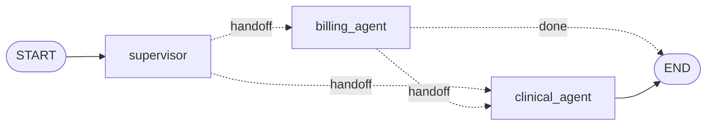

# Post 08 · Multi-agent handoffs

*Series: [Lesson 02 — Agents with LangGraph](../README.md) · Post 8 of 8 · about 35 minutes*

> *"I need my invoice, and also: I missed my blood pressure tablet this morning, should I take two now?"*
>
> One message, two departments. Billing must answer the first half and must **never** give medical advice. The nurse line must answer the second half and nothing about money.

As an agent grows, the temptation is one agent with 30 tools and a 3-page prompt. It gets slow, expensive and confused. The common fix is the same one you use for services: **split by responsibility**. This post shows the smallest version of a multi-agent system, and why the routing should stay in code.

---

## The idea, in plain English

### Supervisor and specialists

- A **supervisor** reads the request and decides **who** should handle it. It never answers.
- **Specialists** each have a short prompt (and, in a real app, only the tools they need). Small prompts are easier for a model to follow and easier for you to test.

It is the same idea as an API gateway in front of microservices.

### A handoff is "go there next, and take this with you"

In posts 02–07, **edges** decided the next node. With handoffs, the **node itself** decides, by returning a `Command`:

```
return new Command({ goto: 'clinical_agent', update: { handoffs: 'billing_agent → clinical_agent' } })
```

`goto` = which node runs next. `update` = a normal state update. Because the next step is chosen at run time, you tell LangGraph the allowed targets when adding the node (`{ ends: [...] }`), so it can still draw and check the graph.



### Conditional edge or `Command`?

| | Conditional edge (post 02) | `Command({ goto })` (this post) |
|---|---|---|
| Who decides | a router function next to the graph | the node, while it runs |
| Can update state at the same time | no | yes |
| Good for | fixed workflows | agents handing work to each other |

Both are fine; `Command` keeps "do my work + pick the next agent" in one place.

### Other shapes you will meet

- **Supervisor** (this post): one router, specialists report back.
- **Swarm / network**: any agent can hand off to any other.
- **Hierarchical**: a specialist is itself a whole graph (a subgraph) with its own supervisor.

LangGraph has prebuilt helpers for these, but they are all built from the `Command` you see here.

---

## Let's see it in code

Open [`example.ts`](./example.ts).

> **Course helpers:** this example imports `env`, `section`, `stripThinking` from `@learn/shared`, the small helper package every lesson uses so that no example names a model or provider. `env` gives typed access to the `.env` settings (provider, Ollama URL, model names); `section()` prints a bold heading in the console output; and `stripThinking()` removes a reasoning model's `<think>…</think>` text from a reply. See [the `@learn/shared` guide](../../shared/README.md) for every helper.

### Step 1 — shared state

```ts
const DeskState = new StateSchema({
  request: z.string(),
  handoffs: new ReducedValue(z.array(z.string()).default(() => []), { inputSchema: z.string(), reducer: (a, b) => [...a, b] }),
  answers: new ReducedValue(z.array(z.string()).default(() => []), { inputSchema: z.string(), reducer: (a, b) => [...a, b] }),
});
```

All agents share one state. `handoffs` records who passed work to whom (a free audit trail). `answers` collects each specialist's part.

### Step 2 — a helper to ask the model in a role

```ts
async function ask(role: string, request: string, cannedReply: string) {
  if (offline) return cannedReply;
```

Each agent = the same model with a different role prompt. With `--offline`, a canned reply is used so you can see the routing without a model.

### Step 3 — the supervisor routes

```ts
const supervisor: GraphNode<typeof DeskState> = async (state) => {
  const word = await ask(
    'You route hospital front-desk requests. Reply with exactly one word: billing (invoices, payments, insurance) or clinical (symptoms, medicines, results).',
```

```ts
const target = /billing/i.test(word) ? 'billing_agent' : 'clinical_agent'; // never trust free text: map it to a known node
return new Command({ goto: target, update: { handoffs: `supervisor → ${target}` } });
```

The model's reply is free text. We never use it as a node name directly; we map it to one of two known nodes. (With a stronger model you would use structured output from lesson 01 here: `z.enum(['billing', 'clinical'])`.)

### Step 4 — a specialist that hands off

```ts
'You are the billing desk of a hospital. Answer ONLY the billing part in two sentences. Never give medical advice.',
```

```ts
// A HANDOFF between specialists: the request also has a clinical part billing must not answer.
const needsClinical = /dose|tablet|medicine|pain|symptom/i.test(state.request);
return new Command({
  goto: needsClinical ? 'clinical_agent' : END,
```

Billing answers its part, then passes the request on if there is a clinical part. Here the check is a simple keyword rule in code. You could also let billing's model decide, but for a safety boundary, code is more reliable.

### Step 5 — declare the possible targets

```ts
.addNode('supervisor', supervisor, { ends: ['billing_agent', 'clinical_agent'] })
.addNode('billing_agent', billingAgent, { ends: ['clinical_agent', END] })
.addNode('clinical_agent', clinicalAgent)
```

`ends` lists where each node *may* go. Only `START → supervisor` and `clinical_agent → END` are normal edges.

```ts
const final = await graph.invoke({ request }, { recursionLimit: 10 });
console.log('route  :', final.handoffs.join('  |  '));
```

The step limit from post 05: if agents ever kept handing work back and forth, this stops them.

```ts
console.log('route  :', final.handoffs.join('  |  '));
final.answers.forEach((a) => console.log(a));
// We do not dump the whole final state: post 02 showed a full invoke() state. The two lines above print
// the fields that matter here. Notice: `handoffs` and `answers` grew one entry per agent (their
// reducers append), so `route` is the exact path; `request` is unchanged, nobody returned a new value for it.
```

We saw the full `graph.invoke()` final state in [post 02](../02-state-graphs/README.md#step-4--run-it), so the file only prints the two fields that matter here (`final.handoffs` as the `route`, and each of `final.answers`). `request` is exactly what you passed in: no agent returned a new value for it. `handoffs` and `answers` have one entry per agent that ran, in order, because their reducers **append**. `Command({ update })` goes through the same reducers as a normal node's return value. So the state is the audit record: who handled the request, and what each one said.

---

## Run it

From the lesson folder:

```bash
npm run post:08:offline   # keyword routing + canned replies: see the handoffs
npm run post:08           # real CHAT_MODEL for routing and answers
# or: npx tsx 08-multi-agent-handoffs/example.ts [--offline]
```

### What you should see

Offline:

```
── Where can I download my invoice from last week? ──
route  : supervisor → billing_agent  |  billing_agent → END
[billing] Your invoice INV-2207 is ready in the patient portal under Billing → Invoices.

── I need my invoice, and also: I missed my blood pressure tablet this morning, should I take two now? ──
route  : supervisor → billing_agent  |  billing_agent → clinical_agent  |  clinical_agent → END
[billing] Your invoice INV-2207 is ready …
[clinical] Do not double the dose. Take the next tablet at the usual time and confirm with your doctor.
```

The `route` line is `final.handoffs` joined together, and the answer lines are `final.answers`: that is the whole audit trail.

Live, with a good model, the route is the same and the answers are the model's own words.

**Live with a tiny model, read this carefully.** On the box with `qwen3:0.6b`, the supervisor routed the plain invoice question to **clinical**, and both agents told the patient to *"take two tablets"*, which is exactly the unsafe advice the prompts forbid. Prompts are suggestions to the model, not rules. This is why:

- routing rules and safety boundaries you care about should be **code** (the keyword check, the enum mapping, post 07's approval edge),
- you need **evals** to measure how often the model gets it wrong ([lesson 05](../../05-evals/README.md)),
- and **guardrails** that check outputs before a patient sees them (later in the series).

## Common gotchas

- ❌ **Using the model's text as a node name.** `goto: word` crashes (or worse) on any unexpected reply. Map it to known nodes.
- ❌ **Forgetting `ends`.** The graph still runs, but drawings and checks don't know the possible paths.
- ❌ **Splitting too early.** Multi-agent adds latency (one model call per hop) and more things to debug. Start with one agent + tools (post 03); split when one prompt is clearly doing several jobs.
- ❌ **Trusting role prompts for safety** ("never give medical advice"). Small models ignore them; see above.
- ✅ Keep a `handoffs` trail in state. When an answer is wrong, the first question is "who handled it?".

## Try it yourself

1. Send *"My knee hurts after the injection, and why was I charged twice?"* Which agent gets it first? Should clinical be able to hand off to billing? Add that path (`ends` + a `Command`).
2. Replace the supervisor's one-word reply with `withStructuredOutput(z.object({ team: z.enum(['billing', 'clinical']) }))` (lesson 01, post 07). Does routing improve with your model?
3. Give `billing_agent` the `list_appointments` tool from post 03 so it is a real mini-agent. Hint: make it a subgraph, compiled on its own, and add the compiled graph as a node.

## Key takeaways

- **Multi-agent = split by responsibility**: a supervisor routes, specialists each have a small prompt and few tools.
- A **handoff** is a node returning **`Command({ goto, update })`**; declare the allowed targets with `ends`.
- Map model output to **known** nodes; keep safety boundaries in **code**, not in role prompts.
- Small models make routing and safety mistakes. **Measure** them with evals before you trust the system.

You have finished lesson 02. You can now build an agent loop by hand, turn it into a LangGraph graph, make it reliable (retries, step limits), give it memory, pause it for a human, and split it into a team. Next: how agents get their tools from **outside** the app, with the Model Context Protocol.

---

[← Previous: Human approval that survives a restart](../07-human-approval/README.md) · [📚 Series index](../README.md) · [Lesson 03 — MCP →](../../03-mcp/README.md)
