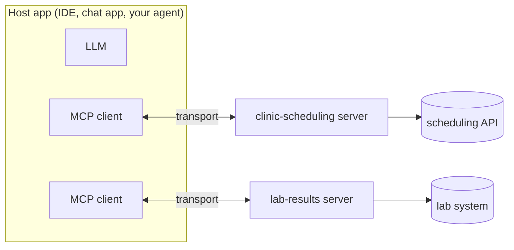

# Post 01 · What is MCP?

*Series: [Lesson 03 — MCP](../README.md) · Post 1 of 7 · about 30 minutes*

> Your team built a great `get_opening_hours` tool for the hospital chatbot. Now the nurses want it in their IDE assistant, the call-centre wants it in their chat app, and another team's agent wants it too.
>
> Three apps, three frameworks, three copies of the same tool definition, and three places to fix when the hours change.

This is the problem the **Model Context Protocol (MCP)** solves. Write the tool once, as an **MCP server**. Every app that speaks MCP can then find it and call it, with no code changes on their side.

---

## The idea, in plain English

### Four parts

| Part | What it is | Hospital example |
|---|---|---|
| **Host** | The app the user works in. It owns the model and decides what the model may do. | Claude Desktop, Cursor, VS Code, your own agent |
| **Client** | A small connector inside the host. One client per server. | `new Client(...)` in your code |
| **Server** | A program that wraps your API and describes it in MCP's standard way. | `clinic-hours`, `clinic-scheduling` |
| **Transport** | How messages travel between client and server. | in-memory (this post), stdio (post 05), HTTP (post 07) |



Notice: **the model never talks to the server.** The host asks the server what it offers, shows that to the model as tools, and when the model asks for a tool, the host's client makes the call. That is the same tool loop as lesson 01; MCP only standardises where the tools come from.

### Three things a server can offer

- **Tools**: actions the **model** decides to call (`book_appointment`). Post 02.
- **Resources**: read-only data the **app** decides to attach (`patient://P-001/appointments`). Post 03.
- **Prompts**: message templates the **user** picks (`confirmation-sms`). Post 04.

### The wire protocol: JSON-RPC

Under the hood, every message is a small **JSON-RPC 2.0** object: a `method`, `params`, and an `id` to match the reply. A session always starts the same way:

1. `initialize`: client and server agree on a protocol version and say what they support.
2. `notifications/initialized`: the client says "ready" (a notification has no `id` and gets no reply).
3. Then normal requests: `tools/list`, `tools/call`, `resources/read`, `prompts/get`, …

You will rarely write these by hand; the SDK does it. But seeing them once removes the magic.

---

## Let's see it in code

Open [`example.ts`](./example.ts). Server and client live in one file, joined by an in-memory pipe.

> **Course helpers:** this example imports `section` from `@learn/shared`, the small helper package every lesson uses so that no example names a model or provider. `section()` prints a bold heading in the console output. See [the `@learn/shared` guide](../../shared/README.md) for every helper.

### Step 1 — the server and one tool

```ts
const server = new McpServer({ name: 'clinic-hours', version: '1.0.0' });
```

```ts
server.registerTool(
  'get_opening_hours',
  {
    description: 'Opening hours of a hospital department.',
    inputSchema: { department: z.enum(['cardiology', 'radiology', 'pharmacy']) },
  },
```

Same three things as a lesson 01 tool: a **name**, a **description** for the model, and a **Zod schema** for the input. The SDK turns the Zod schema into JSON Schema for clients.

```ts
async ({ department }) => {
  const hours = { cardiology: 'Sun-Thu 08:00-16:00', radiology: 'every day 07:00-22:00', pharmacy: '24 hours' };
  return { content: [{ type: 'text', text: `${department}: ${hours[department]}` }] };
},
```

A tool returns `content`: a list of parts (text here; images and others are possible).

### Step 2 — a transport, with a spy

```ts
const [clientSide, serverSide] = InMemoryTransport.createLinkedPair();
```

Two linked ends of a pipe. Great for tests; real apps use stdio or HTTP.

```ts
const send = clientSide.send.bind(clientSide);
clientSide.send = async (message, options) => {
  console.log('client → server', JSON.stringify(message));
  return send(message, options);
};
```

We wrap `send` on both ends to print every message. (Plain monkey-patching, just for learning.)

### Step 3 — the client: connect, discover, call

```ts
await server.connect(serverSide);
await client.connect(clientSide); // sends "initialize", then "notifications/initialized"
```

```ts
const { tools } = await client.listTools();
```

```ts
const result = await client.callTool({ name: 'get_opening_hours', arguments: { department: 'radiology' } });
```

Three lines of client code; each maps to one JSON-RPC method you'll see printed.

---

## Run it

From the lesson folder:

```bash
npm run post:01
# or: npx tsx 01-what-is-mcp/example.ts
```

### What you should see

```
client → server {"method":"initialize","params":{"protocolVersion":"2025-11-25",...},"jsonrpc":"2.0","id":0}
server → client {"result":{"protocolVersion":"2025-11-25","capabilities":{"tools":{"listChanged":true}},"serverInfo":{"name":"clinic-hours",...}},"jsonrpc":"2.0","id":0}
client → server {"method":"notifications/initialized","jsonrpc":"2.0"}
...
client → server {"method":"tools/list","jsonrpc":"2.0","id":1}
server → client {"result":{"tools":[{"name":"get_opening_hours","description":"Opening hours of a hospital department.","inputSchema":{...
...
client → server {"method":"tools/call","params":{"name":"get_opening_hours","arguments":{"department":"radiology"}},"jsonrpc":"2.0","id":2}
server → client {"result":{"content":[{"type":"text","text":"radiology: every day 07:00-22:00"}]},"jsonrpc":"2.0","id":2}
result text: radiology: every day 07:00-22:00
```

Look at `capabilities`: the server announces it has `tools`. A client only asks for what was announced.

## Common gotchas

- ❌ **Thinking the model calls the server.** The host does. The host can filter, log, ask a human, or refuse (post 06).
- ❌ **Treating MCP as a replacement for your API.** It is a thin adapter *in front of* your API, shaped for models: few tools, clear descriptions, small results.
- ❌ **One MCP tool per REST endpoint.** Models do better with a handful of task-shaped tools ("book appointment") than 80 CRUD endpoints.
- ✅ Use the in-memory transport in **unit tests** of your MCP server: no processes, no ports.

## Try it yourself

1. Add a second tool `get_phone_number({ department })`. Run again: where does it appear in the messages?
2. Call `get_opening_hours` with `{ department: 'dentistry' }`. What comes back? (Post 02 explains it.)
3. Remove the `await server.connect(serverSide)` line. What happens, and why?

## Key takeaways

- MCP = a standard way for **hosts** to discover and call **tools, resources and prompts** offered by **servers**.
- The **client** lives in the host; the **model never talks to the server** directly.
- The wire format is **JSON-RPC**: `initialize`, then `tools/list`, `tools/call` and friends.
- The **transport** is swappable: in-memory for tests, stdio for local, HTTP for remote.

---

[← Previous: Lesson 02 — Agents with LangGraph](../../02-agents-langgraph/README.md) · [📚 Series index](../README.md) · [Next: Tools in depth →](../02-tools/README.md)
