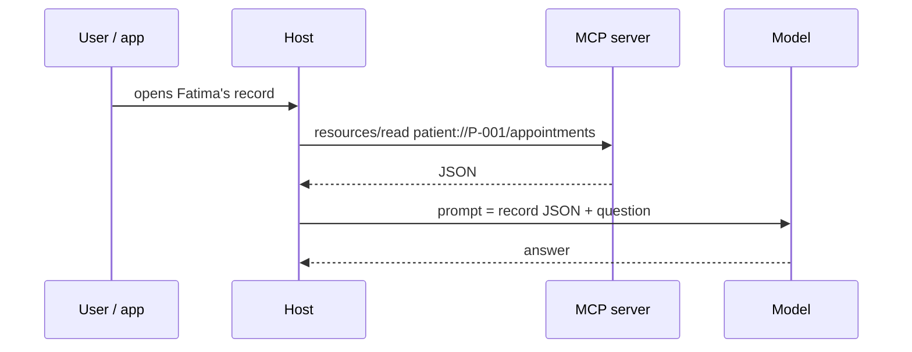

# Post 03 · Resources: context the app reads

*Series: [Lesson 03 — MCP](../README.md) · Post 3 of 7 · about 25 minutes*

> A receptionist opens Fatima's record in the chat app and asks the assistant: *"What is she booked for?"*
>
> The app already knows **which** patient is on screen. Why should the model spend a tool call (and a chance to pick the wrong patient) to look her up?

Tools are for things the **model** decides to do. But a lot of context is chosen by the **app** or the **user**: the open record, the department list, a document they dragged in. MCP calls that a **resource**.

---

## The idea, in plain English

### A resource is read-only data with a URI

Each resource has a **URI** (like a URL) and returns content (text or binary, with a MIME type). Reading it never changes anything.

- **Static resource**: one fixed URI. `clinic://departments` → the department list and hours.
- **Resource template**: a URI pattern with variables. `patient://{patientId}/appointments` → any patient's appointments. The SDK parses `patientId` out of the URI for you.

You choose the URI scheme (`clinic://`, `patient://`); it is just a name the server understands.

### Tool or resource?

| | Tool | Resource |
|---|---|---|
| Who decides to use it | the **model** | the **app or user** |
| Can it change data | yes | no, read-only |
| Typical UI | invisible, called mid-conversation | a picker, an "attach" button, an `@` mention |
| Example | `book_appointment` | `patient://P-001/appointments` |

Rule of thumb: if the app **already knows** what data is relevant, read it as a resource and put it in the prompt. If only the model can figure out what it needs, offer a tool.



---

## Let's see it in code

Open [`example.ts`](./example.ts).

> **Course helpers:** this example imports `section` from `@learn/shared`, the small helper package every lesson uses so that no example names a model or provider. `section()` prints a bold heading in the console output. See [the `@learn/shared` guide](../../shared/README.md) for every helper.

### Step 1 — a static resource

```ts
server.registerResource(
  'departments', // internal name
  'clinic://departments', // the URI clients use to read it
  { title: 'Departments', description: 'Departments and opening hours', mimeType: 'application/json' },
```

The handler gets the parsed `uri` and returns `contents`:

```ts
contents: [{ uri: uri.href, text: JSON.stringify({ cardiology: 'Sun-Thu 08-16', orthopedics: 'Sun-Thu 09-17' }) }],
```

### Step 2 — a resource template

```ts
new ResourceTemplate('patient://{patientId}/appointments', {
  // optional: tell clients which concrete URIs exist right now (for a picker in the UI)
  list: async () => ({
```

```ts
async (uri, { patientId }) => ({
  // `patientId` was parsed out of the URI for us
  contents: [{ uri: uri.href, text: JSON.stringify(appointments.filter((a) => a.patientId === patientId)) }],
}),
```

The `list` callback is optional. With it, `resources/list` shows every patient's URI, so a UI can offer a picker.

### Step 3 — the client reads them

```ts
for (const r of (await client.listResources()).resources) console.log(`resource  ${r.uri.padEnd(32)} ${r.name}`);
for (const t of (await client.listResourceTemplates()).resourceTemplates) console.log(`template  ${t.uriTemplate}`);
```

```ts
const fatima = await client.readResource({ uri: 'patient://P-001/appointments' });
```

### Step 4 — how a host uses it

```ts
const context = (fatima.contents[0] as { text: string }).text;
const prompt = `Patient appointments (JSON):\n${context}\n\nQuestion: what is Fatima booked for, and is it still active?`;
```

No tool call, no chance of the model picking the wrong patient: the app put the right data in the prompt.

---

## Run it

From the lesson folder:

```bash
npm run post:03
# or: npx tsx 03-resources/example.ts
```

### What you should see

```
── Discover ──
resource  clinic://departments             departments
resource  patient://P-001/appointments     Fatima Al-Harbi appointments
resource  patient://P-002/appointments     Rahul Menon appointments
template  patient://{patientId}/appointments

── Read the static resource ──
{"cardiology":"Sun-Thu 08-16","orthopedics":"Sun-Thu 09-17"}

── Read through the template ──
patient://P-001/appointments → [{"id":"A-101","patientId":"P-001","slotId":"S-1","reason":"chest pain follow-up","status":"booked"}]
```

…followed by the prompt a host would send to its model.

## Common gotchas

- ❌ **Expecting the model to read resources by itself.** Most hosts only attach resources the user or app picks. If the model must fetch data on its own, make it a tool.
- ❌ **Side effects in a resource handler.** Resources are read-only by contract; hosts may read them at any time, repeatedly.
- ❌ **Forgetting access control.** `patient://P-002/appointments` is one string away from P-001. On a shared server, check the caller can see that patient (post 07 shows where the caller's identity comes from).
- ✅ Set a `mimeType` so hosts know how to show the content.

## Try it yourself

1. Add a template `clinic://departments/{name}/doctors` that returns the doctors in a department (from `slots`).
2. Read `patient://P-999/appointments`. What comes back? Should it be an error instead? Change the handler so it is.
3. Send the step-4 prompt to `chatModel()` with `generateText` (as in lesson 01) and compare the answer with post 06's agent, which has to find the patient with tools.

## Key takeaways

- A **resource** is read-only data with a **URI**; a **template** is a URI pattern with variables.
- **Tools are chosen by the model; resources by the app or user.**
- Reading a resource and putting it in the prompt is cheaper and safer than a tool call when the app already knows what's relevant.

---

[← Previous: Tools in depth](../02-tools/README.md) · [📚 Series index](../README.md) · [Next: Prompts: reusable templates →](../04-prompts/README.md)
