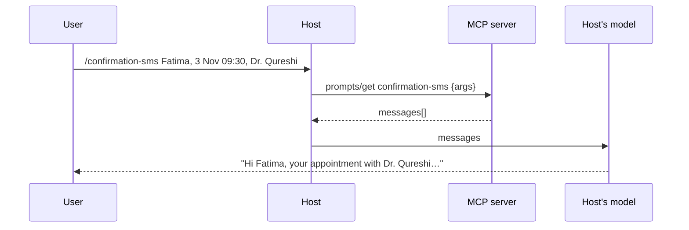

# Post 04 · Prompts: reusable templates

*Series: [Lesson 03 — MCP](../README.md) · Post 4 of 7 · about 25 minutes*

> Every receptionist writes appointment confirmation texts a little differently. One forgets the doctor's name. Another adds "don't eat before your test", which is medical advice they are not allowed to give.
>
> Compliance wants **one** approved wording, used in every app.

That is the job of MCP's third primitive, the **prompt**: a named, parameterised message template that lives on the server. The user picks it (often as a `/slash-command`), fills in a few fields, and the host sends the result to its model.

---

## The idea, in plain English

### Who chooses what

| Primitive | Chosen by | Example |
|---|---|---|
| Tool | the model | `book_appointment` |
| Resource | the app or user | `patient://P-001/appointments` |
| **Prompt** | **the user** | `/confirmation-sms` |

### A prompt is a function from arguments to messages

The server declares a name, a description and an **argument schema** (the little form the UI shows). When the client calls `prompts/get` with the arguments, the server returns ready-made **messages** (role + content). The client then sends those messages to whatever model it uses.

Why put this on the server, not in each app?

- **One owner of the wording.** Compliance changes the server; every app picks it up.
- **Model-agnostic.** The server never calls a model. Each host uses its own.
- **Discoverable.** `prompts/list` shows users what's available.



---

## Let's see it in code

Open [`example.ts`](./example.ts).

> **Course helpers:** this example imports `chatModel`, `section`, `stripThinking`, `modelLabel` from `@learn/shared`, the small helper package every lesson uses so that no example names a model or provider. `chatModel()` returns the chat model named in `.env` (`CHAT_MODEL`), on whichever provider you configured; `section()` prints a bold heading in the console output; `stripThinking()` removes a reasoning model's `<think>…</think>` text from a reply; and `modelLabel()` returns a printable label such as `ollama:qwen3:0.6b`. See [the `@learn/shared` guide](../../shared/README.md) for every helper.

### Step 1 — register the prompt

```ts
server.registerPrompt(
  'confirmation-sms',
  {
    title: 'Appointment confirmation SMS',
    description: 'Draft a short, friendly SMS confirming an appointment',
    argsSchema: { patientName: z.string(), when: z.string(), doctor: z.string() }, // the "form" a UI shows
  },
```

```ts
text: `Write a <160 character SMS to ${patientName} confirming their appointment with ${doctor} at ${when}. No medical advice.`,
```

The approved wording, including the "No medical advice" rule, is in one place.

### Step 2 — the client lists and fills it

```ts
const listedPrompts = await client.listPrompts();
const { prompts } = listedPrompts;
dump('client.listPrompts() result', listedPrompts);
```

The full `prompts/list` result, printed with the toolkit's `dump()` ([what it is](../../shared/README.md#dumplabel-value--print-the-full-returned-value)). Each prompt has `name`, `title`, `description` and `arguments`: a list of `{ name, required }` built from your Zod `argsSchema`. That list is the "form" a host UI shows before it fills the prompt.

```ts
const filled = await client.getPrompt({
  name: 'confirmation-sms',
  arguments: { patientName: 'Fatima', when: '3 Nov 09:30', doctor: 'Dr. Qureshi' },
});
```

No model yet: `filled.messages` is plain data.

```ts
dump('client.getPrompt() result', filled);
```

The whole `prompts/get` result is just `{ messages: [...] }`, with the arguments already filled in. Each message is `{ role, content: { type: 'text', text } }`: note that `content` is **one** typed part here, not a list as in tool results.

### Step 3 — the host sends it to its own model

```ts
// MCP prompt messages are { role, content: { type: 'text', text } }; the AI SDK wants { role, content: string }.
const messages: ModelMessage[] = filled.messages.map((m) => ({
  role: m.role,
  content: m.content.type === 'text' ? m.content.text : '',
}));
const result = await generateText({ model: chatModel(), messages, maxOutputTokens: 400 });
const { text } = result;
console.log('finishReason:', result.finishReason, '| usage.inputTokens:', result.usage.inputTokens, '| usage.outputTokens:', result.usage.outputTokens);
```

A small adapter from MCP's message shape to the AI SDK's, then a normal `generateText` with the model from your `.env`. We saw the full `generateText()` result in [lesson 01 post 00](../../01-foundations-structured-output/00-course-toolkit/README.md#step-4--look-at-everything-the-call-returned), so here we only log the two things this post cares about: `finishReason` (`'stop'`, or `'length'` if the SMS was cut off by `maxOutputTokens`) and `usage.inputTokens`, the cost of the server's prompt text.

---

## Run it

From the lesson folder:

```bash
npm run post:04            # parts 1 and 2 (part 2 calls CHAT_MODEL)
npm run post:04:offline    # part 1 only
# or: npx tsx 04-prompts/example.ts [--offline]
```

### What you should see

```
prompt confirmation-sms: Draft a short, friendly SMS confirming an appointment  args=patientName, when, doctor
[
  {
    "role": "user",
    "content": {
      "type": "text",
      "text": "Write a <160 character SMS to Fatima confirming their appointment with Dr. Qureshi at 3 Nov 09:30. No medical advice."
    }
  }
]
── 2. Send the filled prompt to the model (ollama:…) ──
SMS (94 chars): Hi Fatima, …
```

A real run with the dumps and the targeted log (`qwen3:0.6b`, trimmed at `…`):

```
── 1. Discover and fill a prompt (no model) ────────────────────
▼ client.listPrompts() result
{
  prompts: [
    {
      name: 'confirmation-sms',
      title: 'Appointment confirmation SMS',
      description: 'Draft a short, friendly SMS confirming an appointment',
      arguments: [
        { name: 'patientName', required: true },
        { name: 'when', required: true },
        { name: 'doctor', required: true }
      ]
    }
  ]
}
…
▼ client.getPrompt() result
{
  messages: [
    {
      role: 'user',
      content: {
        type: 'text',
        text: 'Write a <160 character SMS to Fatima confirming their appointment with Dr. Qureshi at 3 Nov 09:30. No medical advice.'
      }
    }
  ]
}

── 2. Send the filled prompt to the model (ollama:qwen3:0.6b) ──
finishReason: stop | usage.inputTokens: 51 | usage.outputTokens: 22
SMS (60 chars): Your appointment with Dr. Qureshi is confirmed. 3 Nov 09:30.
```

Your SMS text and token counts will differ (on an earlier run the same model wrote *"Dr. Qureshi, appointment at Nov 3, 9:30. No medical advice."*, copying the instruction into the SMS). `inputTokens` stays at 51 as long as the prompt and model don't change.

On the box, the tiny `qwen3:0.6b` wrote *"Hi Fatima, I'll be at Dr. Qureshi's appointment on 3 November 09:30. No medical advice needed."*: under 160 characters, but in the wrong voice and repeating the instruction. A shared template does not make a small model good; it makes the **instructions** consistent. Measure the output (lesson 05).

## Common gotchas

- ❌ **Expecting the server to run the model.** A prompt only returns messages. The host chooses and calls the model.
- ❌ **Putting secrets or patient data in the template text.** Prompts are listed to any client; data should come in through arguments or resources.
- ❌ **Using prompts for things the model should decide.** That's a tool.
- ✅ Keep business rules ("No medical advice", "< 160 characters") in the template, and **check** them in code too (`sms.length`).

## Try it yourself

1. Add a `language` argument (`z.enum(['en', 'ar'])`) and make the template ask for Arabic when chosen.
2. Make the prompt return **two** messages: a `user` message with the rules and an `assistant` example of a good SMS (a one-shot example, from lesson 01, post 04). Does your model's output improve?
3. In part 2, reject the SMS in code if it is over 160 characters, and retry once.

## Key takeaways

- An MCP **prompt** is a server-owned template: name + argument schema → messages.
- The **user** picks it; the **host** sends the messages to **its own** model.
- It gives you one owner for approved wording across every app.

---

[← Previous: Resources: context the app reads](../03-resources/README.md) · [📚 Series index](../README.md) · [Next: A real stdio server, inspected →](../05-stdio-server/README.md)
