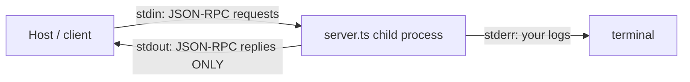

# Post 05 · A real stdio server, inspected

*Series: [Lesson 03 — MCP](../README.md) · Post 5 of 7 · about 40 minutes*

> So far, server and client lived in one file. Real MCP servers are **separate programs**. Cursor, Claude Desktop or VS Code starts your server as a child process and talks to it through its stdin and stdout.
>
> And one stray `console.log("booked!")` in that server silently breaks everything.

This post puts the tools, resources and prompt from posts 02–04 into one real server, `server.ts`, runs it as its own process over the **stdio** transport, and inspects it two ways: with a client you write and with the official **MCP Inspector**.

---

## The idea, in plain English

### The stdio transport

The host **spawns** the server (`node server.ts`) and:

- writes JSON-RPC messages to the server's **stdin**, one per line,
- reads the server's replies from its **stdout**.

It is the simplest transport: no ports, no network, no auth (the server runs as you, on your machine). It is how most IDE and desktop MCP servers work.



### The one rule: stdout is for the protocol

Because stdout **is** the channel, anything else written there (a `console.log`, a library's banner) is read as a broken JSON-RPC message, and the client errors or hangs. So in a stdio server:

- log to **stderr** (`console.error`),
- never `console.log`.

### How hosts are configured

Every host has a small config that says "start this command". For example, in Cursor or Claude Desktop:

```json
{
  "mcpServers": {
    "clinic-scheduling": { "command": "npx", "args": ["tsx", "/path/to/03-mcp/05-stdio-server/server.ts"] }
  }
}
```

That is all it takes for your tools to appear in the IDE's agent.

### The MCP Inspector

A web UI from the MCP team that starts your server, lists its tools, resources and prompts, and lets you call them by hand. It's Postman for MCP. Use it while you build a server, before any model is involved.

---

## Let's see it in code

> **Course helpers:** this example imports `section` from `@learn/shared`, the small helper package every lesson uses so that no example names a model or provider. `section()` prints a bold heading in the console output. See [the `@learn/shared` guide](../../shared/README.md) for every helper.

This folder has four files:

| File | Role |
|---|---|
| [`appointment-store.ts`](./appointment-store.ts) | the fake hospital scheduling API (patients, slots, `book()`) |
| [`server.ts`](./server.ts) | the full MCP server: 4 tools, 2 resources, 1 prompt, over stdio |
| [`spawn.ts`](./spawn.ts) | how a client starts the server as a child process |
| [`example.ts`](./example.ts) | a client that spawns the server and exercises everything |

### `server.ts` — the parts you already know, plus two lines

Everything registered in `server.ts` is the code from posts 02, 03 and 04. What's new is the top and the bottom:

```ts
const log = (...a: unknown[]) => console.error('[mcp-server]', ...a); // stderr!
```

```ts
await server.connect(new StdioServerTransport());
log('ready on stdio');
```

A `log` helper that writes to **stderr**, and a `StdioServerTransport` instead of the in-memory pipe. The tool code doesn't change when the transport does.

### `spawn.ts` — starting the server

```ts
command: process.execPath, // the current `node`
args: ['--import', 'tsx', fileURLToPath(new URL('./server.ts', import.meta.url))],
```

```ts
stderr: 'inherit' as const, // show the server's logs (written to stderr) in our terminal
```

`--import tsx` lets Node run the TypeScript file directly. `stderr: 'inherit'` makes the server's `[mcp-server]` logs show in your terminal.

### `example.ts` — the client

```ts
await client.connect(new StdioClientTransport(serverProcess)); // starts `node --import tsx server.ts`
```

`StdioClientTransport` spawns the process and wires its stdin/stdout. From here on it is the same `Client` API as post 01:

```ts
const booked = await client.callTool({ name: 'book_appointment', arguments: { patientId: 'P-001', slotId: 'S-1', reason: 'chest pain follow-up' } });
```

```ts
await client.close(); // also stops the server child process
```

---

## Run it

From the lesson folder:

```bash
npm run post:05
# or: npx tsx 05-stdio-server/example.ts

# the Inspector (opens a browser tab; press Connect, then try Tools / Resources / Prompts)
npm run inspector
```

### What you should see

```
── Discovery ──
tool  find_patient         hints={"readOnlyHint":true}
tool  search_slots         hints={"readOnlyHint":true}
tool  book_appointment     hints={"readOnlyHint":false,"destructiveHint":false,"idempotentHint":false}
tool  cancel_appointment   hints={"destructiveHint":true}
res   clinic://departments
res   patient://P-001/appointments
res   patient://P-002/appointments
tmpl  patient://{patientId}/appointments
prompt confirmation-sms

── Call tools in another process ──
structuredContent: {"slots":[{"id":"S-1",...},{"id":"S-2",...}]}
[mcp-server] booked A-101
book: [{"type":"text","text":"Booked A-101 (slot S-1) for P-001."}]
double-book → isError = true [{"type":"text","text":"Slot S-1 is already taken"}]
...
```

The `[mcp-server] …` lines come from the **child process's stderr**. (The order of stderr and stdout lines in your terminal can vary.)

## Common gotchas

- ❌ **`console.log` in a stdio server.** It corrupts the protocol stream. Use `console.error` or a logger writing to stderr or a file.
- ❌ **Relative paths in host configs.** The host starts your server from its own working directory. Use absolute paths.
- ❌ **Expecting state to survive.** The appointment store is in memory; each spawn starts fresh (the `A-101` id repeats every run). A real server talks to your database.
- ✅ Build and debug with the **Inspector** first, then connect a model.

## Try it yourself

1. Add `console.log('hello')` at the top of `server.ts` and run `npm run post:05`. What happens? Remove it.
2. Add `server.ts` to your own IDE's MCP config (Cursor, Claude Desktop or VS Code) and ask its agent *"what cardiology slots are free?"*.
3. In the Inspector, call `cancel_appointment` with a made-up id. Compare the result with a call that has a missing argument.

## Key takeaways

- **stdio**: the host spawns the server and talks JSON-RPC over stdin/stdout. Local only, no auth needed.
- **stdout belongs to the protocol**; logs go to **stderr**.
- The server code is the same whatever the transport; only the `connect(...)` line changes.
- The **MCP Inspector** is your Postman for MCP servers.

---

[← Previous: Prompts: reusable templates](../04-prompts/README.md) · [📚 Series index](../README.md) · [Next: An agent that uses MCP tools →](../06-agent-over-mcp/README.md)
