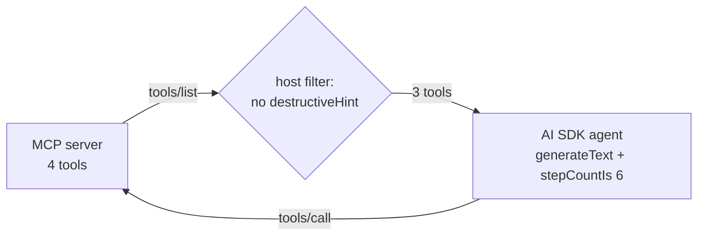

# Post 06 · An agent that uses MCP tools

*Series: [Lesson 03 — MCP](../README.md) · Post 6 of 7 · about 35 minutes*

> *"Book Fatima the earliest free cardiology slot for a chest pain follow-up."*
>
> The agent has never seen the clinic's code. It connects to the MCP server, asks what tools exist, finds Fatima's id, searches the slots and books S-1. And it never even learns that `cancel_appointment` exists.

This post connects the two halves of the course so far: the **agent loop** from lessons 01–02 and the **MCP server** from post 05. The agent discovers its tools at runtime, and the **host** decides which of them the model may see.

---

## The idea, in plain English

### Discover, convert, run

1. **Discover**: the host's MCP client calls `tools/list` on the server.
2. **Convert**: each MCP tool becomes a normal AI SDK tool. Its `execute()` simply sends `tools/call` to the server.
3. **Run**: `generateText` with those tools and a step limit: the same tool loop as lesson 01, post 08.

If the clinic team adds a tool tomorrow, the agent picks it up on its next start, with no code change.

### The host is the gatekeeper (least privilege)

Before step 2, the host can **filter**. Here: drop every tool with `destructiveHint: true`. The model can't call what it was never shown. Other common host policies:

- show only tools from an allow-list,
- send risky calls to a human first (lesson 02, post 07),
- log every call for audit.

Remember the warning from post 02: annotations are written by the server. Filtering by them is fine for a **server you trust**; for an unknown server, use your own allow-list.



---

## Let's see it in code

Open [`example.ts`](./example.ts). It spawns the server from [post 05](../05-stdio-server/README.md) with the same `spawn.ts`.

> **Course helpers:** this example imports `chatModel`, `section`, `stripThinking`, `modelLabel` from `@learn/shared`, the small helper package every lesson uses so that no example names a model or provider. `chatModel()` returns the chat model named in `.env` (`CHAT_MODEL`), on whichever provider you configured; `section()` prints a bold heading in the console output; `stripThinking()` removes a reasoning model's `<think>…</think>` text from a reply; and `modelLabel()` returns a printable label such as `ollama:qwen3:0.6b`. See [the `@learn/shared` guide](../../shared/README.md) for every helper.

### Step 1 — connect with the AI SDK's MCP client

```ts
const mcp = await createMCPClient({ transport: new StdioClientTransport(serverProcess) });
```

`@ai-sdk/mcp` wraps the official client and speaks AI SDK tools.

### Step 2 — discover and filter

```ts
const definitions = await mcp.listTools();
const allowed = { ...definitions, tools: definitions.tools.filter((t) => !t.annotations?.destructiveHint) };
```

### Step 3 — convert to AI SDK tools

```ts
const tools = mcp.toolsFromDefinitions(allowed);
```

### Step 4 — the agent loop

```ts
const result = await generateText({
  model: chatModel(),
  instructions:
    'You are a scheduling assistant. Always look up ids with tools (find_patient, search_slots) ' +
    'before booking. Never invent ids. Reply with a one-line confirmation.',
  prompt: task,
  tools,
  stopWhen: stepCountIs(6), // the step limit, as in lesson 01
});
```

`chatModel()` comes from your `.env`, like everywhere in the course. The instructions say *how* to use the tools: look up ids first, never invent them.

```ts
for (const c of step.toolCalls) console.log(`step ${i}: ${c.toolName}(${JSON.stringify(c.input)})`);
for (const r of step.toolResults) console.log(`        → ${JSON.stringify(r.output).slice(0, 160)}`);
```

Print the trail so you can see what the model did.

```ts
await mcp.close(); // also terminates the server child process
```

Always close in `finally`, or the child process outlives your script.

---

## Run it

From the lesson folder:

```bash
npm run post:06            # default task, calls CHAT_MODEL
npx tsx 06-agent-over-mcp/example.ts "Which orthopedics slots are free?"
npm run post:06:offline    # discovery + filtering only, no model
```

### What you should see

```
tools on the server     : find_patient, search_slots, book_appointment, cancel_appointment
tools offered to model  : find_patient, search_slots, book_appointment

── Agent run (ollama:qwen3:1.7b) ──
step 0: find_patient({"query":"Fatima"})
step 0: search_slots({"department":"cardiology"})
        → {"content":[{"type":"text","text":"[{\"id\":\"P-001\",\"name\":\"Fatima Al-Harbi\",...
        → {"content":[{"type":"text","text":"[{\"id\":\"S-1\",\"doctor\":\"Dr. Qureshi\",...
step 1: book_appointment({"patientId":"P-001","slotId":"S-1","reason":"chest pain follow-up"})
        → {"content":[{"type":"text","text":"Booked A-101 (slot S-1) for P-001."}],"isError":false}

Answer: Booked A-101 (slot S-1) for P-001.
```

With `qwen3:1.7b` the run above worked. With the tiny `qwen3:0.6b` the model skipped the lookups and called `book_appointment({"patientId":"fatima","slotId":null,…})`. The server's schema rejected it (`expected string, received null`), so **nothing wrong was booked**: validation on the server is your safety net when the model ignores the instructions. Use a larger `CHAT_MODEL` for agent work.

## Common gotchas

- ❌ **Giving the model every tool on every server.** More tools = more confusion and more risk. Filter per task.
- ❌ **Trusting annotations from unknown servers.** A malicious server can label `delete_everything` as read-only. Allow-list instead.
- ❌ **Forgetting `mcp.close()`.** The stdio child process keeps running.
- ❌ **No step limit.** A confused model can loop on tool calls; `stopWhen: stepCountIs(n)` caps it.
- ✅ Put "look up ids first, never invent them" in the instructions, and keep the server strict so invented ids fail.

## Try it yourself

1. Ask *"Cancel Fatima's appointment A-101"*. What does the agent say, given it has no cancel tool?
2. Replace the annotation filter with an explicit allow-list: `new Set(['find_patient', 'search_slots'])`. Ask it to book. What happens?
3. Instead of hiding `cancel_appointment`, keep it but wrap its `execute` so it asks for confirmation on the terminal (`readline`) before calling the server. That is lesson 02's human approval, at the host level.

## Key takeaways

- An agent can **discover** tools from an MCP server at runtime: `listTools` → `toolsFromDefinitions` → `generateText`.
- The **host decides** what the model sees: filter by annotations (trusted servers) or by allow-list.
- Instructions guide the model; **server-side validation** catches it when it doesn't follow them.

---

[← Previous: A real stdio server, inspected](../05-stdio-server/README.md) · [📚 Series index](../README.md) · [Next: Remote MCP: HTTP and auth →](../07-http-and-auth/README.md)
