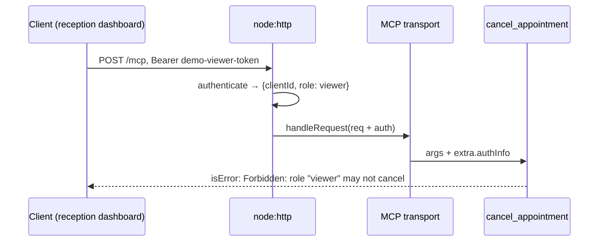

# Post 07 · Remote MCP: Streamable HTTP and auth

*Series: [Lesson 03 — MCP](../README.md) · Post 7 of 7 · about 45 minutes*

> The clinic server works on your laptop. Now 40 ward tablets, the reception dashboard and a partner's agent all need it.
>
> You can't spawn a process on each of their machines. And the reception dashboard may **read** appointments, but must never **cancel** one.

stdio is for local servers. For a shared server you run MCP over **HTTP**, and as soon as it's on a network, you need to know **who is calling** and **what they may do**. This post builds both with plain `node:http`, so nothing is hidden behind a framework.

---

## The idea, in plain English

### Streamable HTTP

MCP's HTTP transport is called **Streamable HTTP**. It is simple:

- One endpoint, say `POST /mcp`. Every JSON-RPC message from the client is a POST.
- The server replies with JSON, or with a stream (Server-Sent Events) if it wants to send progress or several messages.
- Optional sessions: the server can hand out an `Mcp-Session-Id` header, or run **stateless**.

We use **stateless** mode: a fresh `McpServer` per request, no session id. That scales like any stateless Node API behind a load balancer.

### Authentication: who is calling?

MCP uses normal HTTP auth: the client sends **`Authorization: Bearer <token>`** on every request. The server:

1. checks the token **before** MCP sees the request; if it's missing or unknown, replies **401** with a `WWW-Authenticate` header,
2. turns the token into an identity (`AuthInfo`: client id, scopes, extra data like a role),
3. attaches it as `req.auth`. The SDK passes it to every tool handler as **`extra.authInfo`**.

In production, the token is an OAuth 2.1 access token from your identity provider (Entra ID, Okta, Keycloak…), and the MCP spec describes how clients discover where to get one. The shape of your server code stays the same: verify the token, build `AuthInfo`, pass it on.

### Authorization: what may they do?

Check permissions **inside the tool, on the server, on every call**. Not by hiding tools in the client (post 06 was a convenience, not security), and not by annotations.



---

## Let's see it in code

Open [`example.ts`](./example.ts). It starts the HTTP server, then connects three clients to it.

> **Course helpers:** this example imports `section` from `@learn/shared`, the small helper package every lesson uses so that no example names a model or provider. `section()` prints a bold heading in the console output. See [the `@learn/shared` guide](../../shared/README.md) for every helper.

### Step 1 — token → identity

```ts
const TOKENS: Record<string, { clientId: string; role: Role }> = {
  'demo-viewer-token': { clientId: 'reception-dashboard', role: 'viewer' },
  'demo-nurse-token': { clientId: 'ward-3-tablet', role: 'nurse' },
};
```

```ts
const token = req.headers.authorization?.match(/^Bearer (.+)$/)?.[1];
const who = token ? TOKENS[token] : undefined;
if (!token || !who) return undefined;
return { token, clientId: who.clientId, scopes: [], extra: { role: who.role } };
```

A lookup table stands in for "verify the JWT". The result is the SDK's `AuthInfo` type.

### Step 2 — the role check inside the tool

```ts
// AUTHORIZATION happens HERE, on the server, for every call. Never trust the client to hide a tool.
const role = extra.authInfo?.extra?.role as Role | undefined;
if (role !== 'nurse') return { isError: true, content: [{ type: 'text', text: `Forbidden: role "${role}" may not cancel` }] };
```

The second argument of every tool handler, `extra`, carries the caller's `authInfo`.

### Step 3 — the HTTP layer

```ts
const auth = authenticate(req);
if (!auth) {
  // 401 + WWW-Authenticate is what the MCP auth spec expects; real servers also point to their OAuth metadata here.
  res.writeHead(401, { 'WWW-Authenticate': 'Bearer realm="clinic"', 'Content-Type': 'application/json' });
```

```ts
// Stateless mode: a fresh server + transport per request, no session id. Easy to scale behind a load balancer.
const mcp = buildMcpServer();
const transport = new StreamableHTTPServerTransport({ sessionIdGenerator: undefined });
```

```ts
await mcp.connect(transport);
await transport.handleRequest(Object.assign(req, { auth }), res); // req.auth → extra.authInfo in tool handlers
```

Plain `node:http`. The same three lines work inside Express, Fastify or Hono handlers.

### Step 4 — a client with a token

```ts
const headers: Record<string, string> = token ? { Authorization: `Bearer ${token}` } : {};
const client = new Client({ name: 'http-demo', version: '1.0.0' });
await client.connect(new StreamableHTTPClientTransport(url, { requestInit: { headers } }));
```

`requestInit` is passed to `fetch` on every request, so the header goes with every message.

---

## Run it

From the lesson folder:

```bash
npm run post:07
# or: npx tsx 07-http-and-auth/example.ts

# keep it running and connect with the Inspector (Transport: Streamable HTTP,
# URL http://localhost:3333/mcp, header Authorization: Bearer demo-nurse-token)
npm run post:07:serve
```

### What you should see

```
── 1. No token → the HTTP layer refuses before MCP runs ──
connect failed: Streamable HTTP error: Error POSTing to endpoint: {"error":"invalid_token"}

── 2. Viewer token → can read, cannot cancel ──
tools: [ 'list_appointments', 'cancel_appointment' ]
list  : (for reception-dashboard) [{"id":"A-101","patientId":"P-001",...,"status":"booked"}]
cancel → isError = true | Forbidden: role "viewer" may not cancel

── 3. Nurse token → allowed ──
cancel → isError = false | Cancelled A-101 (by ward-3-tablet)
```

Notice the viewer **can see** `cancel_appointment` in the list but can't use it. Listing is not permission; the check in the handler is.

## Common gotchas

- ❌ **Authorization in the client or in annotations.** Any client can call any tool name. Check on the server.
- ❌ **Logging tokens.** Log the `clientId`, never the token.
- ❌ **Passing the user's token through to your backend APIs** ("token passthrough"). The MCP spec forbids it: the server should get its own credentials for downstream calls.
- ❌ **Plain HTTP in production.** Bearer tokens need TLS.
- ✅ Keep the transport stateless unless you really need sessions; it's easier to scale and to test.

## Try it yourself

**Week-3 exercise from the learning map: HTTP transport, then a bearer token that sets the caller's role.**

1. **Port the full server.** Move the tool, resource and prompt registrations from [`../05-stdio-server/server.ts`](../05-stdio-server/server.ts) into a `buildServer()` function, and serve it from this file's HTTP layer. (The registrations don't change; only the transport does.)
2. **Roles everywhere.** Give `book_appointment` the same check (nurse or receptionist) and make `patient://{patientId}/appointments` return only patients the caller may see.
3. **Agent over HTTP.** Change post 06's agent to `createMCPClient({ transport: { type: 'http', url: 'http://localhost:3333/mcp', headers: { Authorization: 'Bearer demo-viewer-token' } } })`. Ask it to cancel A-101. What does the model tell the user?
4. Stretch: replace the `TOKENS` table with real JWT verification (`jose`'s `jwtVerify`) and read the role from a claim.

## Key takeaways

- **Streamable HTTP** = MCP over `POST /mcp`; **stateless** mode scales like any Node API.
- **Authenticate in the HTTP layer** (401 + `WWW-Authenticate`), then pass the identity as `req.auth`.
- **Authorize in the tool** using `extra.authInfo`, on every call.
- Hiding tools (post 06) is convenience; **server-side checks** are security.

You've finished lesson 03. Your APIs are now tools any agent can discover, locally or over the network, with the server deciding who may do what. Next: giving agents **knowledge** from your documents.

---

[← Previous: An agent that uses MCP tools](../06-agent-over-mcp/README.md) · [📚 Series index](../README.md) · [Lesson 04 — RAG →](../../04-rag/README.md)
