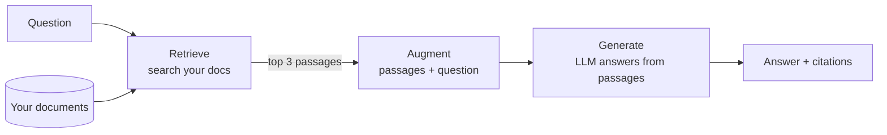

# Post 01 · Why RAG?

*Series: [Lesson 04 — RAG](../README.md) · Post 1 of 8 · about 25 minutes*

> A receptionist asks the hospital assistant: *"How many no-shows before a deposit is required, and how much is the deposit?"*
>
> The model replies, instantly and confidently: *"One no-show, and the deposit is typically the same as the requested amount."* Both parts are wrong. The real policy says **three** no-shows in 12 months, and **SAR 100**.

The model isn't broken. It has simply never read **your** policy. This post shows the three ways to fix that, and why the third one, **RAG**, is what almost every company ends up building.

---

## The idea, in plain English

### The model only knows its training data

A model learned from public text up to some date. Your hospital's policies, your product docs, last week's price change: it has never seen them. When asked anyway, it does what it was trained to do: produce a **plausible** answer. That's a **hallucination**.

### Option A: just ask (closed book)

Cheap and fast, and wrong for anything private or recent.

### Option B: paste every document into the prompt

The model now has the facts. With our 5 tiny policies (≈750 tokens) this works. But:

- a real hospital has thousands of documents, far beyond any context window (lesson 01, post 02),
- you pay for every token on **every** question,
- models get worse at finding one fact in a huge prompt ("lost in the middle").

### Option C: retrieve, then generate (RAG)

1. **Retrieve**: search your documents for the few passages that matter to *this* question.
2. **Augment**: put only those passages in the prompt.
3. **Generate**: tell the model to answer **only** from them.



Small prompt, current facts (update a doc, the next answer changes), and you can show *where* the answer came from. Everything else in this lesson is about making step 1 **good**, because the model can't answer from a passage you didn't retrieve.

### Why not fine-tune instead?

Fine-tuning changes *how* a model writes (tone, format, a task). It is a poor way to add *facts*: slow to update, no citations, and it can still hallucinate. Use RAG for knowledge; fine-tune for behaviour, if ever.

---

## Let's see it in code

Open [`example.ts`](./example.ts). It asks the same question three ways.

> **Course helpers:** this example imports `chatModel`, `section`, `stripThinking`, `modelLabel` from `@learn/shared`, the small helper package every lesson uses so that no example names a model or provider. `chatModel()` returns the chat model named in `.env` (`CHAT_MODEL`), on whichever provider you configured; `section()` prints a bold heading in the console output; `stripThinking()` removes a reasoning model's `<think>…</think>` text from a reply; and `modelLabel()` returns a printable label such as `ollama:qwen3:0.6b`. See [the `@learn/shared` guide](../../shared/README.md) for every helper.

### Our knowledge base

```ts
const docs = readdirSync(DOCS_DIR)
  .filter((f) => f.endsWith('.md'))
  .map((f) => ({ source: f, text: readFileSync(join(DOCS_DIR, f), 'utf8') }));
```

Five fictional policies in [`../docs/`](../docs/appointment-cancellation.md): cancellations, discharge, refills, telehealth, visiting hours.

### A. Closed book

```ts
await ask('A. Closed book (no documents)', 'You are a hospital assistant. Answer in one sentence.', question);
```

### B. Stuff everything

```ts
const everything = docs.map((d) => `### ${d.source}\n${d.text}`).join('\n\n');
```

### C. Retrieve, then generate

```ts
const sections = docs.flatMap((d) => d.text.split(/\n(?=## )/).map((s) => ({ source: d.source, text: s.trim() })));
const words = (t: string) => new Set(t.toLowerCase().match(/[a-z]{4,}/g) ?? []);
const overlap = (s: { text: string }) => [...words(question)].filter((w) => words(s.text).has(w)).length;
const best = sections.sort((a, b) => overlap(b) - overlap(a))[0]!; // crude! posts 03-06 do this properly
```

A deliberately crude retriever: split docs at `##` headings, score each section by shared words, take the best. It works for this question; posts 02–06 replace every line of it with something robust.

```ts
'Answer in one sentence using ONLY the source. If it does not contain the answer, say so.',
`Source (${best.source}):\n${best.text}\n\nQuestion: ${question}`,
```

The two halves of "augment": the instruction to stay inside the source, and the source itself.

---

## Run it

From the lesson folder:

```bash
npm run post:01            # three model calls (CHAT_MODEL)
npm run post:01:offline    # only the prompt sizes, no model
# or: npx tsx 01-why-rag/example.ts [--offline]
```

### What you should see

From the box with the tiny `qwen3:0.6b`:

```
── A. Closed book (no documents) ──
prompt size: 76 chars (~19 tokens)
answer: One no-show before a deposit is required, and the deposit amount is typically the same as the requested amount.

── B. Stuff every document into the prompt ──
prompt size: 3015 chars (~754 tokens)
answer: 24 hours before a deposit is required, patients must have at least three no-shows. The deposit amount is SAR 100.

retrieved: appointment-cancellation.md → "## Late cancellations and no-shows"

── C. Retrieve the relevant section, then generate ──
prompt size: 377 chars (~94 tokens)
answer: After three no-shows within 12 months, the patient must book through the call centre only and a SAR 100 deposit is required for each new booking.
```

A is invented. B has the right numbers mixed with noise from other sections ("24 hours"). C is correct and 8× smaller than B. Your exact wording will differ, but the pattern is typical.

## Common gotchas

- ❌ **"The model is smart, it'll know."** Not about your private, recent or local facts. It will *sound* like it knows.
- ❌ **Stuffing everything because the context window is big.** Cost, latency and accuracy all get worse as the prompt grows.
- ❌ **Blaming the model for bad RAG answers.** Most failures are retrieval failures: the right passage wasn't in the prompt. Check what was retrieved first (lesson 05 measures this).
- ✅ Always tell the model what to do when the source doesn't contain the answer (post 07).

## Try it yourself

1. Change `question` to *"Can my 10-year-old visit grandpa in the ICU?"*. Does the crude retriever still pick the right section? (Hint: count shared words.)
2. Ask *"What does parking cost?"* (not in any doc). What do A, B and C answer?
3. Multiply the docs: `docs.push(...docs, ...docs, ...docs)` a few times and watch B's prompt size and answer time grow while C stays the same.

## Key takeaways

- Models don't know your private or recent data; asked anyway, they **hallucinate**.
- Pasting every document works only at toy scale.
- **RAG = retrieve the few relevant passages, then generate from them only.**
- The quality of RAG is mostly the quality of **retrieval**: the rest of this lesson.

---

[← Previous: Lesson 03 — MCP](../../03-mcp/README.md) · [📚 Series index](../README.md) · [Next: Chunking →](../02-chunking/README.md)
