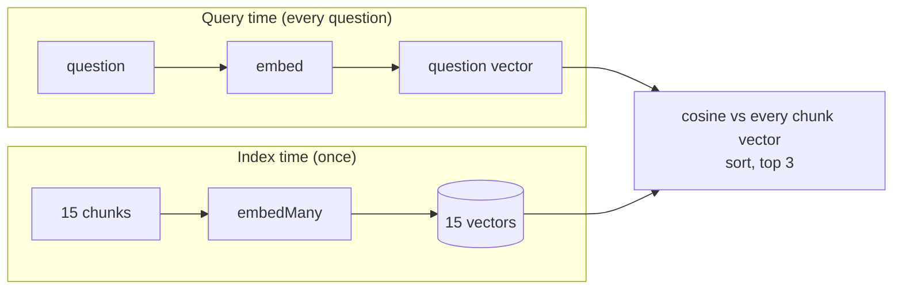

# Post 03 · Embeddings and vector search

*Series: [Lesson 04 — RAG](../README.md) · Post 3 of 8 · about 30 minutes*

> A worried parent types: *"can my kid visit grandpa in intensive care?"*
>
> The policy says *"Children under 12 may not visit the ICU unless approved by the charge nurse."* "Kid" isn't "children". "Grandpa" isn't "immediate family". A word search struggles; a search by **meaning** doesn't.

Post 01 retrieved with shared words, and admitted that was crude. This post replaces it with the core of every RAG system: **embeddings** and **vector search**, in about 20 lines and no database.

---

## The idea, in plain English

### A quick recap of embeddings

[Lesson 01, post 06](../../01-foundations-structured-output/06-embeddings/README.md) introduced them: an **embedding model** turns a text into a list of numbers (a **vector**), and texts with similar meaning get vectors pointing in similar directions. **Cosine similarity** measures how close two directions are (1 = same, ~0 = unrelated).

### Vector search is three steps

1. **Index time** (once): embed every chunk. Keep the vectors.
2. **Query time**: embed the question with the **same** model.
3. Score every chunk vector against the question vector with cosine similarity; sort; take the top *k*.



That's all "semantic search" is. Vector databases (post 04) only make step 3 fast and the vectors persistent.

### Two rules that bite people

- **Same model for chunks and questions.** Vectors from different models (or versions) live in different "spaces"; comparing them is meaningless. Change `EMBED_MODEL` → re-embed everything.
- **Embed what you'll match against.** We embed `heading + text`, so a chunk about "11:00–12:00" also carries "ICU visiting hours".

---

## Let's see it in code

Open [`example.ts`](./example.ts).

> **Course helpers:** this example imports `embeddingModel`, `env`, `section` from `@learn/shared`, the small helper package every lesson uses so that no example names a model or provider. `embeddingModel()` returns the embedding model named in `.env` (`EMBED_MODEL`); `env` gives typed access to the `.env` settings (provider, Ollama URL, model names); and `section()` prints a bold heading in the console output. See [the `@learn/shared` guide](../../shared/README.md) for every helper.

### Step 1 — chunk and embed all documents

```ts
const texts = chunks.map((c) => `${c.heading}\n${c.text}`);
const many = offline ? { embeddings: texts.map(fakeEmbed) } : await embedMany({ model: embeddingModel(), values: texts });
console.log('embedMany: embeddings.length =', many.embeddings.length, '| usage.tokens =', 'usage' in many ? many.usage.tokens : 'n/a (offline)');
const chunkVectors = many.embeddings;
```

`chunkMarkdown` from post 02 gives 15 chunks. `embedMany` embeds them in one batched call; `embeddingModel()` comes from your `.env` (`EMBED_MODEL`). With `--offline`, a fake "embedding" (one number per hand-picked word) stands in so you can run the mechanics without a model.

We saw the full `embedMany()` result in [lesson 01 post 06](../../01-foundations-structured-output/06-embeddings/README.md), so the `console.log` above logs only the two fields this post needs:

- `embeddings`: one vector per value, **in the same order**: `embeddings[i]` belongs to `values[i]` (and so to `chunks[i]`). That is why `chunkVectors[i]` lines up with `chunks[i]` later.
- `usage.tokens`: tokens the embedding model read: your ingest cost.

Offline, `many` is only `{ embeddings }`, with 8-number fake vectors, so there is no `usage`.

### Step 2 — embed the question

```ts
// 2. Embed the question with the SAME model (vectors from different models are not comparable).
const one = offline ? { embedding: fakeEmbed(question) } : await embed({ model: embeddingModel(), value: question });
console.log('embed: usage.tokens =', 'usage' in one ? one.usage.tokens : 'n/a (offline)');
const queryVector = one.embedding;
```

`embed` is the single-value version (full result: [lesson 01 post 06](../../01-foundations-structured-output/06-embeddings/README.md)): one `embedding` (the same 1024 numbers long as every chunk vector, which is what makes them comparable) and `usage`.

### Step 3 — score and sort

```ts
const ranked = chunks
  .map((c, i) => ({ heading: c.heading, score: cosineSimilarity(queryVector, chunkVectors[i]!) }))
  .sort((a, b) => b.score - a.score);
```

`cosineSimilarity` comes from the AI SDK. This is a "brute-force" search: compare with every chunk. Perfectly fine for thousands of chunks.

This is the one value we print in full with the toolkit's `dump()` ([what it is](../../shared/README.md#dumplabel-value--print-the-full-returned-value)), because it is the first vector-search hit list you meet:

```ts
dump('top 3 hits', ranked.slice(0, 3));
```

Each hit is just `{ heading, score }` with the full, unrounded cosine score.

---

## Run it

From the lesson folder:

```bash
npm run post:03                                                   # uses EMBED_MODEL
npx tsx 03-embeddings-vector-search/example.ts "is my little boy allowed to see grandpa in critical care?"
npm run post:03:offline                                           # fake embeddings
```

### What you should see

With `qwen3-embedding:0.6b`:

```
── What an embedding looks like (qwen3-embedding:0.6b) ──
1024 numbers, starting [-0.056, 0.054, -0.002, -0.038, 0.041, …]

── Top 3 for: "can my kid visit grandpa in intensive care?" ──
  1. 0.597  Visiting Hours Policy (Al Noor General Hospital — fictional) › Pediatric ward
  2. 0.574  Visiting Hours Policy (Al Noor General Hospital — fictional) › Intensive Care Unit (ICU)
  3. 0.462  Visiting Hours Policy (Al Noor General Hospital — fictional) › General wards
  …  lowest: 0.272  Telehealth Consultations (fictional) › Fees
```

Read this carefully. Vector search found the right **document**: all three visiting-hours sections beat everything else. But the top hit is **Pediatric ward** ("child"), not the **ICU** rule we need. Embeddings capture "this is about kids visiting", not "the rule about kids in the ICU". That near-miss is exactly what post 05 (hybrid) and post 06 (reranking) fix.

Notice also the scores: the best is ~0.6 and the worst ~0.27. Real embedding scores are compressed; only the **order** matters.

Before the ranking, the run also logs the targeted usage fields, and after it the one dump (a real run, trimmed at `…`; the numbers depend on your embedding model):

```
embedMany: embeddings.length = 15 | usage.tokens = 756
embed: usage.tokens = 11
…
▼ top 3 hits
[
  {
    heading: 'Visiting Hours Policy (Al Noor General Hospital — fictional) › Pediatric ward',
    score: 0.5969682438854131
  },
  …
]
```

Embedding the whole corpus took **756 tokens**, the question **11**. That's the economics of RAG: pay for the documents once, then a few tokens per question.

## Common gotchas

- ❌ **Mixing embedding models** between indexing and querying. Results become random, silently.
- ❌ **Treating the score as a probability** or using a fixed threshold like "> 0.8 = relevant". Scores depend on the model; compare ranks, or calibrate a threshold on your own data.
- ❌ **Re-embedding all documents on every request** (like this demo does). Embed once and store: post 04.
- ❌ **Expecting vectors to match exact tokens** like `SAR 100`, `ICD-10 I10` or a drug name. They're weak at that: post 05.
- ✅ Embed `heading + text`, not the bare text.

## Try it yourself

1. Try *"refill my insulin"*, *"video doctor visit price"*, and *"when do I have to leave my room?"*. Is the top hit right each time?
2. Embed the bare `c.text` instead of `heading + text`. Which questions get worse?
3. Set a different `EMBED_MODEL` in `.env` (e.g. a bigger `qwen3-embedding` or `nomic-embed-text`), rerun, and compare the top 3 for the kid question.

## Key takeaways

- Vector search = embed chunks once, embed the question, rank by **cosine similarity**.
- Use the **same embedding model** for both; changing it means re-embedding.
- Embeddings find **related meaning**, which can be a near-miss; they're weak on exact terms.
- Brute-force search is fine at small scale; a store (post 04) keeps vectors between runs.

---

[← Previous: Chunking](../02-chunking/README.md) · [📚 Series index](../README.md) · [Next: A vector store on SQLite →](../04-vector-store-sqlite/README.md)
