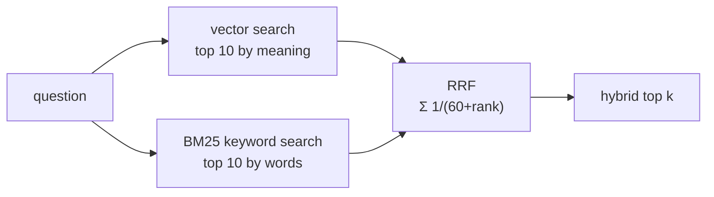

# Post 05 · Hybrid search: keywords + vectors

*Series: [Lesson 04 — RAG](../README.md) · Post 5 of 8 · about 35 minutes*

> A billing clerk searches for *"SAR 100 deposit"*. Vector search's second and third results are about **telehealth technical requirements** and **pharmacy pickup**.
>
> Meanwhile, keyword search can't tell that a "kid" is a child. Each method fails where the other one shines.

Embeddings understand **meaning** but are fuzzy about **exact tokens**: amounts, codes (`ICD-10 I10`), drug names, phone numbers, ids. Classic keyword search is the opposite. **Hybrid search** runs both and merges the results. It's the default in most serious RAG systems, and it's cheap.

---

## The idea, in plain English

### Keyword search: BM25

**BM25** is the ranking formula behind most search engines since the 1990s. Roughly: a chunk scores higher when it contains the query's words, especially **rare** words (`deposit` beats `the`), and is not penalised for being long. SQLite ships it in its **FTS5** full-text index: `bm25(chunks_fts)`.

### Two rankings with different scales

Vector scores are cosines (~0.2–0.7). BM25 scores are unbounded (5.57, 1.84…). You can't add them. You could normalise and weight them, but that needs tuning.

### Reciprocal Rank Fusion (RRF)

RRF ignores the scores and uses only the **ranks**:

> score(chunk) = Σ over each list of **1 / (60 + rank)**

A chunk ranked 1st in one list gets 1/61; 2nd gets 1/62; absent gets 0. Chunks that appear high in **both** lists win. The constant 60 comes from the original paper and rarely needs changing. No tuning, no scale problems.



---

## Let's see it in code

Open [`example.ts`](./example.ts) and the store, [`../pipeline/store.ts`](../pipeline/store.ts).

> **Course helpers:** this example imports `embeddingModel`, `section` from `@learn/shared`, the small helper package every lesson uses so that no example names a model or provider. `embeddingModel()` returns the embedding model named in `.env` (`EMBED_MODEL`); and `section()` prints a bold heading in the console output. See [the `@learn/shared` guide](../../shared/README.md) for every helper.

### The keyword index

```ts
CREATE VIRTUAL TABLE IF NOT EXISTS chunks_fts USING fts5(id UNINDEXED, heading, text);
```

An FTS5 table next to `chunks`, filled in the same `upsert` transaction. Heading and text are indexed; the id is just carried along.

### Keyword search

```ts
// Turn free text into a safe FTS5 OR-query of terms (avoids FTS syntax errors on "?", "-" etc.).
const terms = query.toLowerCase().match(/[\p{L}\p{N}]{3,}/gu) ?? [];
```

User text like `can my kid…?` is not valid FTS5 syntax. We extract words of 3+ characters and build `"can" OR "kid" OR …`.

```ts
`SELECT c.id, c.source, c.heading, c.text, bm25(chunks_fts) AS rank
 FROM chunks_fts JOIN chunks c ON c.id = chunks_fts.id
 WHERE chunks_fts MATCH ? ORDER BY rank LIMIT ?`,
```

```ts
return rows.map(({ rank, ...c }) => ({ ...c, score: -rank })); // bm25(): lower = better
```

SQLite's `bm25()` returns *lower = better*, so we flip the sign to make "higher = better" like the vector scores.

### Hybrid search with RRF

```ts
hybridSearch(query: string, queryEmbedding: number[], k = 5, rrfK = 60): Hit[] {
  const fused = new Map<string, Hit>();
  for (const list of [this.vectorSearch(queryEmbedding, k * 2), this.keywordSearch(query, k * 2)]) {
    list.forEach((hit, rank) => {
      const prev = fused.get(hit.id);
      fused.set(hit.id, { ...hit, score: (prev?.score ?? 0) + 1 / (rrfK + rank + 1) });
    });
  }
  return [...fused.values()].sort((a, b) => b.score - a.score).slice(0, k);
}
```

Take `2k` from each list (a wider net), add `1/(60 + rank)` per appearance, sort, keep `k`. That's the whole algorithm.

### The comparison

```ts
print(store.vectorSearch(queryVector, 3));
```

```ts
print(store.keywordSearch(q, 3));
```

```ts
print(store.hybridSearch(q, queryVector, 3));
```

---

## Run it

From the lesson folder (run post 04 first so `data/rag.db` exists):

```bash
npm run post:05                                          # two built-in questions
npx tsx 05-hybrid-search/example.ts "refill insulin"     # your own
npm run post:05:offline                                  # fake embeddings, in-memory
```

### What you should see

With `qwen3-embedding:0.6b`:

```
── "can my kid visit grandpa in intensive care?" ──
  Vector (cosine): meaning
    1. 0.5972  Visiting Hours Policy (…) › Pediatric ward
    2. 0.5746  Visiting Hours Policy (…) › Intensive Care Unit (ICU)
    3. 0.4636  Visiting Hours Policy (…) › General wards
  Keyword (BM25): exact words only
    1. 5.0455  Visiting Hours Policy (…) › Intensive Care Unit (ICU)
    2. 1.7182  Visiting Hours Policy (…) › Pediatric ward
    3. 1.4052  Prescription Refill Policy (fictional) › Pharmacy pickup
  Hybrid (RRF of both)
    1. 0.0325  Visiting Hours Policy (…) › Pediatric ward
    2. 0.0325  Visiting Hours Policy (…) › Intensive Care Unit (ICU)
    3. 0.0159  Visiting Hours Policy (…) › General wards

── "SAR 100 deposit" ──
  Vector (cosine): meaning
    1. 0.3345  Outpatient Appointment Cancellation Policy (fictional) › Late cancellations and no-shows
    2. 0.3006  Telehealth Consultations (fictional) › Technical requirements
    3. 0.2998  Prescription Refill Policy (fictional) › Pharmacy pickup
  Keyword (BM25): exact words only
    1. 5.5745  Outpatient Appointment Cancellation Policy (fictional) › Late cancellations and no-shows
  Hybrid (RRF of both)
    1. 0.0328  Outpatient Appointment Cancellation Policy (fictional) › Late cancellations and no-shows
    …
```

What to notice:

- **Kid question**: BM25 put the ICU rule first (thanks to "intensive" and "care"); vectors put it second. Hybrid now has ICU in the top 2, tied with Pediatric ward, and pushed the unrelated "Pharmacy pickup" out.
- **Deposit question**: vectors barely separate the right chunk (0.33 vs 0.30); BM25 finds it with a huge margin and nothing else. Hybrid keeps it clearly first.

Hybrid didn't make the kid question perfect; it made the right chunk reliably **present** in the top few. Putting it **first** is the reranker's job (post 06).

## Common gotchas

- ❌ **Passing raw user text to FTS5 `MATCH`.** A `?`, `-` or `"` causes syntax errors (or worse, query injection). Extract terms as we do.
- ❌ **Adding cosine and BM25 scores.** Different scales: the bigger one wins. Use RRF (or normalise carefully).
- ❌ **Only taking `k` from each list.** Fuse a wider pool (`2k` here), then cut.
- ❌ **Language mismatch.** FTS5's default tokenizer doesn't stem ("visits" ≠ "visit") or handle Arabic well. Look at `porter` or `unicode61` options, or rely more on vectors for those cases.
- ✅ Keep both indexes in the **same transaction** so they never disagree.

## Try it yourself

1. Search for `8001234567` (the call-centre number). Which list finds it?
2. Change `rrfK` from 60 to 1. How does the hybrid order change, and why? (Hint: 1/2 vs 1/3 is a much bigger gap than 1/61 vs 1/62.)
3. Add a weight: count keyword ranks twice for queries that contain a digit. Is that better for `SAR 100 deposit`? How would you know? (Lesson 05.)

## Key takeaways

- **Vectors** match meaning; **BM25** matches exact, rare words. Each covers the other's blind spot.
- **RRF** merges rankings by rank alone: Σ 1/(60 + rank). No score scaling, no tuning.
- SQLite **FTS5** gives you BM25 in the same file as your vectors.
- Hybrid improves **recall** (the right chunk is in the top few). Ordering the top few is post 06.

---

[← Previous: A vector store on SQLite](../04-vector-store-sqlite/README.md) · [📚 Series index](../README.md) · [Next: Reranking →](../06-reranking/README.md)
