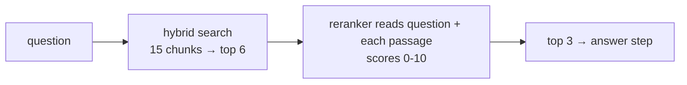

# Post 06 · Reranking

*Series: [Lesson 04 — RAG](../README.md) · Post 6 of 8 · about 30 minutes*

> Hybrid search returned six candidates for *"Can I get my discharge summary the same day I leave?"*. The right section is in there, tied for first with "Discharge time".
>
> The answer step will only see the top 3. Can a second, more careful reader put the best ones on top?

That second reader is a **reranker**. It is one of the most effective upgrades to a RAG system with a **good** reranking model, and on this box's tiny model it made things **worse**. Both facts are the lesson.

---

## The idea, in plain English

### Recall first, then precision

- **Retrieval** (posts 03–05) is built for **recall**: cheaply get the right chunk *somewhere* in the top 6–20. It compares precomputed vectors and keywords; it never reads the question and chunk together.
- A **reranker** is built for **precision**: for each candidate, read the question **and** the passage **together** and score how well the passage answers it. Slower per item, so you only run it on the shortlist.



### Two kinds of reranker

| Kind | How | Trade-off |
|---|---|---|
| **LLM as judge** (`llmRerank`) | any chat model scores each passage 0–10 with structured output | works with any model you have; N model calls; quality depends heavily on the model |
| **Cross-encoder / rerank model** (`modelRerank`) | a model trained only for relevance (Cohere Rerank, bge-reranker, Bedrock rerank), via the AI SDK's `rerank()` | fast and accurate; needs a provider or a model that offers it |

### The rule: measure it

A reranker is a model making judgements. A weak one can **shuffle good results into bad order**. Never switch one on because a blog said so: compare hit rate with and without it on your questions (lesson 05 builds exactly that). The pipeline has a switch for this: `RERANKER=llm` or `RERANKER=none`.

---

## Let's see it in code

Open [`example.ts`](./example.ts) and [`../pipeline/rerank.ts`](../pipeline/rerank.ts).

> **Course helpers:** this example imports `chatModel`, `embeddingModel`, `section`, `modelLabel` from `@learn/shared`, the small helper package every lesson uses so that no example names a model or provider. `chatModel()` returns the chat model named in `.env` (`CHAT_MODEL`), on whichever provider you configured; `embeddingModel()` returns the embedding model named in `.env` (`EMBED_MODEL`); `section()` prints a bold heading in the console output; and `modelLabel()` returns a printable label such as `ollama:qwen3:0.6b`. See [the `@learn/shared` guide](../../shared/README.md) for every helper.

### Step 1 — retrieve generously

```ts
const candidates = store.hybridSearch(question, queryVector, 6);
```

### Step 2 — rerank

```ts
const top = await llmRerank(judge, question, candidates, 3);
```

```ts
dump('llmRerank() result', top);
```

`dump()` ([what it is](../../shared/README.md#dumplabel-value--print-the-full-returned-value)) prints the reranker's full output. It is the **same `Hit` objects** as the candidates (`id`, `source`, `heading`, `text`), with two changes: `score` is now the judge's **0–10 relevance** instead of the RRF score (or `-1` if the judge's reply couldn't be parsed), and only the best 3 are left. Look at the `text` of each kept hit and decide for yourself whether it answers the question: that is the fastest way to see whether your judge is any good.

### Inside `llmRerank`

```ts
const Relevance = z.object({
  score: z.int().min(0).max(10).describe('integer 0-10: 0 = unrelated, 10 = directly answers the question'),
});
```

Structured output from lesson 01: the judge must return `{ "score": n }`, nothing else.

```ts
const { output } = await generateText({
  model,
  output: Output.object({ schema: Relevance }),
  temperature: 0,
  maxOutputTokens: 512,
  prompt: `Rate how well the passage helps answer the question.\nQuestion: ${query}\nPassage (${hit.heading}): ${hit.text}`,
});
```

One call per candidate, all in parallel (`Promise.all`), at temperature 0.

```ts
} catch {
  return { ...hit, score: -1 }; // unparseable judgement → push to the bottom, don't crash
}
```

```ts
return scored.sort((a, b) => b.score - a.score).slice(0, topN);
```

`Array.sort` is **stable**: candidates with equal scores keep their retrieval order. So an indecisive judge (everything 10/10) can't make things worse than retrieval… unless it gives *different* wrong scores, as you'll see.

### The cross-encoder option

```ts
const { ranking } = await rerank({ model, query, documents: hits.map((h) => `${h.heading}\n${h.text}`), topN });
```

`modelRerank` uses the AI SDK's `rerank()` with any reranking model, e.g. `cohere.reranking('rerank-v3.5')`. Same input, same output shape.

---

## Run it

From the lesson folder (needs `data/rag.db` from post 04):

```bash
npm run post:06                                                 # EMBED_MODEL + CHAT_MODEL as judge
npx tsx 06-reranking/example.ts "Can children visit the ICU?"   # your own question
npm run post:06:offline                                         # fake embeddings + word-overlap "judge"
```

### What you should see

The hybrid candidates (with `qwen3-embedding:0.6b`):

```
  1. rrf=0.0325  Inpatient Discharge Process (fictional) › Discharge summary
  2. rrf=0.0325  Inpatient Discharge Process (fictional) › Discharge time
  3. rrf=0.0315  Inpatient Discharge Process (fictional) › Follow-up
  4. rrf=0.0303  Visiting Hours Policy (…) › Pediatric ward
  5. rrf=0.0299  Prescription Refill Policy (fictional) › Chronic medication
  6. rrf=0.0298  Telehealth Consultations (fictional) › Fees
```

Retrieval already did well: the three discharge sections are on top. Then the rerank, on the box's small models:

```
── 2. After llmRerank (judge: ollama:qwen3:0.6b) ──
  1. relevance=10/10  Inpatient Discharge Process (fictional) › Discharge time
  2. relevance=10/10  Visiting Hours Policy (…) › Pediatric ward
  3. relevance=10/10  Prescription Refill Policy (fictional) › Chronic medication
  (6 judge calls, 1989 ms)

── 2. After llmRerank (judge: ollama:qwen3:1.7b), another run ──
  1. relevance=10/10  Inpatient Discharge Process (fictional) › Follow-up
  2. relevance=10/10  Telehealth Consultations (fictional) › Fees
  3. relevance=3/10  Inpatient Discharge Process (fictional) › Discharge summary
```

The full reranker output from a third run (0.6B judge, trimmed at `…`; scores change from run to run):

```
── 2. After llmRerank (judge: ollama:qwen3:0.6b) ───────────────
  1. relevance=10/10  Inpatient Discharge Process (fictional) › Discharge summary
  2. relevance=10/10  Telehealth Consultations (fictional) › Fees
  3. relevance=0/10  Inpatient Discharge Process (fictional) › Discharge time
▼ llmRerank() result
[
  {
    id: 'discharge.md#1',
    source: 'discharge.md',
    heading: 'Inpatient Discharge Process (fictional) › Discharge summary',
    text: 'Every patient receives a discharge summary listing diagnoses, medication changes and follow-up appointments. The summary is also shared to the patient app within 24 hours.',
    score: 10
  },
  {
    id: 'telehealth.md#2',
    source: 'telehealth.md',
    heading: 'Telehealth Consultations (fictional) › Fees',
    text: 'Telehealth follow-ups cost the same as in-person follow-ups and are covered by most insurance plans.',
    score: 10
  },
  {
    id: 'discharge.md#0',
    …
    score: 0
  }
]
  (6 judge calls, 1887 ms)
```

Reading the `text` makes the problem obvious: a passage about telehealth fees got 10/10 for a discharge question, and a hit with relevance **0** still made the top 3 only because there were just 6 candidates.

**Both small judges made the result worse.** The 0.6B judge gave "Pediatric ward" and "Chronic medication" 10/10 but scored "Discharge summary" (the real answer) lower, so the answer dropped out of the top 3. (Results vary between runs; one run kept "Discharge summary" on top but still let "Telehealth fees" in at 10/10.) The 1.7B judge scored the actual answer 3/10. A 0.6–1.7B model is too small to be a reliable judge. With a strong model (or a real rerank model) the right section reliably lands first. This is why the pipeline has `RERANKER=none`, and why lesson 05 measures before you choose.

## Common gotchas

- ❌ **Turning on reranking without measuring.** It can lower quality, as above, while adding latency and cost.
- ❌ **Reranking too few candidates.** If retrieval returns 3 and you keep 3, the reranker can only reorder. Retrieve 10–50, keep 3–5.
- ❌ **Letting one failed judgement crash the request.** Catch and score it low (`-1`).
- ❌ **Ignoring latency.** N judge calls per question. Run them in parallel and cap N.
- ✅ For production, prefer a dedicated rerank model (`modelRerank`) over a general chat model as judge.

## Try it yourself

1. Run with your `.env`'s largest chat model as the judge. Does the discharge summary come first now?
2. Change the judge prompt to ask for a short reason before the score (add `reason: z.string()` to `Relevance` before `score`). Does a "think first" field help a small judge?
3. Make reranking **conservative**: only move a candidate above another if its score is at least 3 points higher. Implement it, and compare on three questions.

## Key takeaways

- Retrieval optimises **recall**; a reranker optimises **precision** by reading question and passage **together**.
- Options: an **LLM judge** (any model, slower, quality varies) or a **rerank model** (fast, accurate).
- A weak judge can make results **worse**. Keep a `RERANKER=none` switch and **measure** (lesson 05).

---

[← Previous: Hybrid search: keywords + vectors](../05-hybrid-search/README.md) · [📚 Series index](../README.md) · [Next: Grounded answers with citations →](../07-grounded-answers-citations/README.md)
