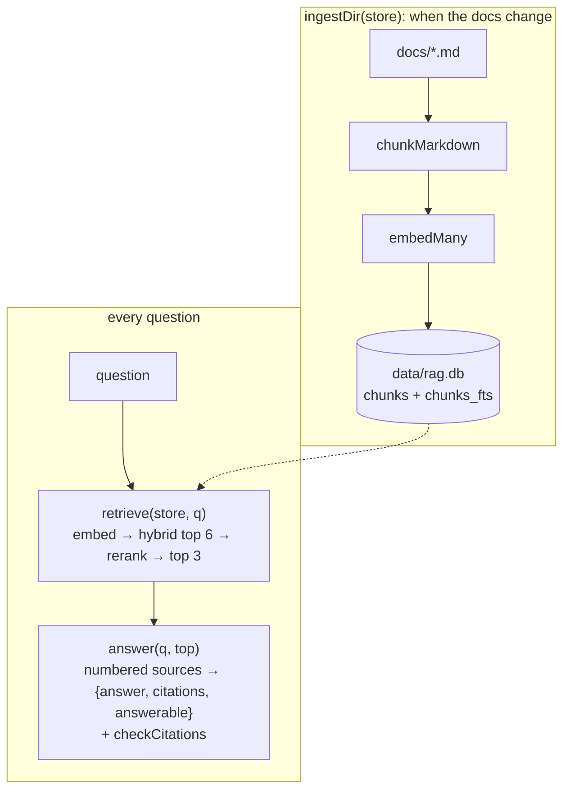

# Post 08 · The full pipeline

*Series: [Lesson 04 — RAG](../README.md) · Post 8 of 8 · about 30 minutes*

> You've built every part: chunks, embeddings, a store, hybrid search, a reranker, and grounded answers.
>
> Now a nurse-facing chat app, an eval suite (lesson 05) and an HTTP service (lesson 09) all need RAG. They shouldn't each re-wire seven posts. They should call **two functions**.

This post tours [`pipeline/`](../pipeline/), the small module the rest of the course imports as **`@learn/rag`**, and the CLI over it ([`example.ts`](./example.ts)). Then it's your turn: the week-4 exercise.

---

## The idea, in plain English

### Two flows, two functions (plus one)



| Function | File | From post |
|---|---|---|
| `chunkMarkdown(source, md)` | [`pipeline/chunk.ts`](../pipeline/chunk.ts) | 02 |
| `HybridStore`: `upsert`, `vectorSearch`, `keywordSearch`, `hybridSearch`, `clear` | [`pipeline/store.ts`](../pipeline/store.ts) | 04, 05 |
| `llmRerank`, `modelRerank` | [`pipeline/rerank.ts`](../pipeline/rerank.ts) | 06 |
| `openStore`, `ingestDir`, `retrieve`, `answer`, `checkCitations` | [`pipeline/rag.ts`](../pipeline/rag.ts) | 04, 07, this post |

### Why it's split like that

- **Ingest and query are separate** so ingest can run as a job (CI, a cron, a queue) and queries stay fast.
- **`retrieve` returns both `candidates` and `top`**, so you (and lesson 05) can see what reranking changed.
- **`answer` takes the model as an optional parameter**, so tests can pass a fake model and evals can compare models.
- **Config lives in `.env`**: `EMBED_MODEL`, `CHAT_MODEL`, `RERANKER=llm|none`. No code names a model.

---

## Let's see it in code

> **Course helpers:** this example imports `embeddingModel`, `section`, `stripThinking` from `@learn/shared`, the small helper package every lesson uses so that no example names a model or provider. `embeddingModel()` returns the embedding model named in `.env` (`EMBED_MODEL`); `section()` prints a bold heading in the console output; and `stripThinking()` removes a reasoning model's `<think>…</think>` text from a reply. `pipeline/rag.ts` also uses `chatModel()` (the chat model from `.env`) and `optional('RERANKER', 'llm')`, which reads an optional `.env` setting with a fallback. See [the `@learn/shared` guide](../../shared/README.md) for every helper.

### Ingest

```ts
export async function ingestDir(store: HybridStore, dir = DOCS_DIR) {
  store.clear(); // re-ingest from scratch, so chunks of deleted or edited docs don't linger
```

```ts
const { embeddings } = await embedMany({
  model: embeddingModel(),
  values: chunks.map((c) => `${c.heading}\n${c.text}`),
  maxParallelCalls: 4,
});
store.upsert(chunks, embeddings);
```

`maxParallelCalls` caps concurrent embedding requests: kind to a local Ollama, essential for rate-limited cloud APIs.

### Retrieve

```ts
export async function retrieve(store: HybridStore, question: string, k = 6) {
  const { embedding } = await embed({ model: embeddingModel(), value: question });
  const candidates = store.hybridSearch(question, embedding, k);
  const reranker = optional('RERANKER', 'llm');
  const top = reranker === 'llm' ? await llmRerank(chatModel(), question, candidates, 3) : candidates.slice(0, 3);
  return { candidates, top };
}
```

Post 05's hybrid search, post 06's reranker behind a switch.

### Answer

```ts
export async function answer(question: string, contexts: Hit[], model: LanguageModel = chatModel()) {
```

Post 07, unchanged.

### The CLI uses exactly that

```ts
const { candidates, top } = await retrieve(store, question); // hybrid top 6 → rerank (RERANKER=llm|none) → top 3
```

```ts
const a = await answer(question, top); // grounded, cited, may refuse
```

We already saw the full shapes these return, so the CLI prints only the fields that matter here. `top` is the 3 hits that become sources `[1]`–`[3]` (hit shape: [post 04](../04-vector-store-sqlite/README.md), [post 05](../05-hybrid-search/README.md) and [post 06](../06-reranking/README.md)); the `after rerank` lines show each one's `score`, which tells you which reranker ran: still the RRF score (≈0.03) with `RERANKER=none`, the judge's 0–10 with `RERANKER=llm`. For the answer we print the fields on top of [post 07](../07-grounded-answers-citations/README.md)'s result:

```ts
console.log('invalidCitations:', a.invalidCitations, '| contexts[0].text:', a.contexts[0]?.text);
```

`invalidCitations` lists citation numbers that point at no source, and `contexts` keeps the same three hits so you can show sources next to the answer.

`npm run search` logs just the question's embedding cost (`embed: usage.tokens = …`: a query costs a handful of tokens; the full `embed()` result is in [lesson 01 post 06](../../01-foundations-structured-output/06-embeddings/README.md)) and prints the vector, keyword and hybrid rankings.

### And so do later lessons

```ts
export { HybridStore, type Hit } from './store.ts';
export { chunkMarkdown, type Chunk } from './chunk.ts';
export { llmRerank, modelRerank } from './rerank.ts';
```

`package.json` exports `./pipeline/rag.ts` as `@learn/rag`. Lesson 05 imports `ingestDir`, `retrieve` and `answer` to score this pipeline; lesson 09 serves it over HTTP.

---

## Run it

From the lesson folder:

```bash
npm run ingest                                       # docs/*.md → data/rag.db
npm run search -- "SAR 100 deposit"                  # vector vs keyword vs hybrid
npm run ask -- "Can children visit the ICU?"         # = npm run post:08 with your question
RERANKER=none npm run ask -- "Can children visit the ICU?"
# or: npx tsx 08-full-pipeline/example.ts ask "Can children visit the ICU?"
```

### What you should see

With `RERANKER=none`, `qwen3-embedding:0.6b` and `qwen3:0.6b`:

```
── Retrieve + rerank ──
  1. rrf=0.0328 Visiting Hours Policy (…) › Intensive Care Unit (ICU)
  2. rrf=0.0323 Visiting Hours Policy (…) › Pediatric ward
  3. rrf=0.0299 Telehealth Consultations (fictional) › Technical requirements
  …
after rerank (RERANKER=none):
  [1] score=0.033 Visiting Hours Policy (…) › Intensive Care Unit (ICU)
  …

── Answer ──
Yes, children under 12 can visit the ICU, provided they are approved by the charge nurse. They must follow the hand hygiene and gown requirements.
{ answerable: true, citations: [ 1 ], citationsValid: true }
```

Retrieval is right, the citation is valid… and the answer is subtly **wrong**. The policy says children under 12 may **not** visit unless approved; *"Yes, children under 12 can visit"* flips the default. The `qwen3:1.7b` answer to the same question even contradicted itself: *"Children under 12 may visit the ICU only if approved… Additionally, children under 12 may not visit the ICU unless approved."*

The extra line from a later run of the same command (trimmed at `…`; the answer wording changes from run to run):

```
Yes, children under 12 may visit the ICU unless approved by the charge nurse. …
{ answerable: true, citations: [ 1, 2 ], citationsValid: true }
invalidCitations: [] | contexts[0].text: ICU visiting is limited to immediate family, 11:00–12:00 and 18:00–19:00. Visitors must perform hand hygiene and wear a gown. Children under 12 may not visit the ICU unless approved by the charge nurse.
```

With that line you can put `answer` and `contexts[0].text` side by side: the source says "may **not** visit … unless approved", the answer starts "Yes, … may visit … unless approved". It also cites `[2]` (Pediatric ward), which says nothing about the ICU.

The `score=` lines also show what the LLM reranker can do. With the default `RERANKER=llm` and the default no-show question, one `qwen3:0.6b` run gave **10/10** to "How to cancel", "Chronic medication" and "Telehealth fees", and dropped "Late cancellations and no-shows" (the only section with the answer, ranked first by hybrid search) out of the top 3. The model then answered *"24 hours"*, with a valid citation.

No check in this lesson catches that. The citation points at the right source; the claim just doesn't follow from it. Catching this is called **faithfulness evaluation**, and it is the first thing lesson 05 builds.

## Common gotchas

- ❌ **Shipping without measurement.** "It answered my three test questions" is not evidence (see above). Lesson 05.
- ❌ **Re-ingesting on every request** or in the web server's startup path. Ingest is a job.
- ❌ **Changing `EMBED_MODEL` without re-ingesting.** The stored vectors no longer match the question vectors.
- ❌ **Leaving `RERANKER=llm` on with a small judge.** Post 06 showed it can hurt. Measure both settings.
- ✅ Keep the module boundary small (`ingestDir`, `retrieve`, `answer`) so you can swap the store, reranker or model behind it.

## Try it yourself: the week-4 exercise

From the learning map: **contextual chunk headers**, or **the same `HybridStore` interface on pgvector or sqlite-vec**. Pick one.

**Option A: contextual chunk headers.** Today each chunk is embedded as `heading + text`. Add one generated sentence of context per chunk (*"This section of the Al Noor visiting policy covers ICU visiting rules for families and children."*), produced once at ingest time by `CHAT_MODEL`, and embed `context + heading + text`.
1. Add the step to `ingestDir` behind an env switch (e.g. `CONTEXT_HEADERS=1`).
2. Compare `npm run search` results for the kid question and *"SAR 100 deposit"* with and without it.
3. In lesson 05, measure retrieval hit@3 for both. Keep it only if the number goes up.

**Option B: pgvector or sqlite-vec.** Implement a class with the same methods as `HybridStore` (`upsert`, `vectorSearch`, `keywordSearch`, `hybridSearch`, `count`, `clear`) on Postgres + pgvector (`ORDER BY embedding <=> $1`, `tsvector` for keywords) or on sqlite-vec. Swap it into `openStore` and check that `npm run test:offline` still passes.

Other small ones:
1. Run `npm run ask` with `RERANKER=llm` and `RERANKER=none` on five questions. Which would you ship?
2. Ask about something no doc covers (*"Is there a cafeteria?"*). Does the pipeline refuse?

## Key takeaways

- The whole RAG system is **`ingestDir`** (when docs change) and **`retrieve` → `answer`** (per question).
- Keep the module small, configurable through `.env`, and testable with fake models.
- Valid citations don't mean a **faithful** answer: small models can cite the right source and still get it wrong.
- That's why the next lesson is **evals**: measure retrieval, refusals, citations and faithfulness before you change anything.

---

[← Previous: Grounded answers with citations](../07-grounded-answers-citations/README.md) · [📚 Series index](../README.md) · [Lesson 05 — Evals →](../../05-evals/README.md)
