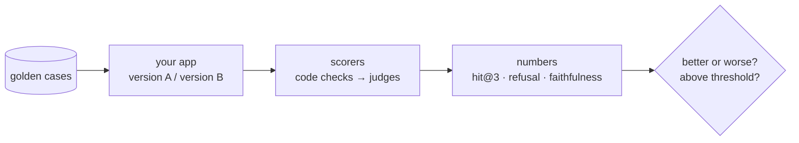

# Post 01 · Why evals?

*Series: [Lesson 05 — Evals](../README.md) · Post 1 of 7 · about 25 minutes*

> Lesson 04 ended with an argument. One blog says *"always add a reranker"*. Post 06 showed a small model making results worse. Your colleague tried three questions and "it looked fine".
>
> Who's right? In normal engineering you'd settle it with a benchmark. In AI engineering, you settle it with an **eval**.

This post explains what evals are and why AI apps need them more than ordinary code needs unit tests, and then settles the reranker question with two numbers in about 40 lines.

---

## The idea, in plain English

### Why ordinary tests aren't enough

A unit test says: same input → same output, assert equality. An AI app breaks every part of that:

- **Output varies.** Different wording each run; a different model gives different answers.
- **Many knobs, invisible effects.** Prompt wording, model, chunk size, embedding model, reranker, `k`. Change one and some answers get better while others quietly get worse.
- **"Looks fine" doesn't scale.** You can eyeball three answers. You can't eyeball 300 after every change, and you'll miss the subtle ones (lesson 04, post 08: the right citation and the wrong rule).

### What an eval is

An **eval** is a repeatable experiment:

1. a fixed set of **cases**: real questions with known good properties (post 02),
2. run through the **real app**,
3. **scored** by metrics: cheap code checks first (post 03), a model as judge where meaning matters (posts 04–05),
4. **aggregated** into numbers you compare between versions, and gate CI on (post 06).



Same habit as performance work: you don't ship an optimisation because it *feels* faster, you benchmark it.

### Measure the cheapest thing first

Retrieval is the foundation of RAG and the cheapest part to measure: no answer generation, just "did the right document come back?". Two metrics:

- **hit@1**: the right document is ranked **first**.
- **hit@3**: the right document is in the **top 3** (what the answer step sees).

---

## Let's see it in code

Open [`example.ts`](./example.ts). It uses the golden cases from [post 02](../02-golden-dataset/README.md) and lesson 04's pipeline, imported as `@learn/rag`.

> **Course helpers:** this example imports `chatModel`, `embeddingModel`, `section`, `modelLabel` from `@learn/shared`, the small helper package every lesson uses so that no example names a model or provider. `chatModel()` returns the chat model named in `.env` (`CHAT_MODEL`), on whichever provider you configured; `embeddingModel()` returns the embedding model named in `.env` (`EMBED_MODEL`); `section()` prints a bold heading in the console output; and `modelLabel()` returns a printable label such as `ollama:qwen3:0.6b`. See [the `@learn/shared` guide](../../shared/README.md) for every helper.

### Build the index, fresh every run

```ts
const store = new HybridStore(); // in-memory, rebuilt every run
```

```ts
} else await ingestDir(store);
```

A fresh in-memory index means every run starts from the same state: reproducible results.

### Same candidates, two orderings

```ts
const candidates = store.hybridSearch(c.question, vector, 6);
const reranked = await llmRerank(reranker, c.question, candidates, 3);
```

Both modes see the **same** six candidates, so the only difference is the reranker. Change one thing at a time.

### Score

```ts
const hit = (hits: Hit[], source: string, k: number) => hits.slice(0, k).some((h) => h.source === source);
```

```ts
score[mode].hit1 += Number(hit(hits, c.expectedSource!, 1));
score[mode].hit3 += Number(hit(hits, c.expectedSource!, 3));
```

---

## Run it

From the lesson folder:

```bash
npm run post:01            # EMBED_MODEL, plus CHAT_MODEL as the reranker
npm run post:01:offline    # fake embeddings + a word-overlap "reranker"
# or: npx tsx 01-why-evals/example.ts [--offline]
```

### What you should see

With `qwen3-embedding:0.6b` and `qwen3:0.6b` as the reranker:

```
── Retrieval on 6 golden questions (reranker: ollama:qwen3:0.6b) ──
  noshow-deposit           none: appointment-cancellation.md  llm: appointment-cancellation.md
  cancel-notice            none: appointment-cancellation.md  llm: appointment-cancellation.md
  icu-children             none: visiting-hours.md            llm: visiting-hours.md
  controlled-refill        none: medication-refill.md         llm: medication-refill.md
  discharge-time           none: discharge.md                 llm: discharge.md
  telehealth-first-visit   none: telehealth.md                llm: visiting-hours.md

── The numbers ──
│ RERANKER=none │ '100%' │ '100%' │
│ RERANKER=llm  │ '83%'  │ '100%' │
```

Argument settled, **for this model and this data**: hybrid search alone already puts the right document first every time; the small reranker moved one wrong document to the top. With these models, `RERANKER=none` is better and faster. With a strong reranking model the answer may flip, and now you have the tool to find out in a minute.

Six questions is a tiny sample. One flipped case is 17 percentage points. Grow the dataset (post 02) before trusting small differences.

## Common gotchas

- ❌ **Deciding by anecdote.** "I tried three questions" is not evidence; neither is a blog post about someone else's data.
- ❌ **Changing two things at once.** New model *and* new chunk size: which one helped?
- ❌ **Over-reading tiny datasets.** With 6 cases, every case is ±17%. Report the count next to the percentage.
- ❌ **Skipping retrieval metrics.** If the right document isn't retrieved, no prompt fix will help.
- ✅ Re-run evals whenever a knob changes: model, prompt, chunking, embedding model, reranker, `k`.

## Try it yourself

1. Run with your strongest chat model as `CHAT_MODEL`. Does the reranker help now?
2. Change `hybridSearch(…, 6)` to `3`. What happens to the `llm` row, and why? (Hint: lesson 04, post 06.)
3. Replace hybrid search with `store.vectorSearch` and compare hit@1. Was post 05's hybrid search worth it on these questions?

## Key takeaways

- AI apps change behaviour with every knob, and outputs vary: you need **evals**, not just unit tests.
- An eval = **fixed cases → real app → scorers → numbers** you compare and gate on.
- Start with **retrieval** (hit@1, hit@3): cheapest to measure, and everything depends on it.
- Measure, don't guess: here the small reranker **hurt** (100% → 83% hit@1).

---

[← Lesson 04 — RAG](../../04-rag/README.md) · [📚 Series index](../README.md) · [Next: A golden dataset →](../02-golden-dataset/README.md)
