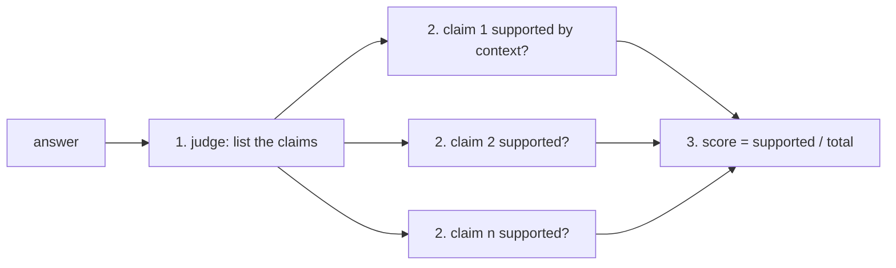

# Post 04 · An LLM judge for faithfulness

*Series: [Lesson 05 — Evals](../README.md) · Post 4 of 7 · about 30 minutes*

> *"Yes, children under 12 can visit the ICU, provided they are approved by the charge nurse."*
>
> Right document. Valid citation. Contains `12` and `charge nurse`. Every code check in post 03 passes. A nurse reading it next to the policy spots the problem in two seconds: the policy says they may **not** visit unless approved.

Checking **meaning** needs something that reads. The practical answer is a second model acting as a **judge**. This post builds the most important judge for RAG, **faithfulness**: does every claim in the answer follow from the retrieved context?

---

## The idea, in plain English

### Faithfulness vs correctness

- **Faithfulness** (also called *groundedness*): is the answer supported by the **context the app retrieved**? Catches hallucination and distortion. Needs no reference answer.
- **Correctness / factuality**: does the answer match a **reference answer**? Needs one per case (post 05).

For RAG, faithfulness is the first one to add: it directly checks the promise "answer only from the sources".

### Don't ask "is this faithful? 1–10"

One vague question gets a vague, inconsistent number. The RAGAS-style method breaks it into small, checkable steps:



Small yes/no questions are much easier for a model to get right than one big judgement, and the per-claim verdicts tell you **which** sentence was the problem.

### Judges are models too

- A judge can be **wrong**, especially a small one. Use a judge **at least as strong** as the model under test (`JUDGE_MODEL` in `.env`).
- A judge can **fail** (bad JSON, timeout). That's *no score*, never a pass. Post 06's gate exits 1 if every judge call fails.
- Spot-check the judge against your own judgement on a few cases before trusting its numbers.

---

## Let's see it in code

Open [`faithfulness.ts`](./faithfulness.ts) (the judge, used by the harness in post 06) and [`example.ts`](./example.ts).

> **Course helpers:** this example imports `chatModel`, `optional`, `section`, `modelLabel` from `@learn/shared`, the small helper package every lesson uses so that no example names a model or provider. `chatModel()` returns the chat model named in `.env` (`CHAT_MODEL`), on whichever provider you configured; `optional(name, fallback)` reads an optional `.env` setting; `section()` prints a bold heading in the console output; and `modelLabel()` returns a printable label such as `ollama:qwen3:0.6b`. See [the `@learn/shared` guide](../../shared/README.md) for every helper.

### Step 1 — extract claims

```ts
const { output: extracted } = await generateText({
  model: judge,
  temperature: 0,
  output: Output.object({ schema: z.object({ claims: z.array(z.string()).max(8) }) }),
  instructions: 'Split the answer into short, self-contained factual claims (max 8). Copy its meaning exactly.',
  prompt: `Answer:\n${answer}`,
});
```

Structured output (lesson 01, post 07) gives a typed `string[]`. `temperature: 0` for repeatability.

### Step 2 — one verdict per claim

```ts
instructions: 'You check facts. supported=true only if the context directly states the claim. A claim that contradicts the context is NOT supported.',
prompt: `Context:\n${ctx}\n\nClaim: "${claim}"`,
```

The judge sees the **same context** the app saw, never the whole document collection. The verdicts run in parallel (`Promise.all`).

### Step 3 — the score

```ts
return { score: verdicts.filter((v) => v.supported).length / verdicts.length, claims: verdicts };
```

### The example: a faithful answer and the flipped one

```ts
faithful: 'No. Children under 12 may not visit the ICU unless the charge nurse approves [1].',
flipped: 'Yes, children under 12 can visit the ICU, provided they are approved by the charge nurse. They must follow the hand hygiene and gown requirements [1].',
```

```ts
const judgeId = optional('JUDGE_MODEL');
const judge = offline ? overlapJudge : chatModel(judgeId);
```

`JUDGE_MODEL` if set, otherwise `CHAT_MODEL`. With `--offline`, a fake judge marks a claim "supported" when most of its words appear in the context: words, not meaning, on purpose.

---

## Run it

From the lesson folder:

```bash
npm run post:04                                   # JUDGE_MODEL, or CHAT_MODEL
JUDGE_MODEL=qwen3:1.7b npm run post:04            # pick a stronger judge
npm run post:04:offline                           # word-overlap fake judge
```

### What you should see

With `JUDGE_MODEL=qwen3:1.7b`:

```
── faithful: "No. Children under 12 may not visit the ICU unless the charge nurse approves [1]." ──
  ✅ Children under 12 may not visit the ICU unless the charge nurse approves.
  ✅ This restriction is outlined in the provided source.
  faithfulness = 1.00

── flipped: "Yes, children under 12 can visit the ICU, provided they are approved by the charge nurse. …" ──
  ❌ Children under 12 can visit the ICU.
  ❌ Visits are approved by the charge nurse.
  ✅ Visitors must follow hand hygiene and gown requirements.
  ❌ These rules apply to all visitors under 12 years old.
  faithfulness = 0.25
```

Caught: the flipped answer scores 0.25, and the ❌ lines point at the exact problem. (Notice the judge also *added* a claim, "these rules apply to all visitors under 12", that wasn't really in the answer. Judges are imperfect.)

With the tiny `qwen3:0.6b` as judge, **both** answers scored 1.00: it marked *"Yes, children under 12 can visit the ICU"* as supported. In the harness run (post 06) it also gave 1.0 to a real app answer that said *"Yes, a 9-year-old can visit"*. A judge weaker than the problem is worse than no judge: it adds false confidence.

The offline fake judge fails the same way (it scores the flipped answer 1.00 and the correct "No." 0.50), because it compares words, exactly like post 03's checks.

## Common gotchas

- ❌ **A judge weaker than the app.** It rubber-stamps errors. Use a stronger `JUDGE_MODEL`, or a hosted one just for evals.
- ❌ **One big "rate 1–10" question.** Break it into claims and yes/no verdicts.
- ❌ **Judging against the wrong context.** Use exactly what the app retrieved; otherwise you're testing something else.
- ❌ **Counting a judge error as a pass.** Record `null` and count failures.
- ❌ **Never checking the judge.** Read its verdicts on 10 cases yourself. If you disagree often, fix the judge prompt or model before trusting the numbers.
- ✅ Keep `temperature: 0` and structured output for judges.

## Try it yourself

1. Run with `JUDGE_MODEL` set to your strongest model. Do the per-claim verdicts match yours?
2. Add a third answer that is faithful but incomplete: *"Children under 12 need approval."* What does faithfulness say? (It should be 1.0: faithfulness doesn't measure completeness. That's what `mustContainAll` and factuality are for.)
3. Run the flipped answer five times. Is the score stable? What would you do if it isn't?

## Key takeaways

- **Faithfulness** = every claim in the answer is supported by the retrieved context. It catches what word checks can't.
- Build it as **claims → yes/no verdicts → ratio**; per-claim verdicts explain the failure.
- The judge must be **at least as strong** as the model under test; a weak judge rubber-stamps errors.
- A failed judgement is **no score**, never a pass.

---

[← Previous: Code checks](../03-code-checks/README.md) · [📚 Series index](../README.md) · [Next: Ready-made scorers with autoevals →](../05-autoevals/README.md)
