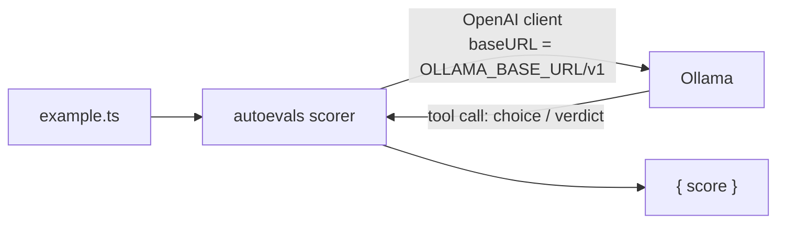

# Post 05 · Ready-made scorers with autoevals

*Series: [Lesson 05 — Evals](../README.md) · Post 5 of 7 · about 25 minutes*

> Your faithfulness judge from post 04 works. Next you'll want "does it match the reference answer?", "is the answer relevant?", "did retrieval find everything needed?"…
>
> You could write and tune a judge prompt for each. Or use ones that others have already written, tested, and published.

**autoevals** (by Braintrust, MIT-licensed) is a library of ready-made scorers: model-graded ones like **Faithfulness**, **Factuality**, **AnswerRelevancy** and **ContextRecall**, and plain ones like **Levenshtein** and **JSONDiff**. This post wires two of them to your local models and compares them with post 04's judge.

---

## The idea, in plain English

### Two scorers that matter most for RAG

| Scorer | Compares | Question |
|---|---|---|
| **Faithfulness** (RAGAS port) | answer ↔ retrieved **context** | Is every statement in the answer supported by the context? (Post 04's idea.) |
| **Factuality** | answer ↔ golden **reference** answer | Does the answer agree with the expert answer? |

Factuality is a classic "pick a category" judge. It asks the model whether the answer is a **subset** of the reference (score 0.4), a **superset** (0.6), the **same** (1), in **disagreement** (0), or different only in ways that don't matter (1). Categories are easier for a model to judge consistently than a free 0–1 number.

### It speaks the OpenAI API, which is fine

autoevals calls models through the OpenAI client and asks for answers as **tool calls**. You don't need OpenAI itself: Ollama, vLLM, LiteLLM, Azure OpenAI and most gateways expose an **OpenAI-compatible** `/v1` endpoint. You point the client at it with `baseURL`.

The catch: the judge model must reliably return **tool calls**. Small local models often don't, and you'll see `No tool call returned`. That's a judge failure (no score), not a pass.



### When to use which

- **Your own judge** (post 04): full control, any AI SDK provider, easy to debug. More code to maintain.
- **autoevals**: tested prompts, many metrics, comparable with other teams' numbers. Needs an OpenAI-compatible endpoint and a model with solid tool calling.

The harness (post 06) runs both, so you can see whether they agree.

---

## Let's see it in code

Open [`example.ts`](./example.ts).

> **Course helpers:** this example imports `env`, `optional`, `section` from `@learn/shared`, the small helper package every lesson uses so that no example names a model or provider. `env` gives typed access to the `.env` settings (provider, Ollama URL, model names); `optional(name, fallback)` reads an optional `.env` setting; and `section()` prints a bold heading in the console output. See [the `@learn/shared` guide](../../shared/README.md) for every helper.

### Point autoevals at Ollama

```ts
const client = new OpenAI({ baseURL: `${env.ollamaBaseUrl}/v1`, apiKey: 'ollama' });
const judgeModel = optional('JUDGE_MODEL', env.chatModel)!;
init({
  // Same openai major as autoevals, but npm may nest a second copy → TS sees two distinct classes.
  client: client as unknown as NonNullable<Parameters<typeof init>[0]>['client'],
  defaultModel: judgeModel,
});
```

Ollama ignores the API key, but the client requires one. For another OpenAI-compatible provider, change `baseURL` and `apiKey`; nothing else.

### Treat a judge failure as "no score"

```ts
async function score(fn: () => Promise<{ score: number | null }> | { score: number | null }) {
  try {
    return (await fn()).score;
  } catch (e) {
    console.log(`    (judge failed: ${(e as Error).message.slice(0, 100)})`);
    return null;
  }
}
```

### The two scorers

```ts
// 2. Faithfulness: is every statement in the output supported by the context?
const faithful = await score(() => Faithfulness({ input: icu.question, output, context }));
// 3. Factuality: does the output agree with the reference answer from the golden dataset?
const factual = await score(() => Factuality({ input: icu.question, output, expected: icu.reference }));
```

`icu.reference` comes from the golden dataset (post 02): *"Children under 12 may not visit the ICU unless the charge nurse approves."*

---

## Run it

From the lesson folder (needs `AI_PROVIDER=ollama`; other providers print a note and exit):

```bash
npm run post:05                           # JUDGE_MODEL, or CHAT_MODEL
JUDGE_MODEL=qwen3:1.7b npm run post:05
# or: npx tsx 05-autoevals/example.ts
```

### What you should see

With `JUDGE_MODEL=qwen3:1.7b`:

```
judge: ollama:qwen3:1.7b via http://localhost:11434/v1

── faithful: "No. Children under 12 may not visit the ICU unless the charge nurse approves [1]." ──
    (judge failed: No tool call returned)
{ faithful: null, factual: 1 }

── flipped: "Yes, children under 12 can visit the ICU, provided they are approved by the charge nurse [1]." ──
    (judge failed: No tool call returned)
{ faithful: null, factual: 0.4 }
```

- **Factuality** separates them: 1 for the correct answer, 0.4 for the flipped one. (A strong judge would call the flip a *disagreement*, 0; 0.4 means "subset". Lower, but not as low as it should be.)
- **Faithfulness** failed both times: the small model didn't return the tool call that autoevals' RAGAS-style prompt needs. Correctly recorded as `null`, not as a pass.

With `qwen3:0.6b`, Faithfulness also failed, and Factuality gave **0.4 to both** answers: no signal at all. Each judge call is slow on a CPU (minutes for this file with 1.7B), which is another reason CI runs `evals:fast` without judges.

## Common gotchas

- ❌ **Assuming autoevals needs OpenAI.** Any OpenAI-compatible endpoint works; set `baseURL`.
- ❌ **A judge without reliable tool calling.** You get `No tool call returned` on every call. Use a stronger judge for these scorers.
- ❌ **Counting failures as passes** (or as zero). Record `null`; the harness counts failures and fails the gate if **all** of them fail.
- ❌ **Mixing up the two scorers.** Faithfulness needs the **context**; Factuality needs a **reference**. Unanswerable cases have neither.
- ✅ Run your own judge and a library judge side by side for a while; trust them where they agree with you.

## Try it yourself

1. Add `AnswerRelevancy` (needs an embedding model through the same client) or `ClosedQA` to the example. What does each measure?
2. Run Factuality on `answers.flipped` with your strongest model. Do you get 0 (disagreement)?
3. Point `baseURL` at another OpenAI-compatible endpoint you have (Azure OpenAI, LiteLLM, vLLM) and rerun, changing nothing else.

## Key takeaways

- **autoevals** ships tested scorers: **Faithfulness** (answer vs context) and **Factuality** (answer vs reference) are the core pair for RAG.
- It uses the **OpenAI API shape**, so any **OpenAI-compatible endpoint** (Ollama `/v1`) works.
- Its judges need reliable **tool calling**: small local models often fail, and a failure is **no score**.
- Category judges (Factuality's A–E) are more consistent than free-form scores.

---

[← Previous: An LLM judge for faithfulness](../04-llm-judge-faithfulness/README.md) · [📚 Series index](../README.md) · [Next: The eval harness and the CI gate →](../06-eval-harness-and-gate/README.md)
