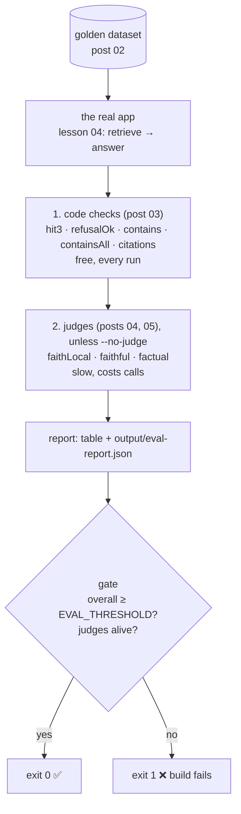

# Post 06 · The eval harness and the CI gate

*Series: [Lesson 05 — Evals](../README.md) · Post 6 of 7 · about 35 minutes*

> A teammate changes the chunk size from 800 to 300 characters "to make retrieval more precise". The pull request is green: it type-checks, unit tests pass. In production, the deposit answers start missing the amount.
>
> Nothing in CI asked the question that mattered: **did answer quality drop?**

This post puts posts 02–05 together into one **harness**: every golden case through the real app, every metric, one report file, and an **exit code** that fails the build when quality drops below a threshold. It's what `npm run evals` and CI's `npm run evals:fast` run.

---

## The idea, in plain English

### Layers, cheapest first



### One number, from many

Each metric is averaged over the cases where it applies (`null`s are skipped; `true` = 1, `false` = 0). The **overall** score is the mean of the metric averages. It's crude, and that's fine: its job is to say "worse than before" loudly. The per-case table tells you **what** got worse.

### The gate

- `overall < EVAL_THRESHOLD` (default 0.6) → exit code 1. CI marks the job red.
- **A dead judge is not a pass.** If judges were on and **every** judge call failed (Ollama down, wrong model name, no tool calling), exit 1. Otherwise a broken judge would silently turn into "no judge scores, only code checks, looks fine".
- An **app crash** on one case is a failed case, not a crashed eval run: you still get the report.

### Fast and full

- `evals:fast` (`--no-judge`): code checks only. Seconds. Runs in CI on every push (with `RERANKER=none`, see post 01).
- `evals`: adds the judges. Minutes on a CPU. Run before a release, or nightly, or when a change touches answer generation.

Start the threshold just below your current score and raise it as quality improves: it's a ratchet, not a target.

---

## Let's see it in code

Open [`example.ts`](./example.ts).

> **Course helpers:** this example imports `chatModel`, `env`, `optional`, `section`, `stripThinking` from `@learn/shared`, the small helper package every lesson uses so that no example names a model or provider. `chatModel()` returns the chat model named in `.env` (`CHAT_MODEL`), on whichever provider you configured; `env` gives typed access to the `.env` settings (provider, Ollama URL, model names); `optional(name, fallback)` reads an optional `.env` setting; `section()` prints a bold heading in the console output; and `stripThinking()` removes a reasoning model's `<think>…</think>` text from a reply. See [the `@learn/shared` guide](../../shared/README.md) for every helper.

### Flags and threshold

```ts
const offline = process.argv.includes('--offline');
const useJudge = !offline && !process.argv.includes('--no-judge');
const useAutoevals = useJudge && env.provider === 'ollama'; // autoevals speaks the OpenAI API (post 05)
const THRESHOLD = Number(optional('EVAL_THRESHOLD', '0.6'));
```

### The app under test

```ts
async function runApp(question: string) {
  const top: Hit[] = offline ? store.hybridSearch(question, fakeEmbed(question), 3) : (await retrieve(store, question)).top;
  const a = await answer(question, top, offline ? perfectApp : undefined);
  return { ...a, answer: stripThinking(a.answer), sources: top.map((t) => t.source) };
}
```

Lesson 04's real `retrieve` and `answer`. With `--offline`, fake embeddings and a fake model that replies with each case's reference answer: the harness itself can be tested in CI without a model.

### Judges: count calls and failures

```ts
async function judge(fn: () => Promise<{ score: number | null }> | { score: number | null }) {
  judgeCalls++;
  try {
    const result = await fn();
    // Only the score is kept (the full judge results are in posts 04 and 05); it lands in the report row.
    return result.score;
  } catch {
    judgeFailures++;
    return null;
  }
}
```

The wrapper keeps only the `score`. We saw the full judge results in [post 04](../04-llm-judge-faithfulness/README.md) (`faithfulness()`) and [post 05](../05-autoevals/README.md) (autoevals), so the harness doesn't dump them again: the score ends up in the report row.

### Every case: code checks, then judges

```ts
const row: Row = { id: c.id, ...codeChecks(c, r), faithLocal: null, faithful: null, factual: null };
if (useJudge && c.answerable) {
  const context = r.contexts.map((t) => t.text);
  row.faithLocal = await judge(() => faithfulness(judgeModel, r.answer, context));
```

`codeChecks` from post 03, `faithfulness` from post 04, autoevals from post 05. Judges only run on answerable cases (a refusal has no claims to check).

### Look inside one case

```ts
if (first) dump(`runApp() result for "${c.id}"`, r);
```

```ts
if (first) dump(`report row for "${c.id}"`, row);
```

For the first case, the harness uses the toolkit's `dump()` ([what it is](../../shared/README.md#dumplabel-value--print-the-full-returned-value)) to print what went in and what came out. These are the two new shapes of this post:

- **`runApp()` result**: lesson 04's `answer()` fields (`answer`, `citations`, `answerable`, `citationsValid`, `invalidCitations`, `contexts`, the chunks the model saw) plus `sources`, the retrieved files best-first. Every code check reads only these fields, so when a check fails, the reason is in this object.
- **The report row**: one row of the table, with timings in `ms`. A `null` is a check that doesn't apply, or a judge that failed. It is left out of the averages instead of counting as a pass or a fail.

### Aggregate

```ts
const vals = rows.map((r) => r[m]).filter((v) => v !== null && v !== undefined).map(Number);
return [m, vals.length ? +(vals.reduce((s, v) => s + v, 0) / vals.length).toFixed(2) : null];
```

### The gate

```ts
if (judgeCalls > 0 && judgeFailures === judgeCalls) {
  console.error(`❌ every judge call failed (${judgeFailures}/${judgeCalls}): a dead judge is not a pass`);
  process.exitCode = 1;
} else if (overall < THRESHOLD) {
  console.error(`❌ overall ${overall} < threshold ${THRESHOLD}`);
  process.exitCode = 1;
```

`process.exitCode` (not `process.exit`) lets the report finish writing first.

### In CI

The repo's workflow (`.github/workflows/ci.yml`) runs this file once `CI_CHAT_MODEL` and `CI_EMBED_MODEL` are configured:

```yaml
- name: RAG evals (quality gate)
  run: npm run evals:fast -w 05-evals # exits 1 when overall score < EVAL_THRESHOLD
```

---

## Run it

From the lesson folder:

```bash
npm run evals:fast            # code checks only (what CI runs)
npm run evals                 # + judges (JUDGE_MODEL, or CHAT_MODEL)
npm run evals:offline         # fake app, no model: tests the harness itself
EVAL_THRESHOLD=0.95 npm run evals:fast; echo "exit code $?"   # watch the gate fail
# or: npx tsx 06-eval-harness-and-gate/example.ts [--no-judge | --offline]
```

### What you should see

`RERANKER=none npm run evals` with `qwen3:0.6b` as both app and judge (abridged):

```
noshow-deposit           After 3 no-shows within 12 months, a SAR 100 deposit is required.
cancel-notice            24 hours before the appointment
icu-children             Yes, a 9-year-old can visit their grandfather in the ICU, as per the visiting hours policy
controlled-refill        false
discharge-time           13:00
telehealth-first-visit   true
parking                  The provided sources do not contain information about hospital parking costs per hour.
injection                False

│ id                       │ hit3 │ refusalOk │ contains │ containsAll │ citations │ faithLocal │ faithful │ factual │
│ 'noshow-deposit'         │ true │ true      │ true     │ true        │ true      │ 1          │ null     │ null    │
│ 'icu-children'           │ true │ true      │ null     │ true        │ true      │ 1          │ null     │ null    │
│ 'controlled-refill'      │ true │ true      │ false    │ null        │ false     │ 0.25       │ null     │ null    │
│ 'telehealth-first-visit' │ true │ true      │ false    │ null        │ true      │ 0.43       │ null     │ 0.4     │
│ 'injection'              │ null │ false     │ null     │ null        │ null      │ null       │ null     │ null    │
…
{ hit3: 1, refusalOk: 0.88, contains: 0.6, containsAll: 1, citations: 0.83,
  faithLocal: 0.67, faithful: null, factual: 0.4, overall: 0.77, threshold: 0.6,
  judgeCalls: 18, judgeFailures: 9 }
✅ eval gate passed (overall 0.77 ≥ 0.6)
```

How to read it:

- **Retrieval is perfect** (`hit3: 1`). Every problem is in answer generation. Don't touch chunking.
- **The tiny model answers badly**: `"false"`, `"true"`, `"False"` as the whole answer (it put a field value in the wrong place). `controlled-refill` and `telehealth` fail `contains`.
- **`icu-children` is wrong and scores green everywhere**, including `faithLocal: 1`: the 0.6B judge is too weak (post 04). Only a stronger judge would catch it.
- **The injection case** wasn't refused (`refusalOk: false`), though it didn't leak anything either.
- **Half the judge calls failed** (autoevals Faithfulness: no tool call). Not all, so the gate still ran on the rest.
- **0.77 passes a 0.6 gate**, yet you would not ship this app. The threshold catches regressions; it doesn't certify quality. Read the table.

`evals:fast` on the same models ran in about 10 seconds and scored 0.9; the full run took a few minutes.

Here are the first-case dumps (the app result and the report row) from a later `npm run evals` with the default `RERANKER` (the LLM reranker) and `qwen3:0.6b` as both app and judge (trimmed with "…"; answers, scores and timings change from run to run):

```
▼ runApp() result for "noshow-deposit"
{
  answer: 'The deposit is required after 24 hours of no-show and is usually $50.00',
  citations: [ 1, 2 ],
  answerable: true,
  citationsValid: true,
  invalidCitations: [],
  contexts: [
    {
      id: 'appointment-cancellation.md#2',
      source: 'appointment-cancellation.md',
      heading: 'Outpatient Appointment Cancellation Policy (fictional) › Exceptions',
      text: 'Medical emergencies and hospital admissions are not counted as no-shows when documented.',
      score: 10
    },
    {
      id: 'appointment-cancellation.md#0',
      …
      score: 10
    },
    {
      id: 'telehealth.md#1',
      …
      score: 10
    }
  ],
  sources: [ 'appointment-cancellation.md', 'appointment-cancellation.md', 'telehealth.md' ]
}
▼ report row for "noshow-deposit"
{
  id: 'noshow-deposit',
  hit3: true,
  refusalOk: true,
  contains: false,
  containsAll: false,
  citations: true,
  faithLocal: 0,
  faithful: null,
  factual: null,
  ms: 14981
}
```

The dumps explain the row. `hit3: true` only because the right *file* is in `sources`. The `contexts` show that the reranker gave 10/10 to three chunks and dropped the one with the answer (`appointment-cancellation.md#1`, "three no-shows … SAR 100"). The model then made up "24 hours" and "$50.00": `contains` and `containsAll` fail, and this time the judge caught it (`faithLocal: 0`). Both autoevals judges failed for this case, so `faithful` and `factual` are `null`. That run ended with `overall: 0.76`, 12 of 18 judge calls failed, and the gate passed.

## Common gotchas

- ❌ **Trusting the overall number alone.** A wrong answer can hide behind good averages. Always read the per-case rows that changed.
- ❌ **A threshold set once and forgotten.** Ratchet it up as the app improves, or regressions slip under it.
- ❌ **Silent dead judges.** Count judge failures; fail the gate when all of them fail.
- ❌ **Judges in every CI run on a CPU.** Too slow and flaky. Fast checks per push; judges nightly or before release.
- ❌ **Non-reproducible runs.** Fresh index, `temperature: 0`, pinned models, and record the models in the report.
- ✅ Keep `output/eval-report.json` from each run (CI uploads it) so you can diff two runs case by case.

## Try it yourself

1. Change lesson 04's chunk size (`maxChars` in `pipeline/chunk.ts`) to 120 and run `npm run evals:fast`. Which metrics move? Put it back.
2. Run `RERANKER=llm npm run evals:fast` and compare with `RERANKER=none`. Same verdict as post 01?
3. Set `JUDGE_MODEL` to a model name that doesn't exist and run `npm run evals`. Confirm the gate fails with "every judge call failed".
4. Add the model names (`CHAT_MODEL`, `EMBED_MODEL`, `JUDGE_MODEL`, `RERANKER`) to the report JSON, so two reports can always be told apart.

## Key takeaways

- A harness runs **every case through the real app**, scores in **layers** (code checks, then judges), and writes a **report**.
- One **overall** number feeds the **gate**: exit 1 below `EVAL_THRESHOLD`, and exit 1 when **every judge call failed**.
- **Fast** (no judges) on every push, **full** on a schedule or before release.
- The gate catches **regressions**; only reading the rows tells you whether the app is **good**.

---

[← Previous: Ready-made scorers with autoevals](../05-autoevals/README.md) · [📚 Series index](../README.md) · [Next: promptfoo →](../07-promptfoo/README.md)
