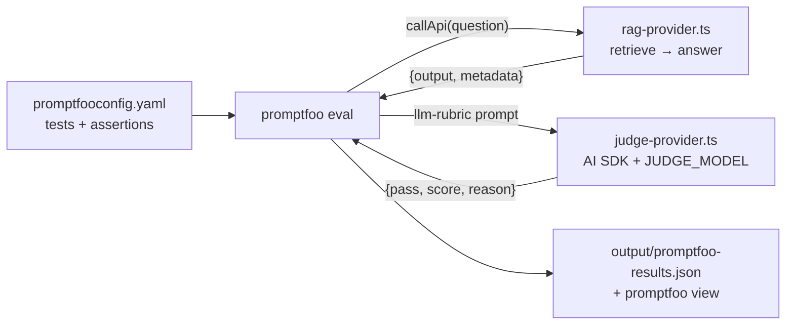

# Post 07 · promptfoo

*Series: [Lesson 05 — Evals](../README.md) · Post 7 of 7 · about 35 minutes*

> Your harness works, and you understand every line of it. Now the product owner wants to add test cases, the security team wants a red-team scan, and someone asks for a web page comparing two models side by side.
>
> You could keep growing your script. Or use the tool most Node teams already use for this.

**promptfoo** is an open-source Node CLI for testing prompts, RAG apps and agents: test cases in YAML, a large library of assertions (exact, regex, JavaScript, model-graded), a web viewer, model comparisons, and a non-zero exit code on failure. This post expresses the golden questions as a promptfoo suite that calls **your real app** and uses **your model-agnostic judge**.

---

## The idea, in plain English

### Three parts

| promptfoo term | What it is here |
|---|---|
| **prompts** | just `{{question}}`: the app builds its own prompt |
| **providers** | what gets tested. Normally a model (`openai:gpt-…`); here a **custom provider**: a TypeScript class that runs lesson 04's whole pipeline |
| **tests** | variables (`question`) + **assertions** about the output |

### Assertions, cheap to expensive

The same layers as post 06:

- `icontains`, `icontains-any`, `not-regex`: post 03's word checks.
- `javascript`: any code, including `context.metadata` that **your provider** returns (refusal, citations).
- `latency`: a time budget.
- `llm-rubric`: a judge model grades the output against a sentence you write. promptfoo defaults to OpenAI for grading; we point it at our own **judge provider** instead, so it works with any model in `.env`.



### Your harness or promptfoo?

Both, usually. A code harness is best for metrics you design (hit@k, the dead-judge rule, custom reports). promptfoo is best for many cases written by many people, side-by-side model comparisons, a viewer, and red-teaming. Another option to recognise: **Evalite**, which writes evals as TypeScript files run like Vitest tests, with a local UI.

---

## Let's see it in code

Open [`promptfooconfig.yaml`](./promptfooconfig.yaml), [`rag-provider.ts`](./rag-provider.ts), [`judge-provider.ts`](./judge-provider.ts) and [`example.ts`](./example.ts).

> **Course helpers:** this example imports `section` from `@learn/shared`, the small helper package every lesson uses so that no example names a model or provider. `section()` prints a bold heading in the console output. The providers also use `chatModel()` (the chat model from `.env`), `optional()` (an optional `.env` setting, here `JUDGE_MODEL`) and `stripThinking()` (removes a reasoning model's `<think>…</think>` text). See [the `@learn/shared` guide](../../shared/README.md) for every helper.

### The app as a provider

```ts
export default class RagAppProvider {
  id() {
    return 'rag-app';
  }
  async callApi(prompt: string) {
```

```ts
const { top } = await retrieve(await getStore(), prompt);
const a = await answer(prompt, top);
return {
  output: stripThinking(a.answer),
  // metadata is visible to assertions as context.metadata
  metadata: { answerable: a.answerable, citationsValid: a.citationsValid, sources: top.map((t) => t.source) },
};
```

promptfoo only needs a class with `id()` and `callApi(prompt)`. The index is built once per run (`getStore`) and reused for every test.

### The judge as a provider

```ts
const { output } = await generateText({
  model: chatModel(optional('JUDGE_MODEL')),
  temperature: 0,
  output: Output.object({ schema: Grade }),
  prompt, // promptfoo's rubric prompt already contains the rubric, the output and the instructions
});
return { output: JSON.stringify(output) };
```

`Grade` is `{ reason, pass, score }`: the JSON promptfoo expects back from a grader.

### Wiring them in the config

```yaml
providers:
  - id: file://rag-provider.ts # paths are relative to this file
    label: rag-app
```

```yaml
defaultTest:
  options:
    # Model-graded assertions (llm-rubric) use this grader instead of promptfoo's OpenAI default.
    provider: file://judge-provider.ts
```

`defaultTest` also applies two assertions to **every** test:

```yaml
- type: javascript # deterministic: every answerable reply must carry valid citations
  value: '!context.metadata?.answerable || context.metadata?.citationsValid === true'
  metric: citations
```

### Tests

```yaml
- description: ICU visiting for children
  vars: { question: 'Can a 9 year old visit their grandfather in the ICU?' }
  assert:
    - type: llm-rubric
      value: Says children under 12 may NOT visit the ICU unless the charge nurse approves. Fail if it says they can visit by default.
      metric: correctness
```

```yaml
- description: out-of-scope question must be refused, not invented
  vars: { question: 'How much does hospital parking cost per hour?' }
  assert:
    - type: javascript
      value: 'context.metadata?.answerable === false'
      metric: refusal
    - type: not-regex
      value: 'SAR\s*\d+|\d+\s*riyal'
```

### Debug the providers first

```ts
const app = await new RagAppProvider().callApi(question);
console.log(app); // { output, metadata: { answerable, citationsValid, sources } } — what assertions see
```

`example.ts` calls both providers exactly as promptfoo does, so you can see what promptfoo will receive before running the suite.

### TypeScript providers

```json
"promptfoo": "NODE_OPTIONS=--import=tsx PROMPTFOO_DISABLE_TELEMETRY=1 promptfoo eval -c 07-promptfoo/promptfooconfig.yaml --no-cache -j 1 -o output/promptfoo-results.json"
```

`--import=tsx` lets promptfoo load `.ts` providers; `-j 1` runs one test at a time (kind to a local model); `--no-cache` so every run really calls the app; telemetry is off.

---

## Run it

From the lesson folder:

```bash
npm run post:07                         # call the two providers once, like promptfoo does
npm run promptfoo                       # the suite → output/promptfoo-results.json
npx promptfoo view                      # browse the results in the web UI
```

In CI, the same `npm run promptfoo` step runs after the eval gate, with `continue-on-error: true`, and `output/` is uploaded as an artifact.

### What you should see

`RERANKER=none npm run promptfoo` with `qwen3:0.6b` as app and judge:

```
│ After how many no-shows is a deposit required, … │ [PASS] After three no-shows within 12 months, a SAR 100 deposit is required for each new booking. │
│ Can a 9 year old visit their grandfather in the ICU? │ [FAIL] No, a 9-year-old cannot visit their grandfather in the ICU. … children under 12 may not visit the ICU unless approved by the charge nurse. │
│ By what time should a discharged patient leave the room? │ [PASS] 13:00 │
│ How much does hospital parking cost per hour? │ [PASS] The sources provided do not contain information about hospital parking costs per hour. │

Results:
  ✓ 3 passed (75.00%)
  ✗ 1 failed (25.00%)
```

Look at the failure: the answer is **correct**. The 0.6B judge failed it with the reason *"the content says children under 12 may not visit the ICU unless approved by the charge nurse"*, which agrees with the answer. That's a **false negative from a weak judge**. promptfoo exits with code 100 when a test fails; that's why CI marks this step `continue-on-error` until your chosen judge passes reliably.

And `npm run post:07` showed another small-model quirk: a correct, cited answer to the ICU question returned with `answerable: false`. The structured fields and the text disagreed. A `javascript` assertion that checks them against each other would catch it (try it below).

## Common gotchas

- ❌ **Forgetting to replace the default grader.** `llm-rubric` uses OpenAI unless you set `defaultTest.options.provider`. Without a key, every rubric errors.
- ❌ **Testing a bare prompt instead of the app.** Wrap the real pipeline in a custom provider, or you're testing something you don't ship.
- ❌ **Running in parallel against a local model.** Use `-j 1`, or calls time out.
- ❌ **Trusting rubric verdicts from a tiny judge.** Read the `reason`; above, it contradicted its own verdict.
- ❌ **Caching between runs.** promptfoo caches responses by default; `--no-cache` when the app changed.
- ✅ Return useful `metadata` from your provider (refusal flag, citations, sources) and assert on it with `javascript`.

## Try it yourself: the week-5 exercise

From the learning map: **10 more cases, then a table of two models by two chunk sizes.**

1. Add 10 cases to [`../02-golden-dataset/dataset.ts`](../02-golden-dataset/dataset.ts) in real-user phrasing, including at least 3 must-refuse ones. Run the lint (`npm run post:02`).
2. Pick two chat models and two chunk sizes (e.g. `maxChars` 800 and 300 in `04-rag/pipeline/chunk.ts`). For each of the 4 combinations, run `npm run evals` and record hit3, contains, containsAll, faithLocal and overall.
3. Put the results in a table in your notes. Which knob mattered more? Would you change the default?

Smaller ones:

1. Add the same new cases to `promptfooconfig.yaml`. (Or generate the `tests:` list from `dataset.ts`; promptfoo accepts `tests: file://tests.ts`.)
2. Add a `javascript` assertion that fails when `answerable` is false but the output contains a citation like `[1]`.
3. Add a second provider entry (the same `rag-provider.ts` with a different `label` and `config`), and compare two models side by side in `promptfoo view`.

## Key takeaways

- **promptfoo** = YAML tests + assertions + providers, with a viewer, comparisons and an exit code.
- Wrap **your real app** as a custom provider, and return **metadata** for code assertions.
- Replace the default grader with **your own judge provider** so `llm-rubric` works with any model.
- Judges produce false **negatives** as well as false positives: read the reasons, and gate on promptfoo only once your judge is reliable.
- Recognise **Evalite** as the Vitest-style alternative.

---

[← Previous: The eval harness and the CI gate](../06-eval-harness-and-gate/README.md) · [📚 Series index](../README.md) · [Lesson 06 — Guardrails →](../../06-guardrails/README.md)
