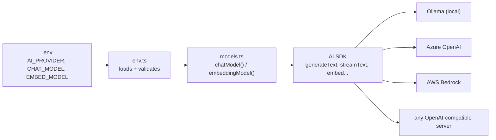

# `@learn/shared` — the course toolkit

*A guided tour of the small helper package every example imports. About 20 minutes.*

> You open a lesson file and the very first line is:
>
> ```ts
> import { chatModel, section, stripThinking } from '@learn/shared';
> ```
>
> You search npm for `@learn/shared` and find nothing. So what is it, and why does every example depend on it?

This page answers that. It explains what the package is, why it exists, and then walks through every function in it, using the real code from `shared/src/`.

**Back to:** [Lesson 01 — series index](../01-foundations-structured-output/README.md) · [Post 00 · The course toolkit](../01-foundations-structured-output/00-course-toolkit/README.md)

---

## The idea, in plain English

### What it is

`@learn/shared` is **a tiny helper library that lives inside this course**, in the `shared/` folder. It is **not published on npm** and you never install it on its own.

It works through **npm workspaces**, a feature you may already use in monorepos. The root `package.json` lists `shared` as a workspace:

```json
"workspaces": [
  "shared",
  "01-foundations-structured-output",
  ...
]
```

and `shared/package.json` gives that folder a package name:

```json
{
  "name": "@learn/shared",
  "version": "1.0.0",
  "private": true,
  "type": "module",
  "exports": { ".": "./src/index.ts" },
```

When you run `npm install` at the repo root, npm creates a **symlink** `node_modules/@learn/shared → ../../shared`. So `import ... from '@learn/shared'` simply loads `shared/src/index.ts` from your own disk. `"private": true` stops it from ever being published by accident.

Note that `exports` points straight at a `.ts` file. There is no build step: the examples run with `tsx`, which runs TypeScript directly.

### Why it exists

Two rules run through the whole course:

1. **Models are chosen only in `.env`.** No lesson file ever writes a model name like `"llama3"` or `"gpt-4o"`.
2. **Switching providers is a config change, not a code change.** Moving from Ollama on your laptop to Azure OpenAI or AWS Bedrock should mean editing `.env`, nothing else.

If every example created its own Ollama client, both rules would break in dozens of places. So that work lives in one place, `shared/`, and every example asks it for "the chat model" or "the embedding model". This is the same thing you would do in a backend service: wrap the vendor SDK behind one small factory so the rest of the code never sees it.

The package also holds a few tiny printing helpers, so each example's output is easy to read.

### How it fits together



The same picture in plain text, if your Markdown preview doesn't draw Mermaid:

```
 .env  ──►  env.ts  ──►  chatModel() / embeddingModel()  ──►  AI SDK  ──►  Ollama | Azure | Bedrock | OpenAI-compatible
 (you edit   (reads +      (picks the provider and          (generateText,
  this only)  checks)       builds a model object)           streamText, embed…)
```

The files in `shared/src/`:

| File | What's in it |
|---|---|
| `env.ts` | Loads `.env` once. Exports `env`, `required`, `optional`. |
| `models.ts` | The provider switch. Exports `chatModel`, `embeddingModel`, `modelLabel`. |
| `util.ts` | Small output helpers. Exports `section`, `show`, `isMain`, `stripThinking`. |
| `index.ts` | Re-exports all three files, so one import gets everything. |
| `check-ollama.ts` | A script (not an export) that checks Ollama is running and your models are pulled. |

`index.ts` is just three lines:

```ts
export * from './env.ts';
export * from './models.ts';
export * from './util.ts';
```

---

## Part 1 — reading `.env`: `env`, `required`, `optional` (`env.ts`)

### Loading the file once

```ts
const rootEnv = resolve(import.meta.dirname, '../../.env');
if (existsSync(rootEnv)) process.loadEnvFile(rootEnv);
```

`import.meta.dirname` is the folder this file lives in (`shared/src`), so `../../.env` is always the **repo-root** `.env`, no matter which lesson folder you run from. Node 22+ has `process.loadEnvFile` built in, so there is no `dotenv` dependency. If the file is missing, nothing happens, and real environment variables (for example in Docker or CI) still work.

This code runs **the first time anything imports `@learn/shared`**. That is why an example never has to load `.env` itself.

### `required(name)` — fail early with a useful message

```ts
/** Read a required env var, failing with an actionable message instead of a deep stack trace. */
export function required(name: string): string {
  const v = process.env[name]?.trim();
  if (!v || v.startsWith('<')) {
    throw new Error(
      `Missing env var ${name}. Copy .env.example to .env at the repo root and set it ` +
        `(for Ollama: pick a model from \`ollama list\`).`,
    );
  }
  return v;
}
```

Without this, a missing `CHAT_MODEL` would show up much later as a confusing HTTP 404 from the provider. Here it fails at once and tells you exactly what to fix.

The `startsWith('<')` check is there because `.env.example` uses placeholders like `CHAT_MODEL=<your-chat-model>`. If you copy the file and forget to edit it, that placeholder counts as "not set".

### `optional(name, fallback?)` — a value or a default

```ts
export function optional(name: string, fallback?: string): string | undefined {
  const v = process.env[name]?.trim();
  return v && !v.startsWith('<') ? v : fallback;
}
```

Same idea, but it never throws. It is used for settings that have a sensible default, like the Ollama URL or the AWS region.

### `env` — named, typed settings

```ts
export const env = {
  /** ollama | azure | bedrock | openai-compatible (see 08-cloud) */
  get provider() {
    return optional('AI_PROVIDER', 'ollama')!;
  },
  get ollamaBaseUrl() {
    return optional('OLLAMA_BASE_URL', 'http://localhost:11434')!.replace(/\/$/, '');
  },
  get chatModel() {
    return required('CHAT_MODEL');
  },
  get embedModel() {
    return required('EMBED_MODEL');
  },
  /** Optional second model used by fallback chains (06) and cheap/expensive routing (07). */
  get fallbackModel() {
    return optional('FALLBACK_MODEL');
  },
};
```

Two details worth noticing:

- **They are getters, not plain values.** `env.chatModel` is read at the moment you use it, not when the file loads. So an example that only needs an embedding model never fails because `CHAT_MODEL` is missing, and an offline run (`--offline`) works even with no models set.
- **Defaults live here, in one place.** If `AI_PROVIDER` isn't set, you get `ollama`. The trailing `/` is removed from the URL so `${env.ollamaBaseUrl}/api` never becomes `//api`.

You will rarely call these yourself in lesson 01, but later lessons use `optional(...)` for their own settings (for example `RERANKER` in lesson 04).

---

## Part 2 — the provider switch: `chatModel` and `embeddingModel` (`models.ts`)

This is the heart of the package.

> **Need credentials for a provider?** [Getting API keys](../GETTING-API-KEYS.md) shows, step by step, how to get the keys for Azure, Bedrock and the OpenAI-compatible APIs, and which `.env` variables each `case` below reads.

### The idea behind it

The Vercel AI SDK defines two **interfaces**: `LanguageModel` (for chat/text) and `EmbeddingModel` (for vectors). Functions like `generateText`, `streamText` and `embed` accept *any* object that implements them. Each vendor ships a small **provider package** that creates such objects: `ollama-ai-provider-v2`, `@ai-sdk/azure`, `@ai-sdk/amazon-bedrock`, and so on.

So if one function decides *which* provider package to use, based on `.env`, the rest of your code only ever sees a `LanguageModel` and never knows the vendor.

```ts
import type { EmbeddingModel, LanguageModel } from 'ai';
import { createOllama } from 'ollama-ai-provider-v2';
import { createAzure } from '@ai-sdk/azure';
import { createAmazonBedrock } from '@ai-sdk/amazon-bedrock';
import { createOpenAICompatible } from '@ai-sdk/openai-compatible';
import { env, required, optional } from './env.ts';
```

### A small helper for Ollama

```ts
function ollama() {
  // The provider talks to Ollama's native /api endpoints (not the /v1 OpenAI shim).
  return createOllama({ baseURL: `${env.ollamaBaseUrl}/api` });
}
```

This builds an Ollama provider pointed at your Ollama server. It's not exported; the two functions below use it.

### `chatModel(modelId?)`

```ts
export function chatModel(modelId: string = env.chatModel): LanguageModel {
  switch (env.provider) {
    case 'ollama':
      return ollama()(modelId);
    case 'azure':
      // AZURE_RESOURCE_NAME + AZURE_API_KEY are read from env by the provider as well.
      return createAzure({
        resourceName: required('AZURE_RESOURCE_NAME'),
        apiKey: required('AZURE_API_KEY'),
      })(modelId);
    case 'bedrock':
      // Uses the standard AWS credential env vars (AWS_ACCESS_KEY_ID, AWS_SECRET_ACCESS_KEY, ...).
      return createAmazonBedrock({ region: optional('AWS_REGION', 'us-east-1') })(modelId);
    case 'openai-compatible':
      // Any OpenAI-compatible server: vLLM, LM Studio, LiteLLM proxy, a gateway, etc.
      return createOpenAICompatible({
        name: 'compat',
        baseURL: required('OPENAI_COMPAT_BASE_URL'),
        apiKey: optional('OPENAI_COMPAT_API_KEY'),
        supportsStructuredOutputs: true,
      }).chatModel(modelId);
    default:
      throw new Error(`Unknown AI_PROVIDER "${env.provider}"`);
  }
}
```

Read it as: *"look at `AI_PROVIDER`, build that vendor's provider with its credentials from `.env`, and hand back a model object for `modelId`."*

- **It does not call the model.** It only builds a configuration object. The network call happens later, inside `generateText(...)`. Calling `chatModel()` is cheap.
- **What `modelId` means depends on the provider.** For Ollama it's a name from `ollama list` (e.g. `qwen3:8b`). For Azure it's your *deployment* name. For Bedrock it's a Bedrock model id.
- **Credentials use `required(...)`.** If you switch to `azure` and forget the key, you get a clear "Missing env var AZURE_API_KEY" message.

This is how every example uses it:

```ts
const result = await generateText({
  model: chatModel(),          // whatever .env says
  prompt: 'In one sentence: what is an EHR?',
});
```

### The per-call override

`modelId` has a default (`env.chatModel`, i.e. `CHAT_MODEL`), but you can pass a different id:

```ts
chatModel();                     // CHAT_MODEL from .env
chatModel(env.fallbackModel!);   // a second model, still on the same provider
```

Later lessons use this for **fallback chains** (try the main model, then a cheaper backup) and for **routing** (a small model for easy questions, a bigger one for hard ones). Even then, the ids come from `.env` (`FALLBACK_MODEL`, `JUDGE_MODEL`), never from the code.

### `embeddingModel(modelId?)`

```ts
export function embeddingModel(modelId: string = env.embedModel): EmbeddingModel {
  switch (env.provider) {
    case 'ollama':
      return ollama().embedding(modelId);
    case 'azure':
      return createAzure({
        resourceName: required('AZURE_RESOURCE_NAME'),
        apiKey: required('AZURE_API_KEY'),
      }).embeddingModel(modelId);
    case 'bedrock':
      return createAmazonBedrock({ region: optional('AWS_REGION', 'us-east-1') }).embeddingModel(modelId);
    case 'openai-compatible':
      return createOpenAICompatible({
        name: 'compat',
        baseURL: required('OPENAI_COMPAT_BASE_URL'),
        apiKey: optional('OPENAI_COMPAT_API_KEY'),
      }).embeddingModel(modelId);
    default:
      throw new Error(`Unknown AI_PROVIDER "${env.provider}"`);
  }
}
```

Exactly the same switch, but it returns an **embedding** model and defaults to `EMBED_MODEL`. Chat models and embedding models are different kinds of model (one writes text, the other turns text into a list of numbers), which is why `.env` sets them separately. [Post 06](../01-foundations-structured-output/06-embeddings/README.md) explains embeddings.

### `modelLabel(id?)`

```ts
/** Human-readable label for logs, e.g. "ollama:my-model". */
export const modelLabel = (id: string = env.chatModel) => `${env.provider}:${id}`;
```

Just a string for printing, such as `ollama:qwen3:8b`. Examples print it so you can see in the output which provider and model actually ran. It's very handy after you edit `.env` and want to be sure the change took effect.

---

## Part 3 — small output helpers (`util.ts`)

These have nothing to do with AI. They keep the examples short and their output readable.

### `section(title)`

```ts
/** Print a section header so example output is easy to scan. */
export function section(title: string) {
  console.log(`\n\x1b[1m── ${title} ${'─'.repeat(Math.max(0, 60 - title.length))}\x1b[0m`);
}
```

Prints a bold divider line like `── [A] generateText ──────────`. The `\x1b[1m … \x1b[0m` parts are terminal codes for "bold on / bold off". Each example has parts A, B, C…, and `section` marks where each one starts in your terminal.

### `show(label, value)`

```ts
/** Pretty-print any value. */
export function show(label: string, value: unknown) {
  console.log(`${label}:`, typeof value === 'string' ? value : JSON.stringify(value, null, 2));
}
```

Prints strings as they are and pretty-prints everything else as indented JSON. Handy for looking at a structured object the model returned.

### `isMain(import.meta.url)`

```ts
/** True when this file is the process entry point (lets modules double as libraries and CLIs). */
export function isMain(importMetaUrl: string): boolean {
  return process.argv[1] !== undefined && importMetaUrl === new URL(`file://${process.argv[1]}`).href;
}
```

This is the ES-module version of Python's `if __name__ == "__main__"` or CommonJS's `require.main === module`. Some later files are **both** a runnable demo and a module other files import (for example in lesson 09):

```ts
if (isMain(import.meta.url)) {
  // only runs when you execute this file directly, not when another file imports it
}
```

### `stripThinking(text)` — and why models "think out loud"

```ts
/** Strip <think>...</think> blocks some reasoning models emit inline in text. */
export function stripThinking(text: string): string {
  return text.replace(/<think>[\s\S]*?<\/think>/g, '').trim();
}
```

Some newer models are **reasoning models** (Qwen3, DeepSeek-R1 and others). They were trained to write out their working first, step by step, and only then give the answer. This usually makes answers better on hard questions. Many of them wrap that working in `<think> … </think>` tags *inside the normal text*:

```
<think>The user wants one word. "OK" is the word they asked for.</think>
OK
```

That working text is useful when you are debugging, but it's not the answer. If your code expects one word, or JSON, the `<think>` block would break it. `stripThinking` removes every `<think>…</think>` block (`[\s\S]*?` means "any characters, including new lines, as few as possible") and trims the spaces left behind.

Three things to keep in mind:

- **Where the thinking appears depends on the server.** With Ollama, the provider used here returns the thinking in a separate reasoning field, so `result.text` is usually already clean. Other servers (an OpenAI-compatible server, some model templates) put the `<think>` block inside the text. `stripThinking` is a safety net so the same example works on both.
- **The thinking still costs tokens.** Removing it from the display doesn't remove it from `usage.outputTokens`. A reasoning model can spend hundreds of tokens thinking, which is why examples set `maxOutputTokens` generously.
- **Models that don't think are unaffected.** If there's no `<think>` tag, the text comes back unchanged (just trimmed). That's why examples can call it every time, whichever model you picked.

---

## Part 4 — `check-ollama`: is my setup ready?

`shared/src/check-ollama.ts` is a small script, not an export. You run it from the repo root:

```bash
npm run check:ollama
```

It asks Ollama for the list of models you have pulled:

```ts
const res = await fetch(`${env.ollamaBaseUrl}/api/tags`).catch((e: unknown) => {
  console.error(`✗ Cannot reach Ollama at ${env.ollamaBaseUrl}: ${String(e)}`);
  process.exit(1);
});
const { models } = (await res.json()) as { models: { name: string }[] };
```

`/api/tags` is the Ollama endpoint behind `ollama list`. If Ollama isn't running, you get a clear "Cannot reach Ollama" message instead of a failure halfway through a lesson.

Then it checks each model setting from `.env`:

```ts
const have = new Set(models.map((m) => m.name));
const norm = (n: string) => (n.includes(':') ? n : `${n}:latest`);
console.log(`✓ Ollama reachable at ${env.ollamaBaseUrl} (${models.length} models)`);
for (const key of ['CHAT_MODEL', 'EMBED_MODEL', 'FALLBACK_MODEL', 'JUDGE_MODEL']) {
  const v = optional(key);
  if (!v) {
    console.log(`  ${key}: (not set)`);
    continue;
  }
  console.log(`  ${have.has(norm(v)) ? '✓' : '✗ not pulled —'} ${key}=${v}`);
}
```

`norm` handles a small Ollama detail: a name without a tag (`llama3`) really means `llama3:latest`. The output looks like:

```
✓ Ollama reachable at http://localhost:11434 (12 models)
  ✓ CHAT_MODEL=qwen3.8:latest
  ✓ EMBED_MODEL=qwen3-embedding:4b
  FALLBACK_MODEL: (not set)
  JUDGE_MODEL: (not set)
```

A `✗ not pulled` line means: run `ollama pull <that name>`, or fix the name in `.env`.

This check is only for Ollama. For Azure or Bedrock, the first real call tells you whether the credentials work.

---

## Adding a provider

Say you want to use Google Gemini (or Anthropic, Mistral, Groq…). The AI SDK has a provider package for most vendors. Three small steps:

**1. Install the provider package into `shared`** (run at the repo root):

```bash
npm install @ai-sdk/google --workspace shared
```

**2. Add a `case` to both switches in `models.ts`:**

```ts
import { createGoogleGenerativeAI } from '@ai-sdk/google';

// in chatModel():
    case 'google':
      return createGoogleGenerativeAI({ apiKey: required('GOOGLE_API_KEY') })(modelId);

// in embeddingModel():
    case 'google':
      return createGoogleGenerativeAI({ apiKey: required('GOOGLE_API_KEY') }).embeddingModel(modelId);
```

**3. Set it in `.env`:**

```bash
AI_PROVIDER=google
GOOGLE_API_KEY=...
CHAT_MODEL=<a Gemini model id>
EMBED_MODEL=<a Gemini embedding model id>
```

That's all. **No lesson file changes**, because they all just call `chatModel()`. (Check the provider's docs for the exact function names; the pattern is always "create the provider, then call it with a model id".)

If the vendor offers an **OpenAI-compatible endpoint** (many do, as do vLLM, LM Studio and LiteLLM), you don't even need step 1 or 2: set `AI_PROVIDER=openai-compatible` and `OPENAI_COMPAT_BASE_URL` in `.env`.

---

## Key takeaways

- `@learn/shared` is **the course's own helper folder** (`shared/`), linked by npm workspaces. It's not on npm.
- It exists so that **models live only in `.env`** and **changing provider is a config change**.
- `chatModel()` / `embeddingModel()` read `AI_PROVIDER` and the model name, and return an AI SDK model object. They don't call the model.
- Pass an id (`chatModel(env.fallbackModel!)`) to use a second model on the same provider.
- `section`, `show`, `modelLabel` are for readable output. `stripThinking` removes a reasoning model's `<think>` block before you use the answer.
- Run `npm run check:ollama` whenever something seems wrong with your local setup.

---

**Back to:** [Lesson 01 — series index](../01-foundations-structured-output/README.md) · [Post 00 · The course toolkit](../01-foundations-structured-output/00-course-toolkit/README.md) · [Next: Post 01 — What is an LLM, and what is a token? →](../01-foundations-structured-output/01-llm-and-tokens/README.md)
